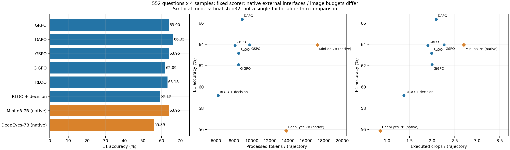

# VLM RL Signal Design

**算法／建模讨论的证据入口。** 围绕多轮视觉裁图模型，先比较实际成败和过程证据，再讨论 advantage、credit assignment 与必要时的 reward shaping。这个仓库保存截至 **2026-10-30（America/New_York）** 的实验快照、匿名导师要求、文献阅读和待验证理解，不宣称已经找到统一瓶颈或新方法。

面向研究者及通过 GitHub MCP 访问的网页 Pro。先读 [START_HERE](START_HERE.md)；可直接复制 [Pro 开场提示词](prompts/PRO_START.md)。

讨论按轮推进：先现象与竞争解释，再明确候选gap，随后检查组件必要性、推导最小改动。第一轮不要求完整算法；“多个问题交织”与“算法可能臃肿”都保留为待检验判断。见 [讨论顺序](design/DISCUSSION.md)。

## 当前事实

- 25个历史评测条件，共55,200条已脱敏模型轨迹；重点比较6个本地32步RL条件与Mini-o3-7B、DeepEyes-7B。
- 每个条件E1为552题 × 4次采样，统一终答评分；E1有数据交叉，**不是独立盲测**。
- 12题 × 8方法 = 96条定向逐图审查，保留未判定项和重建限制；原图/完整题面不公开，不能把文字记录当本次网页模型的亲眼验图。
- 新增SFT→RL、GRPO→其他方法、RLOO control→decision的同题得失；完整题号、分母、脚本都在库内。
- 所有既有训练与E1已结束。本仓库没有调度训练、后台监控或自动执行Pro建议。

## 阅读入口

| 内容 | 入口 | 状态 |
|---|---|---|
| 协议、模型、预算、可比性 | [当前协议](protocol/CURRENT_PROTOCOL.md) / [外部差异](protocol/EXTERNAL_PROTOCOLS.md) | 实验事实；官方原生复现/新交叉评测未完成 |
| 总体结果与成本、训练曲线 | [结果](results/RESULTS.md) / [训练信号](results/TRAINING_SIGNALS.md) | 固定输出复算与已有日志汇总 |
| 谁多答对、又错了哪些 | [同题得失](results/PAIRED_RESULTS.md) | 552题的4次采样计数，不是因果干预 |
| 错误与正确但过程有问题的轨迹 | [12个同题页面](observations/CASE_INDEX.md) / [现象索引](observations/PHENOMENA.md) | 96条定向审查，不外推总体比例 |
| 导师要求与历史变更 | [匿名技术整理](context/MENTOR_REQUIREMENTS.md) | 要求/建议，不是机制证据 |
| 我们目前的理解 | [竞争解释](design/HYPOTHESES.md) / [方法历史](design/METHOD_HISTORY.md) | 明确标为暂定、允许推翻 |
| 文献 | [13篇来源与3篇详细笔记](literature/README.md) | 阅读状态分开；未声称全部精读 |
| 既有corpus卡片 | [3张卡及使用边界](cards/README.md) | 候选模式笔记，不是当前失败oracle |
| 后续建模讨论 | [待回答的问题](design/DISCUSSION.md) / [开场提示词](prompts/PRO_START.md) | 供人讨论，未选择新算法 |
| 复算与数据身份 | [验证说明](REPRODUCIBILITY.md) / [来源](provenance/README.md) | CPU-only，无模型调用 |

## 结果概览

| 方法 | E1 | 裁图/条 | 累计处理token/条 |
|---|---:|---:|---:|
| DAPO | .6635 | 2.092 | 8929.8 |
| GSPO | .6395 | 2.263 | 9756.2 |
| GRPO | .6390 | 1.905 | 8125.4 |
| RLOO control | .6318 | 1.992 | 8535.4 |
| GiGPO | .6209 | 1.998 | 8506.3 |
| RLOO + 首动作监督 | .5919 | 1.372 | 6266.1 |
| Mini-o3-7B | .6395 | 2.703 | 17279.8 |
| DeepEyes-7B | .5589 | .852 | 13799.6 |

外部为**原生工具接口＋E1采样/预算适配**，不是完整官方复现；RLOO与旧GRPO训练协议及奖励也不同。此表不是单因素算法排名。

上游数据与公开实验代码固定于[实验仓库2c5155d](https://github.com/CrepuscularIRIS/vlm-caption-trajectories/tree/2c5155d7e629e6eadb043bb8c751035f9132fca9)。本仓库专门用于建模推导，包含公开数据快照与新的同题分析；不会替代或修改上游结果。公开范围见 [RIGHTS](RIGHTS.md)。
