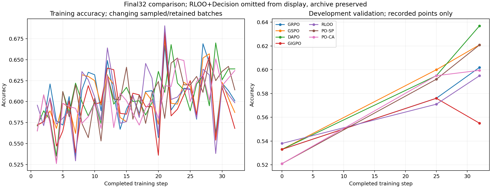
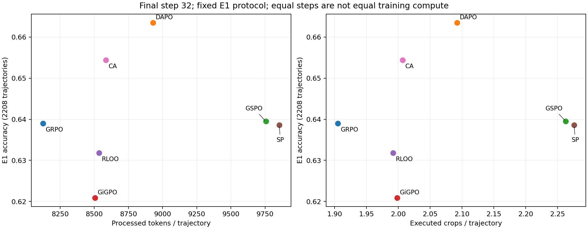

# VLM RL Signal Design

## Native Zoom 对照已完成（2026-11-01）

原SFT Native Zoom **32.16% → 坐标归一化44.88% → 取消8192累计生成上限44.88%**（每组2208条）。后两组逐条正确性一致，10条长输出继续到上下文上限，未新增答对。8次裁图/32768上下文保留。

[完整结果、成本与轨迹核对](results/native_zoom_normalized_20261031/REPORT.md) · [数据与SHA](results/native_zoom_normalized_20261031/PROVENANCE.json)。本次仅评测，完成后由用户决定下一步。

## 最新：A 路线方案与 primitives 的理解（2026-11-01）

研究者已选定 **A 路线**：保留 A-SFT，在 RL 中把 hint 转成可验证的过程信号。研究问题是：缺少逐步真值时，构造与视觉推理正确性稳定相关、又不易被钻空子的过程信号。新增两项实测：V\* 上 4B 的裁图命中率为 76–88%，命中时准确率约 0.9、未命中时约 0.55；只用终答奖励时，RL 放大了 fallback 和多次裁图，但 HOLD、REVISE、abstain、记录已排除区域这些接近 0 的行为没有长出来。RL 题池标注类型的工作进行中。[完整方案](design/PRIMITIVES_ROUTE_A.md)

## 最新：Visual Primitives 桥接与 Reward 建模（2026-10-31）

研究者读了 DeepSeek 的 *Thinking with Visual Primitives*，把论文发现的问题和方法逐条对照到我们的 caption 协议下：论文“在思考里写框”，对应我们“会被执行的裁图框 + 视图引用”；不改 SFT、不在 caption 里写坐标。导师建议补归一化 bbox，在保留任务奖励的前提下加“目标逼近 / 探索程度 + gate”的过程信号。本节全部是讨论稿，**没有新实验**。

- [协议 v5.1 完整定义](protocol/CAPTION_V51.md)：SYSTEM 原文、每轮模板、13 类 hint 原文与选取规则、环境步骤、硬检查、奖励与 advantage。hint 只在教师生成 SFT 轨迹时使用，RL 和 E1 的 prompt 里都没有。
- [论文 → 协议逐条对照与导师信号公式化](design/VISUAL_PRIMITIVES_BRIDGE.md)：已测风险，例如整图裁剪的覆盖项也接近 1、小目标 IoU 有上限；难标注题的代理信号候选（未验证）。
- [13 类 hint 能否转成奖励](design/HINTS_AS_REWARD.md)：RL 题池 4,096 题的 hint 覆盖统计（近似）；三种用法比较；逐类拆解。
- [导师 10-31 要求（匿名技术整理）](context/MENTOR_20261031_PROCESS_SIGNAL.md) · [论文精读](literature/readings/visual_primitives/精读.zh.md) · [网页 Pro 提示词](prompts/PRO_VISUAL_PRIMITIVES.md)

## 最新：A 路线方案与 primitives 的理解（2026-11-01）

研究者已选定 **A 路线**：保留 A-SFT，在 RL 中把 hint 转成可验证的过程信号。研究问题是：缺少逐步真值时，构造与视觉推理正确性稳定相关、又不易被钻空子的过程信号。新增两项实测：V\* 上 4B 的裁图命中率为 76–88%，命中时准确率约 0.9、未命中时约 0.55；只用终答奖励时，RL 放大了 fallback 和多次裁图，但 HOLD、REVISE、abstain、记录已排除区域这些接近 0 的行为没有长出来。RL 题池标注类型的工作进行中。[完整方案](design/PRIMITIVES_ROUTE_A.md)

## 最新：Visual Primitives 桥接与 Reward 建模（2026-10-31）

研究者读了 DeepSeek 的 *Thinking with Visual Primitives*，把论文发现的问题和方法逐条对照到我们的 caption 协议下：论文“在思考里写框”，对应我们“会被执行的裁图框 + 视图引用”；不改 SFT、不在 caption 里写坐标。导师建议补归一化 bbox，在保留任务奖励的前提下加“目标逼近 / 探索程度 + gate”的过程信号。本节全部是讨论稿，**没有新实验**。

- [协议 v5.1 完整定义](protocol/CAPTION_V51.md)：SYSTEM 原文、每轮模板、13 类 hint 原文与选取规则、环境步骤、硬检查、奖励与 advantage。hint 只在教师生成 SFT 轨迹时使用，RL 和 E1 的 prompt 里都没有。
- [论文 → 协议逐条对照与导师信号公式化](design/VISUAL_PRIMITIVES_BRIDGE.md)：已测风险，例如整图裁剪的覆盖项也接近 1、小目标 IoU 有上限；难标注题的代理信号候选（未验证）。
- [13 类 hint 能否转成奖励](design/HINTS_AS_REWARD.md)：RL 题池 4,096 题的 hint 覆盖统计（近似）；三种用法比较；逐类拆解。
- [导师 10-31 要求（匿名技术整理）](context/MENTOR_20261031_PROCESS_SIGNAL.md) · [论文精读](literature/readings/visual_primitives/精读.zh.md) · [网页 Pro 提示词](prompts/PRO_VISUAL_PRIMITIVES.md)

## 最新安排与三类基础baseline（2026-10-31）

用户已停止DAPO-LOO两组训练与监控：L0完整24步、L01完整28步，未完成32步，未派发E1；checkpoint与日志保留。下一阶段转向Reward部分，提升幅度目前是研究者预期，尚无新实验结果。

**第一、二类baseline之前已经完成，现在单独展示。** 原模型和A-SFT分别比较direct answer / CoT / 模型原生zoom工具提示；第三类列outcome-only标准GRPO，并区分caption与无工具接口及32/47步预算。

[三类baseline完整结果、协议和来源](results/baseline_classes_20261031/REPORT.md) · [精确分母与成本](results/baseline_classes_20261031/summary.csv) · [多数据集](results/baseline_classes_20261031/by_source.csv)

**算法／建模讨论的证据入口。** 围绕多轮视觉裁图模型，先比较实际成败和过程证据，再讨论 advantage、credit assignment 与必要时的 reward shaping。这个仓库保存截至 **2026-10-31（America/New_York）** 的实验快照、匿名导师要求、文献阅读和待验证理解，不宣称已经找到统一瓶颈或新方法。

面向研究者及通过 GitHub MCP 访问的网页 Pro。先读 [START_HERE](START_HERE.md)；可直接复制 [Pro 开场提示词](prompts/PRO_START.md)。

讨论按轮推进：先现象与竞争解释，再明确候选gap，随后检查组件必要性、推导最小改动。第一轮不要求完整算法；“多个问题交织”与“算法可能臃肿”都保留为待检验判断。见 [讨论顺序](design/DISCUSSION.md)。

## 给导师的最新说明（2026-10-31）

[阶段汇报：结果、失败实例与我们的猜测](context/MENTOR_UPDATE_20261031.md) · [本轮18条轨迹对照与局部信用记录](results/po_diagnostic_20261031/RESULTS.md) · [SP／CA设计与实跑公式](design/PO_METHODS.md)。

此前提出的三个核心问题——**信用分配、模型视觉／多模态能力与状态表示、奖励目标不完整**——已保存在[原推导](design/CREDIT_ASSIGNMENT_FOCUS.md)。最新说明沿用这条思路，分别记录结果与研究者的猜测，供向导师请教；尚未发送。

## PO最终32步结果（2026-10-31）

两组已从完整step20恢复至32步并exit0；最终开发验证SP .6209、CA .5995，**不是E1**。固定最终32步E1各552题×4，原评分器与池/协议hash核验通过：SP 1410/2208=.6386，CA 1445/2208=.6544，对照DAPO 1465/2208=.6635。相对DAPO，SP新增214/失去269，CA新增223/失去243；不作因果归因。E1不是独立盲测，等步数不是等计算。

[最终报告与多源/裁图分层](results/po_final32_20261031/REPORT.md) · [24条逐图审查](results/po_final32_20261031/audit_findings.jsonl) · [验收与SHA](results/po_final32_20261031/PROVENANCE.json)。四来源各三题×两组已审24条，原14条训练审查独立；病理与部分小目标保留未判定。全部4416条模型轨迹已脱敏导出到同目录PO-SP-32/PO-CA-32.jsonl.gz。原图与题面不公开。

明确观察包括：裁图排除目标却仍引用、声称读到不存在的数字、货架/人物身份转移，以及为匹配选项更换算式。也有UNCLEAR拒答实例，依既定评分计0。定向样本不外推发生率；不能由E1错答反推训练advantage或梯度。下一步仍需用户讨论具体瓶颈，不自动新建模。

历史中断与14条训练审查见[旧阶段报告](results/po_review_20261030/REPORT.md)，不混入本轮24条E1审查。

## 最新更新：优先推导credit assignment

新增[六算法配置与曲线核对](results/ALGORITHM_CURVE_AUDIT.md)、[阶段差异的竞争解释](design/STAGEWISE_QUESTIONS.md)和[下一轮Pro提示词](prompts/PRO_ALGORITHM_NEXT.md)。研究者最新选择是[以DAPO为工作基线，优先推导中间信用](design/CREDIT_ASSIGNMENT_FOCUS.md)：让尚未答对但有可测视觉进展的探索获得有依据的信号。能力／状态表示保留为竞争解释，独立行为目标的reward shaping后置。该段为PO实施前的讨论状态；最新PO最终结果见上方。

## 当前事实

- 25个历史评测条件，共55,200条已脱敏模型轨迹；重点比较6个本地32步RL条件与Mini-o3-7B、DeepEyes-7B。
- 每个条件E1为552题 × 4次采样，统一终答评分；E1有数据交叉，**不是独立盲测**。
- 12题 × 8方法 = 96条定向逐图审查，保留未判定项和重建限制；原图/完整题面不公开，不能把文字记录当本次网页模型的亲眼验图。
- 新增SFT→RL、GRPO→其他方法、RLOO control→decision的同题得失；完整题号、分母、脚本都在库内。
- 旧baseline与v53训练及E1已结束；新PO两组32步及E1已完成。本仓库没有调度训练、后台监控或自动执行Pro建议。

## 阅读入口

| 内容 | 入口 | 状态 |
|---|---|---|
| 协议、模型、预算、可比性 | [当前协议](protocol/CURRENT_PROTOCOL.md) / [外部差异](protocol/EXTERNAL_PROTOCOLS.md) | 实验事实；官方原生复现/新交叉评测未完成 |
| 总体结果与成本、训练曲线 | [结果](results/RESULTS.md) / [训练信号](results/TRAINING_SIGNALS.md) | 固定输出复算与已有日志汇总 |
| 谁多答对、又错了哪些 | [同题得失](results/PAIRED_RESULTS.md) | 552题的4次采样计数，不是因果干预 |
| 错误与正确但过程有问题的轨迹 | [12个同题页面](observations/CASE_INDEX.md) / [现象索引](observations/PHENOMENA.md) | 96条定向审查，不外推总体比例 |
| 导师要求与历史变更 | [匿名技术整理](context/MENTOR_REQUIREMENTS.md) | 要求/建议，不是机制证据 |
| 我们目前的理解 | [竞争解释](design/HYPOTHESES.md) / [方法历史](design/METHOD_HISTORY.md) | 明确标为暂定、允许推翻 |
| 文献 | [13篇来源与3篇详细笔记](literature/README.md) | 阅读状态分开；未声称全部精读 |
| 既有corpus卡片 | [3张卡及使用边界](cards/README.md) | 候选模式笔记，不是当前失败oracle |
| 后续建模讨论 | [待回答的问题](design/DISCUSSION.md) / [开场提示词](prompts/PRO_START.md) | 供人讨论，未选择新算法 |
| 复算与数据身份 | [验证说明](REPRODUCIBILITY.md) / [来源](provenance/README.md) | CPU-only，无模型调用 |

## 结果概览

| 方法 | E1 | 裁图/条 | 累计处理token/条 |
|---|---:|---:|---:|
| DAPO | .6635 | 2.092 | 8929.8 |
| GSPO | .6395 | 2.263 | 9756.2 |
| GRPO | .6390 | 1.905 | 8125.4 |
| RLOO control | .6318 | 1.992 | 8535.4 |
| GiGPO | .6209 | 1.998 | 8506.3 |
| RLOO + 首动作监督 | .5919 | 1.372 | 6266.1 |
| Mini-o3-7B | .6395 | 2.703 | 17279.8 |
| DeepEyes-7B | .5589 | .852 | 13799.6 |

外部为**原生工具接口＋E1采样/预算适配**，不是完整官方复现；RLOO与旧GRPO训练协议及奖励也不同。此表不是单因素算法排名。

上游数据与公开实验代码固定于[实验仓库2c5155d](https://github.com/CrepuscularIRIS/vlm-caption-trajectories/tree/2c5155d7e629e6eadb043bb8c751035f9132fca9)。本仓库专门用于建模推导，包含公开数据快照与新的同题分析；不会替代或修改上游结果。公开范围见 [RIGHTS](RIGHTS.md)。

2026-10-31更新：PO已获准从完整step20恢复至累计32步，各双卡串行。当前图比较GRPO/GSPO/DAPO/GiGPO/RLOO control/PO-SP/PO-CA，不展示RLOO+Decision；历史证据保留。该恢复说明为历史安排；最终32步训练与E1已完成，见顶部。
