# VLM 多轮裁图 RL：阶段性汇报（2026-11-04）

Qwen3-VL-4B 在 caption v5.1 协议下多轮裁图后作答选择题。本页汇总到目前为止**同一起点、同一题池、同一评测**下的全部 RL 训练，按三部分组织：① 设定 ② 定性 + 定量 ③ 训练 Log。

> 旧版 README（含各阶段过程记录）已移到 [docs/README_before_stage_20261104.md](docs/README_before_stage_20261104.md)。11-03 发布的“读取层 43%”诊断已撤回，见 [results/rereview_20261104](results/rereview_20261104/RESULTS.zh.md)。

## 阶段小结：结果与预估是否一致

| 预估（来源） | 观测 | 是否一致 |
|---|---|---|
| 尺度门控获取分 S 在训练中能被抬高（离线准入：无任务信号组 40.4% 有 S 方差） | S 从 0.11（第 1 步）升到 0.27（第 25–32 步均值）；门控开启率 0.86 → 0.93 | 一致 |
| 预登记风险：S 可以靠多裁图抬高（8 格平铺离线 ΔS +0.164） | 训练后期裁图数 2.18 张/条，GRPO 为 1.65；E1 裁图 2.40 张/条，GRPO 为 1.91 | 一致（风险兑现） |
| V\* 上答错时“覆盖了但目标太小”的情况会减少（尺度门的设计目的） | 答错且单裁覆盖 GT 的轨迹中，目标 <5% 裁图边长的条数：GRPO 14 → A+B 7；A+B+C 15 | A+B 一致，A+B+C 不一致 |
| 端到端门槛：总体 E1 ≥ +1pp（R-bind 草案沿用的预登记线） | A+B +0.82pp（配对净增 +18/2,208）；A+B+C +0.05pp（净增 +1） | 均未达到 |
| 证据续答行（C）提升“看到之后”的读取与推理（A+B+C 对 A+B 不只差续答行：被选作续答的 384 题没有普通探索行，第 31–32 步题目构成也不同） | 续答行训练正确率约 0.8，同步原题行约 0.6；E1 上 A+B+C 对 A+B 净增 −17：V\* +16、WorldBench −14、MME −13 | 未观测到整体迁移；第 31–32 步题目构成有偏差（见 §1.6） |

Design_New 给出的定位是：A 改变的是取证偏好，不证明感知能力提高。分层探针（给 GT 证据图、控制尺度、单独统计选项匹配错误）还没有跑。

---

## 一、设定

### 1.1 SFT

- **A-SFT**（所有 RL 的起点）：4,040 条 caption 轨迹，turnwise 格式，mask_history；E1 .5670。**本阶段无 SFT 语料改动。**
- 因果叙事格式的新 SFT（B-SFT causal）：同样 4,040 条，改写成因果叙事、不做 mask_history。E1 只有 .4543；在其上再做 GRPO 得 .6033，仍低于 A-SFT 起点的 GRPO（.6390）。该线已停。

### 1.2 协议（caption v5.1，训练与评测相同）

- 每轮输出一个 `<think>`（首行 `Step N | WORD`，WORD ∈ locate / re_examine / fallback / commit / abstain），后接**恰好一个**动作：
  - `<grounding>{"bbox_2d":[x1,y1,x2,y2],"source":"VIEW_ID"}</grounding>`：坐标是所选源视图上的 [0,1] 相对值；
  - 或 `<answer>X</answer>`。
- 每题最多 8 次裁图，外加 1 次最终作答回合。裁图从全分辨率原图重新切；任一边小于 56 px 时，绕中心扩到 56 px。
- 呈现尺寸规则：
  - 短边小于 448 时放大到 448，放大倍数最多 4×；
  - 面积超过 1400² 时等比缩小；
  - 边长对齐到 28 的倍数；
  - 之后再经 `max_pixels = 589,824` 缩放。
- **奖励 V·Y**：
  - V = 1 当且仅当轨迹以合法 answer 结束（无硬协议错误、未截断）；
  - Y = 1 当且仅当输出恰好一个 `<answer>X</answer>` 且 X 等于 gt；
  - 奖励放在最后一个 assistant token 上；回执和图像 token 的 loss mask 为 0。
- 模型的思考文本里**不写坐标**。下文凡是用到 bbox 的地方，都只在**奖励计算一侧**使用 L1 标注框。

### 1.3 公共 RL 设置（所有 run 以此为准，差异在 §1.4 逐条列出）

| 项 | 值 |
|---|---|
| 起点 | A-SFT（Qwen3-VL-4B） |
| 题池 | rl4k：4,096 道题，原图互不相同。进入梯度更新的始终是 32 步 × 128 组 = 4,096 组。无过滤的方法（GRPO、GSPO、GiGPO、RLOO、DTPO、G1、A+B、A+B+C）每题只采一遍；**DAPO 和 Hτ 带过滤和补采**，采样量不同，见下表 |
| rollout | 每题 n = 8；temperature 0.7；top_p 1.0 |
| 更新 | 每步 128 题，actor mini-batch 32 题（每步 4 次更新）；ppo_epochs 1 |
| 优化 | lr 1e-6，constant，warmup ratio 0.05；grad norm 1.0；无 KL |
| clip | low 0.2 / high 0.3（dual clip 3.0）；token 平均 |
| seed | 42；RandomSampler 题序（各 run 第 1 步的题目集合相同） |
| 评测 E1 | 552 题 × 4 次采样 = 2,208；step 32 终点权重；统一评分器；截断、错误、无答案都保留在分母里 |

**采样预算并不相等**：所有方法的梯度更新次数相同（32 步 × 128 组），但带过滤的方法生成的 rollout 更多。

| | GRPO | DAPO |
|---|---:|---:|
| 实际生成的组（每组 8 条） | 4,096 | 7,872 |
| rollout 条数 | 32,768 | 62,976 |
| 题池遍历 | 每题 1 遍 | 4,096 题全部采过，其中 3,776 题采了 2 遍 |
| 累计处理 token | 2.11 亿 | 4.79 亿（2.27 倍） |
| 训练墙钟 | 6.8 h | 11.2 h |

DAPO 累计生成到 4,096 组是在第 18 步，该步的权重没有保留。Hτ 用同样的过滤，同样多采了样。因此 DAPO / Hτ 与其他方法的比较属于**等更新次数、不等采样量**。

### 1.4 各方法：公式与取值

记号：每题 $G=8$ 条 rollout，组记作 $g$。第 $i$ 条轨迹的奖励为 $r_i$；$V_i, Y_i\in\{0,1\}$ 的定义见 §1.2；$N_i$ 为裁图次数；$\rho_{i,t}=\pi_\theta/\pi_{\text{old}}$ 为 token 级重要性比。

**参数一览**（未列出的项都与 §1.3 相同；各方法的源码见 [code/](code/README.md)）

| 方法 | advantage | 奖励 | clip (low / high) | 过滤 | 其他差异 |
|---|---|---|---|---|---|
| GRPO | 组内 z-score | V·Y | 0.2 / 0.3 | 无 | — |
| DAPO | 组内 z-score | V·Y | 0.2 / 0.28 | 组均值 ∈ (0.01, 0.99)，补采上限 100 | update micro 1 |
| GSPO | 组内 z-score | V·Y | 3e-4 / 4e-4（序列级） | 无 | 序列内先平均 |
| GiGPO | episode + 1.0 × step | V·Y | 0.2 / 0.3 | 无 | 锚点分组 |
| RLOO | 留一基线 | Y(1 − 0.01N) | 0.2 / 0.3 | 无 | 训练协议 v5.2i，warmup 1 步 |
| RLOO + 首动作分叉 | 同 RLOO | 同 RLOO | 0.2 / 0.3 | 无 | β = 1/256，每边 K = 4 分叉 |
| DTPO | 组内 z-score | V·Y | 0.2 / 0.24 | 无 | 中间段权重 0.5 |
| SAPO | turn 级 GAE（γ = λ = 0.95） | Y | 0.2 / 0.2 | 无 | n = 1；V/Q 损失系数各 0.1 |
| Hτ | 组内 z-score | V·(Y + 0.25·m·Φ_τ) | 0.2 / 0.28 | 同 DAPO（filter_key = accuracy） | τ = 0.005 |
| G1 | 组内 z-score | V·(Y + 0.25·m·Φ_read) | 0.2 / 0.3 | 无 | m = 1 的题共 2,699 道 |
| **A+B** | 任务尺度归一 | V·(Y + 0.1·m·S) | 0.2 / 0.3 | 无 | m = 1 的题共 3,014 道 |
| **A+B+C** | 任务尺度归一 | 同 A+B；续答行 V·Y | 0.2 / 0.3 | 无 | 384 行续答行 |

#### GRPO（对照）

$$
A_i=\frac{r_i-\operatorname{mean}_{g}(r)}{\operatorname{std}_{g}(r)+10^{-6}},\qquad r_i=V_iY_i
$$

$$
\mathcal{L}=-\frac{1}{T}\sum_{i,t}\min\Big(\rho_{i,t}A_i,\ \operatorname{clip}(\rho_{i,t},\,1-0.2,\,1+0.3)\,A_i\Big)
$$

$A_i$ 铺到该轨迹的全部 assistant token；8 条全对或全错时 $A_i=0$。$A<0$ 时另有 dual clip $3.0$。

#### DAPO

advantage 与 GRPO 相同，差别在进入更新的题组：

$$
\text{keep group } g \iff 0.01<\operatorname{mean}_g(Y)<0.99
$$

保留的组不足 128 个时继续补采（最多 100 次）。本 run 共生成 7,872 个题组，进入更新 4,096 组。clip high 为 0.28。

#### GSPO

$$
s_i=\frac{1}{\lvert y_i\rvert}\sum_t\big(\log\pi_\theta(y_{i,t})-\log\pi_{\text{old}}(y_{i,t})\big),\qquad
\mathcal{L}_i=-\min\Big(e^{s_i}A_i,\ \operatorname{clip}(e^{s_i},\,1-3\times10^{-4},\,1+4\times10^{-4})\,A_i\Big)
$$

同一序列的所有 token 共用 $e^{s_i}$；loss 先在序列内平均，再跨序列平均。

#### GiGPO

$$
A_{i,k}=A^{\text{episode}}_i+1.0\cdot\frac{r_i-\operatorname{mean}_{a}(r)}{\operatorname{std}_{a}(r)+10^{-6}}
$$

$a$ 是第 $k$ 个回合的锚点组。同一题中“已收视图、已执行裁图框、已用裁图数、步序号”都相同的回合属于同一个锚点组；单成员组的 step 项为 0。step 项只加在该回合的生成 token 上。

#### RLOO 与 RLOO + 首动作分叉

$$
A_i=r_i-\frac{1}{G-1}\sum_{j\ne i}r_j,\qquad r_i=Y_i\,(1-0.01\,N_i)
$$

分叉监督：在首个动作之前的前缀 $h$ 处，强制 answer 续写 4 条、强制 crop 续写 4 条，各自续到终止。

$$
D=\operatorname{sg}\big(\bar R_{\text{answer}}-\bar R_{\text{crop}}\big),\qquad
z=\log\pi(\text{answer tag}\mid h)-\log\pi(\text{grounding tag}\mid h)
$$

$$
\ell=\operatorname{relu}(D)\,\operatorname{softplus}(-z)+\operatorname{relu}(-D)\,\operatorname{softplus}(z),\qquad
\mathcal{L}=\mathcal{L}_{\text{RLOO}}+\frac{\beta}{H_0}\sum_q\ell_q,\quad \beta=\tfrac{1}{256},\ H_0=32
$$

#### DTPO

advantage 同 GRPO。把非最终回合的 assistant token 合并为中间段 $I$，最终回合为 $F$：

$$
\mathcal{L}=0.5\cdot\frac{1}{\lvert I\rvert}\sum_{t\in I}\ell_t+\frac{1}{\lvert F\rvert}\sum_{t\in F}\ell_t,\qquad
\ell_t=-\min\big(\rho_tA,\ \operatorname{clip}(\rho_t,0.8,1.24)\,A\big)
$$

#### SAPO

$n=1$。用共享 LM head 读出每轮的 $V$（动作前）和 $Q$（本轮末），不新增 value head。

$$
\delta_k=r_k+\gamma\,c_k\,V_{k+1}-V_k,\qquad \hat A_k=\delta_k+\gamma\lambda\,c_k\,\hat A_{k+1},\qquad \gamma=\lambda=0.95
$$

$\hat A_k$ 在有效 turn 之间做方差归一，再广播到该轮生成 token。总损失为 PPO 损失（clip 0.2 / 0.2）加 $0.1\,\mathcal{L}_V+0.1\,\mathcal{L}_Q$。

#### Hτ：bbox 覆盖过程奖励（DAPO 基座）

$$
r_i=V_i\Big(Y_i+0.25\,m_q\,\Phi_\tau\Big),\qquad
\Phi_\tau=\frac{1}{J}\sum_{j=1}^{J}\min\Big(1,\ \tfrac12\big(\max_{v\in\mathcal{C}_j}\operatorname{IoU}(b_j,v)+\operatorname{cover}(b_j,\textstyle\bigcup\mathcal{C}_j)\big)\Big)
$$

$b_j$ 为第 $j$ 个 L1 证据框。$\mathcal{C}_j=\{v:\lvert b_j\cap v\rvert/\lvert v\rvert\ge\tau\}$，$\tau=0.005$，即只计入目标框在裁图中占比足够的裁图。原图不计入。

#### G1：读值一致性过程奖励（GRPO 基座）

$$
r_i=V_i\Big(Y_i+0.25\,m_q\,\Phi_{\text{read}}\Big),\qquad
\Phi_{\text{read}}=\frac{1}{K_q}\sum_{k=1}^{K_q}\mathbb{1}\big[\text{作答文本中字段 }k\text{ 的读数}=\text{L2 值}_k\big]
$$

作答文本 = 最后一次 `</grounding>` 之后的文本。读数经规范化后要求精确相等；枚举多个值、否定、并列都记 0；每个字段只算一次。

#### A+B：尺度门控证据奖励 + 任务尺度归一的 advantage（GRPO 基座）

**A（奖励）**

$$
r_i=V_i\big(Y_i+\lambda\,m_q\,S_i\big),\qquad \lambda=0.1
$$

对每个 L1 证据框 $b$ 和模型看到的每个视图 $v$（含原图 $v_0$）：

$$
c(b,v)=\frac{\lvert b\cap v\rvert}{\lvert b\rvert},\qquad
p_b(v)=d_b\cdot s(v),\qquad
a_b(v)=\mathbb{1}\big[c(b,v)\ge0.9\big]\cdot h\big(p_b(v)\big)
$$

- $d_b$：细节尺寸。文字取框高 / 行数，物体取框的短边。
- $s(v)$：原图像素到最终模型输入像素的倍率（依次经过呈现规则和 `max_pixels`）。
- $h$：线性上升后饱和于 1，文字 $6\to14$ px，物体 $16\to48$ px（**未校准**）。

$$
z_b=\max_{v}\,a_b(v),\qquad
\Phi=\max_{\mathcal{S}\in\mathcal{E}_q}\ \frac{1}{\lvert\mathcal{S}\rvert}\sum_{b\in\mathcal{S}}z_b
$$

$\mathcal{E}_q$ 为 L2 的 evidence_sets（合法的充分证据组合）。

$$
\Psi=\begin{cases}0.25\,E' & g=0\\[2pt] 0.25+0.75\,\Phi & g=1\end{cases},\qquad
S_i=\Psi_T-\Psi_0\in[0,1]
$$

- 门 $g=1$ 的条件：任一关键框（cell / answer_text / value_label / instance / target / data_mark / subject）满足 $a_b\ge0.5$。
- $E'$：放大倍率 $\ge2$ 倍原图倍率的裁图，其并集面积占全图的比例（探索分，上限 0.25）。
- $\Psi_0$ 只用原图计算，所以原图上已能看清的题 $S=0$。

**B（advantage）**

$$
y_i=\mathbb{1}[r_i\ge1],\qquad s'_i=r_i-y_i,\qquad
A_i=\frac{(y_i-\bar y)+(s'_i-\bar s')}{\max\big(\operatorname{std}(y),\ 1/\sqrt{G}\big)}
$$

因为 $\lambda S\le0.1<1$，$r$ 可以精确拆成 $y$ 和 $s'$。全错或全对组中 $\lvert A_i\rvert\le\lambda\sqrt{G}=0.28$；混合组里，过程项不会翻转任务项的符号（$\lambda<1/(G-1)$）。

**资格 $m_q=1$**：可回答、无 GT 分歧、L1 不是 absent / region_global、L1 置信度不为 low、至少一组 evidence_set 成员齐全且没有 `readable=false`。共 3,014/4,096 题。

**离线准入**（A-SFT 真实轨迹 256 题 × 8）：无任务信号组中 S 有方差的占 40.4%（准入线 10%）；追加一张整图裁剪 ΔS = 0；8 格平铺 ΔS +0.164。

#### A+B+C：再加证据续答行

- 在 A+B 基础上，把 384 行训练题换成续答行：第 1–8 步每步 32 行，第 9–16 步每步 16 行，之后为 0。每道题仍只出现一次。
- 续答行把该题第一组 evidence_set 的并集框（每边外扩 10%）作为合成的第 1 步 locate 回合注入 prompt；这部分是 prompt token，不进 loss。若并集框中有框达不到可用尺度，就改为每个框一个视图（最多 3 个）。模型从第 2 步接着答。
- 续答行只拿 $r=V\cdot Y$，注入的前缀不得过程分；它们与普通行同在一个 batch，但各自按题组计算 advantage。

### 1.5 rl4k 标注

**思路**：对 RL 题池的每道题逐级回答三个问题。
- L0：这题能不能答、gt 对不对。
- L1：答题要看图里哪里。
- L2：那里写的或画的是什么，以及它们怎样组合成答案。

做不到常规框的题，另走线索层 LC。原则：逐题看图，不参考模型轨迹，不改 gt。

| 层 | 内容 | 规模 |
|---|---|---|
| L0 定性 | 标注单位（single_box / keyed_set / multi_set / pair_relation / region_global / absent / unanswerable …）、可回答性、gt 核对（agree 3,369 / cannot_tell 575 / disagree 152）、task_tags | 4,096 |
| L1 证据框 | 带 id 和 role 的框（cell 1,794、answer_text 1,433、row_header 1,279、col_header 1,121、instance 918 …），原图归一化 [x1,y1,x2,y2]；负候选框；`target_too_small`（主目标短边 < 56 px）；置信度 | 3,559 题，10,142 个框 |
| L2 事实与绑定 | 每个框的读值（text / unit / readable）；绑定元组（table 1,685、entity 671、chart 429、compare 220、count 200、relation 135、chain 13）；**evidence_sets**（充分证据组合，3,212 题只有 1 组）；区分条件（为什么负候选不对） | 3,255 题 |
| LC 线索层 | 没有常规证据框的题：可见线索 → 可推测 → 未解决。类别：needs_temporal 406、disagree 152、ambiguous 38、external 36、not_found 31、low_res 26 | 681 题 |

- relation 绑定中 `computable_from_boxes = true` 的有 48 条：表示该关系是图像坐标系下的左右、上下，能直接由两框坐标算出。11-04 已把它们规范成 L/R/U/D：看图核对 18 条，其中 2 条标注方向错误，5 条不是方向关系。
- 流程：
  - gpt-6-astra 两轮标注：先出草稿，再叠框并对照原图裁图核对后写 L2；校验报错时回灌重做，最多 2 次。
  - Claude Opus 5.5 审查 1,857 题：pass 1,499、小改 90、大改 268。
  - needs_external_knowledge 的 215 题重标。
  - 全量校验 0 error。

### 1.6 hint 的构造与使用

- **13 类 hint**：count、table、chart、map、instance、text、relation、color、search、aerial、screen、compute、puzzle。每类是一句操作指引，例如 table 类提示先确认行键和列路径再读单元格。原文见 [protocol/CAPTION_V51.md](protocol/CAPTION_V51.md)。
- **生成规则 `task_hints`**：按题目元数据（material、category）、题面正则关键词、图像长边 ≥ 3000（触发 search）依次判断，每题最多 2 条，**不使用 gold**。
- **在哪里出现**：
  - 教师生成 SFT 轨迹时，按题在首轮 `Question:` 后加 `Hint: …`；
  - 导出给学生的 SFT 数据去掉了 hint；
  - RL 题池和 E1 的 prompt 中都**没有** hint。学生模型在 SFT、RL、评测中都没见过 hint 原文。
- **标注阶段怎么用**：
  - 规则 `task_hints` 用于生成单位草案；
  - L0 的 task_tags 沿用 13 类名称，但按看图结果选，不按题面关键词选；
  - 外部知识题重标时，以 compute hint 原文作为“该找什么证据”的指引。
- 本阶段的 A / B / C 都没有把 hint 放进 prompt。C 的续答行也只注入证据视图，不注入 hint 或答案事实。

### 1.7 本阶段的记录事项

- A+B+C 第 31–32 步的原题集合与其他 run 不同：构造续答行时从题序尾部挑题，跳过的不合格题积在了最后两步。m = 0 的题分别占 49/128 和 109/128；GRPO 在同一批题上的正确率为 .566 / .318，A+B+C 为 .560 / .311。
- 11-03 的 oracle 探针计分有误（正则把冠词 “A” 当成选项），依赖它的“读取层 43%”结论已撤回。

---

## 二、定性 + 定量

### 2.1 E1 总分与成本（step 32；按 E1 降序）

| 方法 | E1 | 正确 / 2,208 | 裁图 / 条 | 生成 token / 条 | 总处理 token / 条 |
|---|---:|---:|---:|---:|---:|
| DAPO | **.6635** | 1465 | 2.092 | 287 | 8,930 |
| DTPO | .6553 | 1447 | 3.357 | 395 | 15,579 |
| Hτ（bbox 覆盖奖励） | .6508 | 1437 | 2.546 | 305 | 10,872 |
| **A+B** | **.6472** | 1429 | 2.404 | 342 | 10,047 |
| GSPO | .6395 | 1412 | 2.263 | 278 | 9,756 |
| G1（读值一致性） | .6395 | 1412 | 2.308 | 374 | 10,063 |
| **A+B+C** | .6395 | 1412 | 2.337 | 326 | 10,181 |
| **GRPO** | .6390 | 1411 | 1.905 | 261 | 8,125 |
| RLOO | .6318 | 1395 | 1.992 | 278 | 8,535 |
| GiGPO | .6209 | 1371 | 1.998 | 275 | 8,506 |
| RLOO + 首动作分叉 | .5919 | 1307 | 1.372 | 203 | 6,266 |
| SAPO | .5770 | 1274 | 1.063 | 171 | 5,292 |
| A-SFT 起点（无 RL） | .5670 | — | 0.994 | — | 5,015 |

### 2.2 分源

| 方法 | MME-RealWorld (1,356) | V\* (448) | WorldBench (248) | MMMU-Pro (156) |
|---|---:|---:|---:|---:|
| GRPO | .6645 | .8438 | .3347 | .3141 |
| DAPO | .6881 | .8728 | .3468 | .3526 |
| **A+B** | .6659 | .8371 | **.3952** | .3397 |
| **A+B+C** | .6563 | **.8728** | .3387 | .3013 |
| Hτ | .6792 | .8571 | .3306 | .3205 |
| G1 | .6645 | .8527 | .3266 | .3077 |
| GSPO | .6622 | .8348 | .3508 | .3397 |
| GiGPO | .6342 | .8304 | .3750 | .2949 |
| DTPO | .6799 | .8638 | .3548 | .3205 |

### 2.3 同题配对（uid + sample_idx，2,208 对）

| 对比 | 两者都对 | 仅前者对 | 仅后者对 | 都错 | 后者净增 |
|---|---:|---:|---:|---:|---:|
| GRPO vs A+B | 1157 | 254 | 272 | 525 | **+18**（WorldBench 39 / 54） |
| GRPO vs A+B+C | 1152 | 259 | 260 | 537 | +1（V\* 33 / 46） |
| A+B vs A+B+C | 1146 | 283 | 266 | 513 | −17 |

本阶段未做显著性检验。

### 2.4 案例（同题 4 次采样；V\* 原图不在公开库中，以下用文字描述）

**案例 1：vstar_82“汽水罐是什么颜色”（GT 绿色，目标仅 8×12 px）。** GRPO 1/4，A+B 4/4，A+B+C 3/4。
- GRPO s2：执行了 7 张裁图，覆盖目标的裁图中，目标都不到裁图边长的 2%。最后一张宽 1011 px，作答 “The soda can has a reddish tint” → B，错。
- A+B s0：第 2 张裁图 56×56 px，目标约占裁图边长的 1/5，作答 “The enlarged view of the soda can shows it is a distinct green” → D，对。

**案例 2：vstar_15“行李箱是什么颜色”（GT 棕色，被栏杆部分遮挡，由一名穿黑裤的人拖着）。** GRPO 3/4，A+B 0/4。
- A+B 有 2 条采样的裁图都没覆盖到这只行李箱，作答 “clearly black”。
- A+B s0：第 4 张裁图紧框覆盖 GT（目标占裁图边长 0.73），仍答 “clearly dark, consistent with black” → C，错。
- GRPO s0：68×56 px 裁图覆盖 GT，答 “brown suitcase carried by the person” → D，对。

### 2.5 V\* 答错轨迹的尺度复算

口径：目标框长边 / 覆盖它的最小裁图长边。

| | V\* 错答 | 其中单裁覆盖 GT | 覆盖时尺度中位数 | 尺度 <5% 的条数 | 答对且覆盖时尺度中位数 |
|---|---:|---:|---:|---:|---:|
| GRPO | 70 | 38 | 0.066 | 14 | 0.193 |
| A+B | 73 | 29 | 0.087 | 7 | 0.218 |
| A+B+C | 57 | 30 | 0.053 | 15 | 0.153 |

---

## 三、训练 Log

- 每张图只画一个指标。A+B、A+B+C 用粗线；GRPO、DAPO 用中等线；其余同协议 run 用淡线，作背景参照。
- 线为 3 步滑动平均，圆点是重点 run 的逐步原始值。
- 紫色阴影标出 A+B+C 第 31–32 步，这两步的题目构成不同（见 §1.7）。
- 未记录某个指标的 run 写在图右下角，不补画。
- 数据：[stage_report_20261104/family_long.csv](results/stage_report_20261104/family_long.csv)；脚本：[build_family.py](results/stage_report_20261104/scripts/build_family.py)、[plot_family.py](results/stage_report_20261104/scripts/plot_family.py)。

**Reward**（日志里的 rollout 平均奖励；A+B 系列含 0.1·m·S，G1 含 0.25·m·Φ）

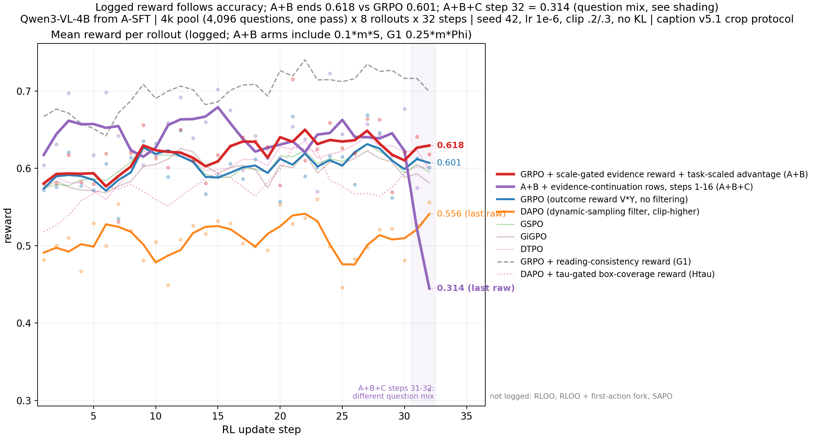

**训练正确率 Y**（不含续答行）。第 25–32 步均值：A+B .608、GRPO .613、DAPO .626、A+B+C .625（取第 25–30 步，避开构成偏差）

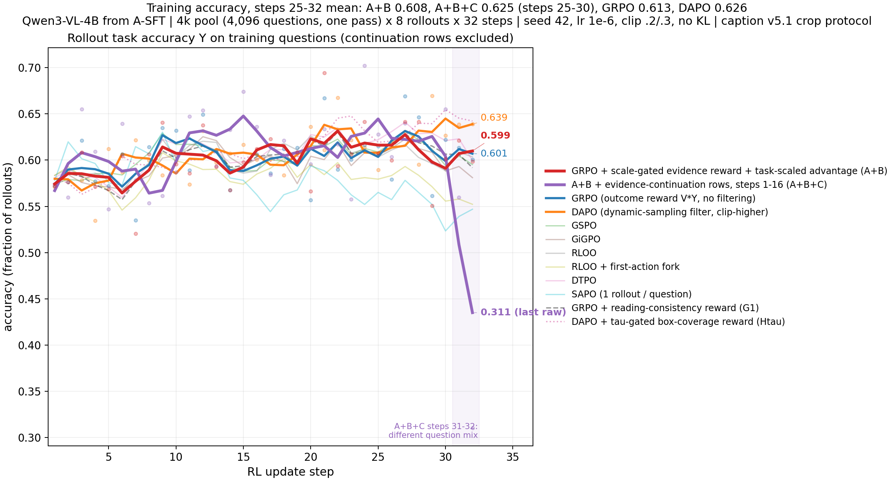

**Entropy**（平均 token 熵）。第 25–32 步均值：A+B .469、GRPO .448、DAPO .447、A+B+C .417；G1 为 .471

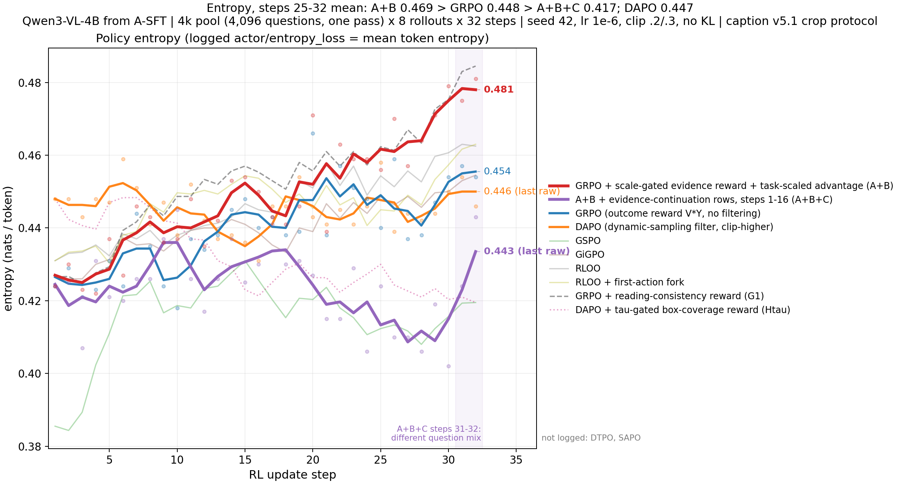

**Diff**（actor/ppo_kl，更新策略相对 rollout 策略，逐步原始值，×1e-4）。除 A+B 第 5 步的 1.0e-3 外，各 run 都在 ±1e-4 以内

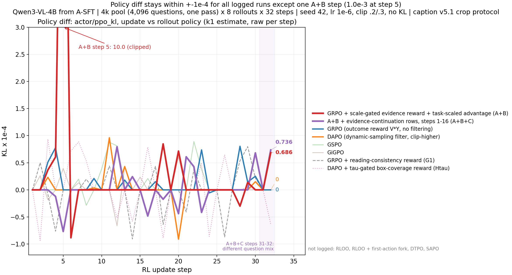

**梯度范数**（裁剪前）。第 25–32 步均值：GRPO 5.99、DAPO 7.34、A+B 6.65、A+B+C 4.91

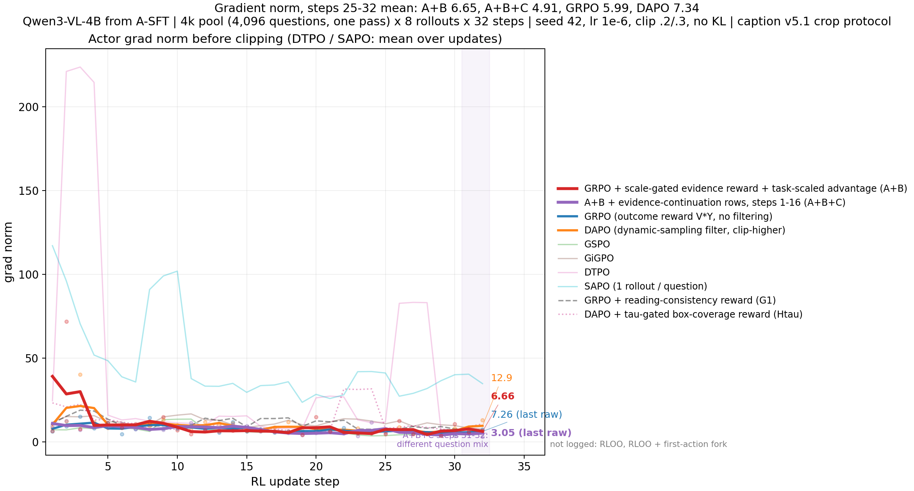

**非零 advantage 的 token 占比**。全程均值：GRPO .64、A+B .75、A+B+C .73、DAPO 1.00（DAPO 在更新前丢掉了全对、全错的组）

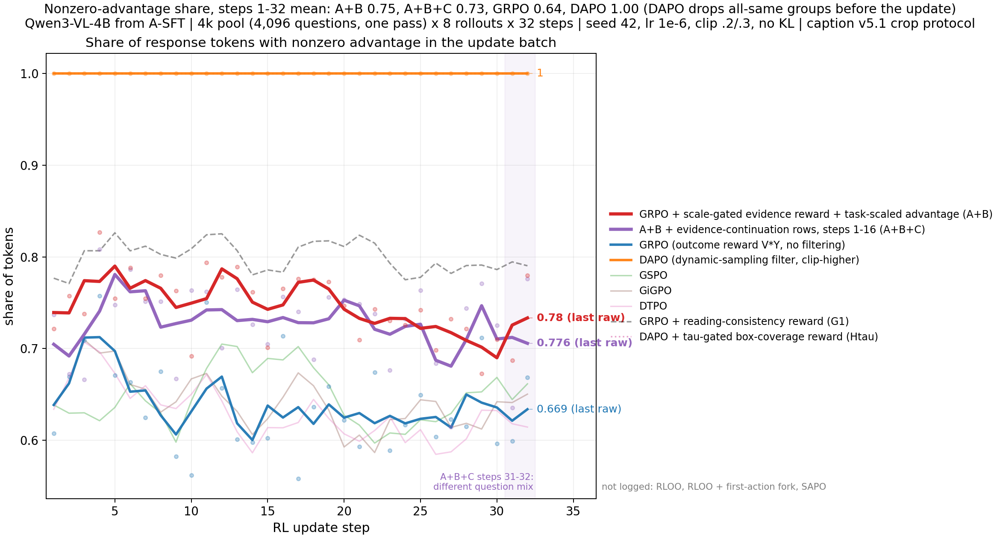

**裁图数 / 条**。第 25–32 步均值：A+B 2.18、A+B+C 2.04、DAPO 2.04、GRPO 1.65

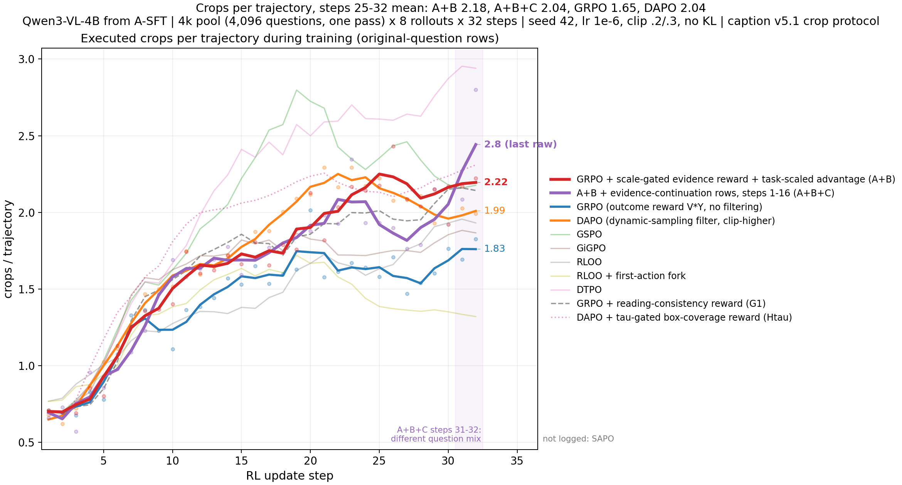

**生成 token / 条**

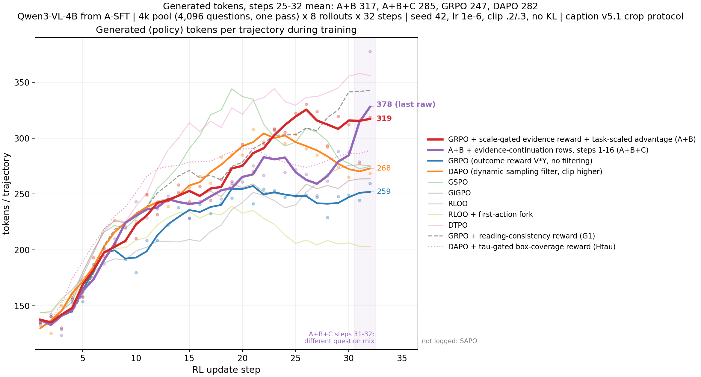

**S 与门控开启率**（只有 A+B 系列计算这两项）

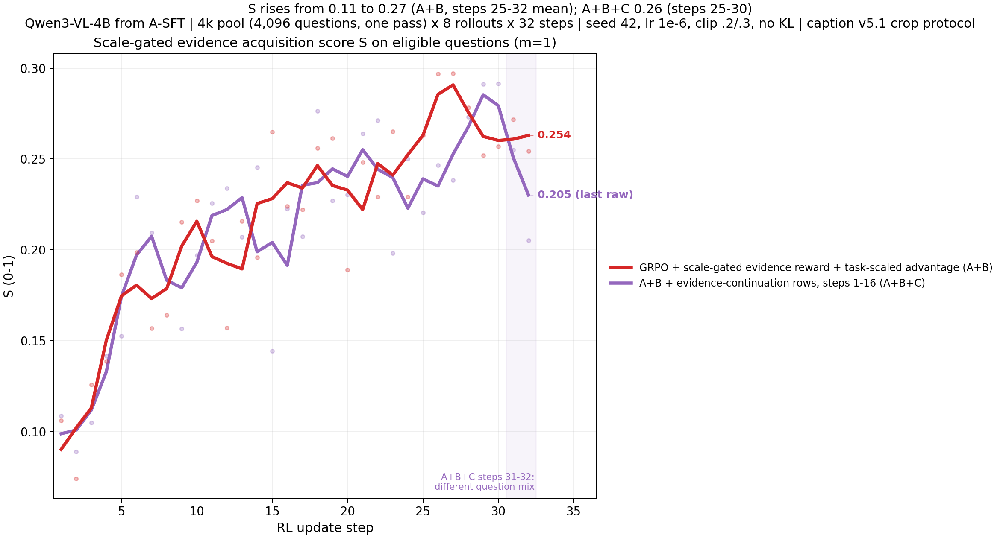
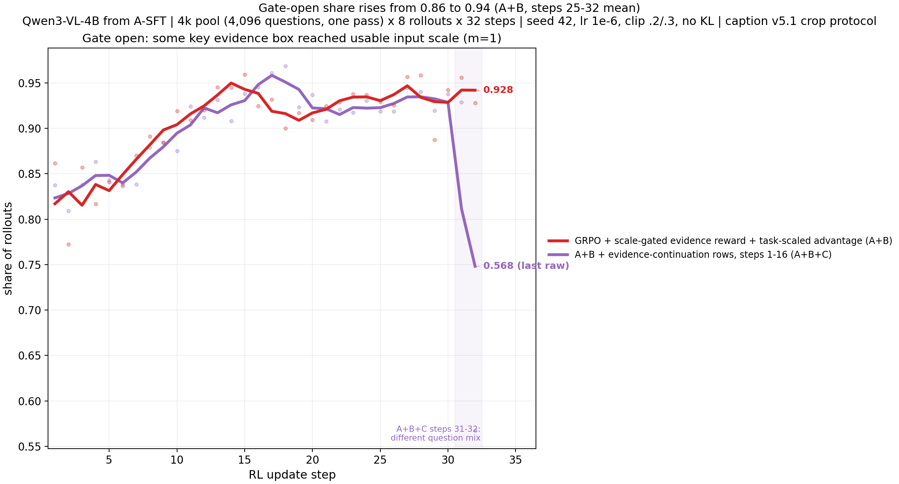

**E1 汇总图**

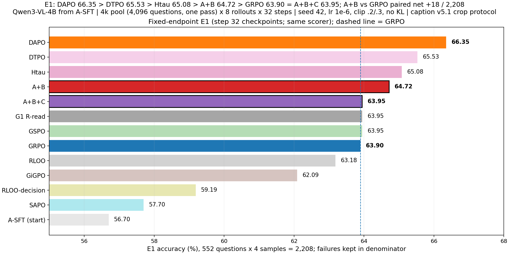
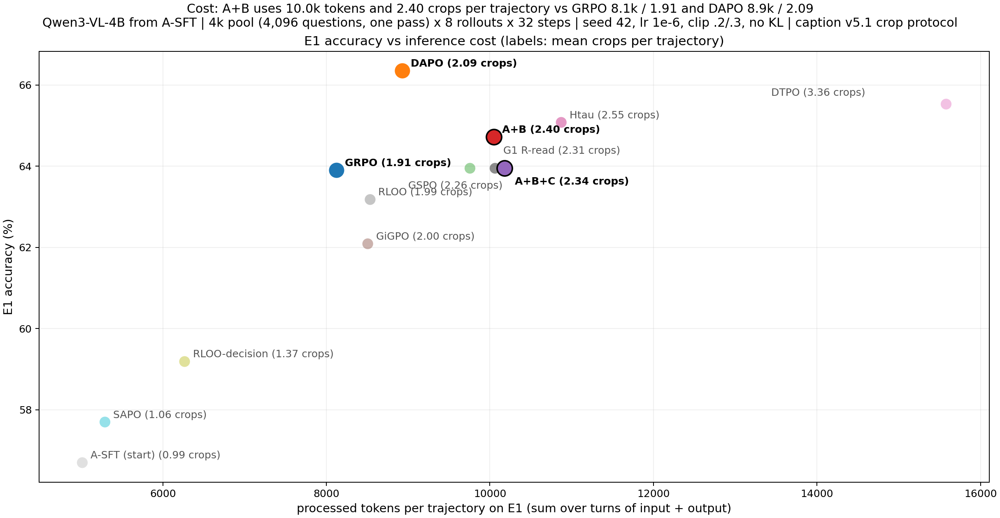
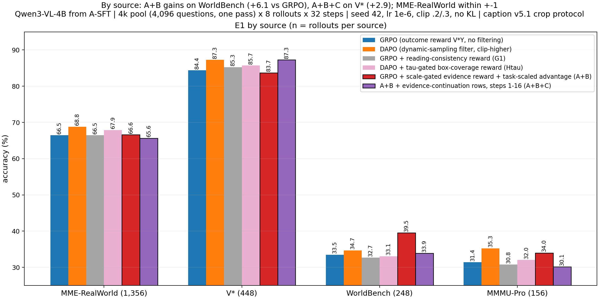

### GRPO 与 DAPO 的差异

两者的 advantage 公式相同，差别在下面三点：
- **过滤**：DAPO 丢掉全对和全错的题组，不足 128 组就补采。本 run 共生成 7,872 组，GRPO 是 4,096 组。所以 DAPO 进入更新的 token 全部带非零 advantage（GRPO 约 .64），代价是多出约 92% 的 rollout。
- **clip high**：DAPO 0.28，GRPO 0.3。
- **update micro batch**：DAPO 为 1，GRPO 为 2，属于显存工程差异。

E1 上 DAPO 比 GRPO 高 2.45pp。A+B 是在 GRPO（无过滤）上做的改动，目前处在两者之间（.6472）。

---

## 行为审计（2026-11-04）

按外部评审提出的检查点，对 DAPO、A+B、A+B+C（GRPO 作参照）做了离线审计，见 [results/sg_20261104/audit/AUDIT.zh.md](results/sg_20261104/audit/AUDIT.zh.md)。要点：

- DAPO 的 4,095 个更新组只覆盖 2,648 道不同的题，其中 1,447 道题被更新 2 次以上，累计 token 是 GRPO 的 2.27 倍。
- A+B 中拿到正 advantage 的错答 rollout 占 2.6%，平均 +0.035，全部来自全错组；混合组没有出现符号翻转。
- A+B 把大量单裁轨迹变成双裁（单裁 1,024 → 615 条，双裁 574 → 892 条）。在 V\* 上，A+B 首次覆盖 GT 后平均再裁 0.91 张（GRPO 0.44）。
- 目标不存在的题（72 条）：正确率 GRPO .403、DAPO .361、A+B .236、A+B+C .167。
- A+B 对 DAPO 的差距集中在 MME（−30）和 V\*（−16）；在 WorldBench 上 A+B 多对 12 条。

## 设计主线：预算化势能信用（草案，2026-11-04）

不再设计新的过程奖励，只改结果信用怎样分配到轨迹和回合：每条轨迹的信用总额固定、末轮保障 2/3；中间工具回合按“看图前后强制作答答对概率的差”（势能差）分配信用，对应导师的四种信用情况和“势能方程”。含依据的实测数（梯度 32/32 步被裁剪、末轮只占约 30% 的 token、按 token 平均时负 / 正信用比为 1.05）、类比来源、与已有方法的区别、风险和验证顺序。见 [design/CREDIT_MAINLINE.zh.md](design/CREDIT_MAINLINE.zh.md)。尚未实现和训练。

## 期待行为清单的实测表（2026-11-04）

用 DAPO step 32 在 1,572 道 rl4k 训练题上各采 8 条（共 12,576 条轨迹），逐条测量 A1–C3 共 12 条期待行为：适用题数、达标率、组内差异率、同题内“做到 vs 没做到”的正确率差、与答对的一致率、全错组中是否仍有差异。见 [results/behavior_20261104/BEHAVIOR_TABLE.zh.md](results/behavior_20261104/BEHAVIOR_TABLE.zh.md)。

Design_PH 执行结果见 [BIND_AUDIT.zh.md](results/behavior_20261104/BIND_AUDIT.zh.md)：剥离协议编号后，B2 达标率从 .572 降到 .273，C2 从 .940 降到 .786。Φ_bind（最终采用的表格绑定）60 条人工抽检：v1 精确率 90%、召回率 63%，v2 精确率 26/26、召回率 60%。被抽到的 30 条答对轨迹全部写对了绑定，所以混合组里“答对的轨迹之间”的 Φ 差异在抽检中全部来自评分器能否识别其写法，而不是绑定对错。

同一批数据上，DAPO 失败组可核验证据辅助线的第二道关结果：可教的全错组只占可核验题的 22/1191，该线按判据停止。

## DAPO-SB 与单 A 的训练结果（2026-11-05）

两组都以 A-SFT 为起点，在 4k 池上训练 32 步，单 seed。三部分报告见 [results/sb_20261104/REPORT.zh.md](results/sb_20261104/REPORT.zh.md) 和 [results/sg_20261104/REPORT_sg_a.zh.md](results/sg_20261104/REPORT_sg_a.zh.md)，代码见 [code/dapo_sb](code/dapo_sb/)。

- **DAPO-SB（停止相对 advantage）**：DAPO 的其余设置不变，只把组均值基线换成每回合之前的停止探针 $b_{i,k}$，即 $A_{i,t}=(Y_i-b_{i,k(t)})/(\sigma_q+\epsilon)$，λ=1。$b_{i,k}$ 是用 rollout 权重、只看题面和该回合前已呈现的图像、强制作答时的 P(gt 字母)。
- **GRPO+A（单 A）**：GRPO 的奖励加上尺度门控获取分 S，即 R = V·(Y+0.1·m·S)；advantage 用标准 GRPO。

| | E1 | 配对净增（对直接对照） | 裁图 / 条 | 零裁图 | 总处理 token / 条 | 训练末步 entropy |
|---|---:|---:|---:|---:|---:|---:|
| DAPO（对照） | .6635 | — | 2.092 | 1.00% | 8,930 | .446 |
| DAPO-SB | .6413 | DAPO +49 | 1.631 | 4.80% | 7,055 | .341 |
| GRPO（对照） | .6390 | — | 1.905 | 4.35% | 8,125 | .454 |
| GRPO+A | .6436 | GRPO+A +10 | 4.020 | 0.18% | 18,034 | .449 |

DAPO-SB 训练中，保留组的探针 b0 均值从 .257 升到 .306，组正确率减 b0 的值在 32 步内平均为 +.220，每条轨迹的回合数从 1.77 升到 2.81。探针让训练多出 ≥182,334 次单 token 前向；32 步 timing 合计 13.25 h，k8 DAPO 为 11.21 h，两者并行负载不同。未跑的检查：Advantage.md §七的三层离线验收、固定根状态基线消融、λ=0 / 0.5。

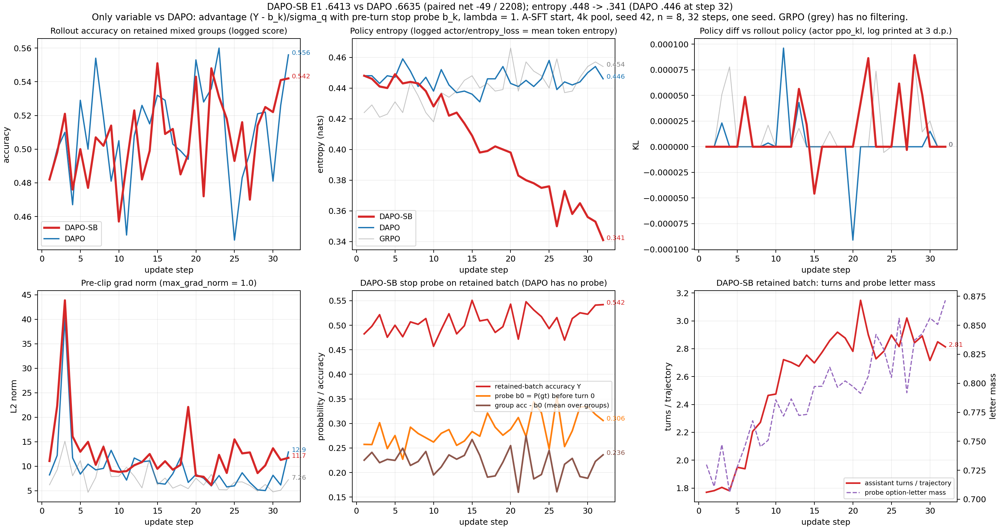

## 后续实验（已列入但未开始）

1. Design_New §3 的分层探针：同一批错题，依次给“模型自己尺度最合适的裁图”“GT 证据图”“GT 三档尺度”“正确转录”“正确绑定”，按选项计分；同时用来校准尺度函数 h。
2. 修正 A+B+C 的题序构造，让每一步的原题集合与 GRPO 一致后重跑，单独得到 C 相对 A+B 的增量。
3. 拆分 A+B 多出的约 0.5 张裁图 / 条、约 80 个生成 token / 条分别落在哪类题上；逐图审查 A+B 在 WorldBench 上的 +15 题。
4. 7B 阶段（Qwen3-VL-8B、Qwen2.5-VL-7B）：模型规模、轨迹、RL 方法不同时更换。

## 目录

完整源码（每个方法一个目录，含公式所在函数与行号）见 [code/README.md](code/README.md)。

| 路径 | 内容 |
|---|---|
| [code/](code/README.md) | 13 个方法、E1 评测、rl4k 标注的实际运行代码快照 + MANIFEST（原始 sha256） |
| [results/stage_report_20261104/](results/stage_report_20261104/) | 本页全部图（png / pdf）、长表、脚本 |
| [results/sb_20261104/](results/sb_20261104/) | DAPO-SB 冻结记录、三部分报告、曲线、E1 配对表 |
| [results/sg_20261104/](results/sg_20261104/) | A+B / A+B+C / GRPO+A 冻结记录、三部分报告、代码 |
| [results/rereview_20261104/](results/rereview_20261104/) | Probe A/B 撤回与重审 |
| [protocol/CAPTION_V51.md](protocol/CAPTION_V51.md) | 协议全文、13 类 hint |
| [design/ANNOTATION_SPEC.md](design/ANNOTATION_SPEC.md) | L0 / L1 / L2 标注规范 |
| [results/RESULTS.md](results/RESULTS.md) | 结果入口 |
| [docs/README_before_stage_20261104.md](docs/README_before_stage_20261104.md) | 旧版 README |
