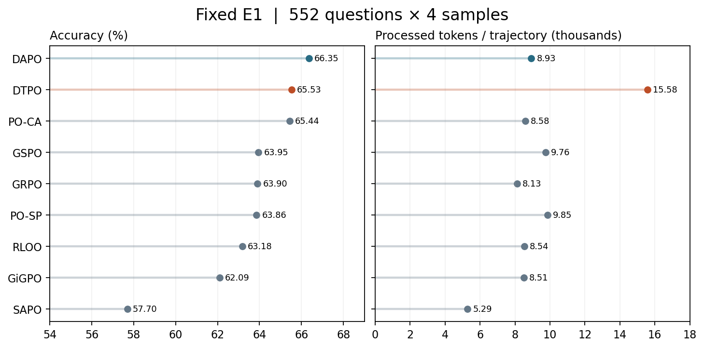

# VLM RL Signal Design

SAPO-VLM 第 32 步 E1 为 57.70%，历史 DAPO 为 66.35%。[分源结果、成本、训练曲线与同题轨迹](results/sapo_vlm_20261102/REPORT.md)。

多轮视觉工具模型的实验记录与算法设计讨论。我们从模型的回答、实际裁图和失败实例出发，逐步讨论：**模型应该学到什么行为，以及怎样给出相应的训练信号。**

本仓库面向研究者、导师，以及通过 GitHub MCP 阅读材料的网页 Pro。保存实验结果、设计公式、研究者猜测和文献笔记；最新整理于 **2026-11-02（America/New_York）**。

[从这里开始](START_HERE.md) · [给导师的阶段汇报](context/MENTOR_UPDATE_20261031.md) · [当前协议](protocol/CURRENT_PROTOCOL.md) · [文献](literature/README.md)

## 补充：剩余题线索层标注与对照实验（2026-11-02）

537 道止于 L0 的题与 152 道 gt 存疑题补一层 **LC 线索记录**（可见→可推测→未解决；歧义题记多解；disagree 题记按读数推出的选项，不改 gt），与 v2 终稿分开存放。配套五个对照实验：E2 线索覆盖离线审计、E3 gt 噪声上限复算（都用已有 k8 训练 rollouts，零 GPU）→ E1 hint 探针（两张空闲卡）→ E4 过程信号训练臂（后置）。[设计与实验矩阵](design/CLUE_ANNOTATION_AND_CONTROLLED_RUNS.md) · [testbed 主线](design/ANNOTATION_TESTBED.md)

## D2：覆盖+引用过程奖励通过离线判据（2026-11-02）

D1-B 失败的引用关由新增引用项修复：同样的引用替换对照，D1 同分，D2 变分率 0.51（Δ中位 −1.0）。引用=使用为显式冻结假设，cite-all 余量 0.16–0.19 预登记为后置 hacking 观察项。[D2 协议](results/d2_offline_20261102/PROTOCOL.zh.md) · [D2 结果](results/d2_offline_20261102/RESULTS.zh.md)

## 末裁=使用：假设验证与算法方向（2026-11-02，GPU 已停）

实测：RL 后模型的最后一张裁图与 commit 引用一致率 92–93%，覆盖信号损失 ≤0.024——"最后裁图 ≈ 使用"冻结为工作假设，替代文本引用（免疫"写引用不裁图"）。配套算法方向文档给出等效视角（势能差分 ≡ 集合边际贡献 ≡ 事件级过程 GRPO，三者同一对象）与 A/B/C/D/E 五个候选，供 Pro 设计。[方向文档](design/USAGE_EQUIVALENCE_AND_ALGORITHM_DIRECTIONS.md) · [数据](data/usage_equivalence_20261102/lastcrop_vs_cited.json)

## Hτ 训练臂启动（2026-11-02）

按设计评审矩阵：Aτ 离线判据出局（判别率 ≤0.53 且压攻击的 τ 清零过半正确轨迹），**Hτ（τ=0.005 精度门控集合覆盖）**通过并已在 GPU 0/1 启动 32 步对照；D0 用既有 k8 DAPO（E1 66.35%）。[冻结协议与 τ 定标](results/htau_training_20261102/PROTOCOL.zh.md)

## DTPO 固定终点评测

DTPO 答对 1,447/2,208，DAPO 答对 1,465/2,208；两者相差 18 条。V* 分别为 387/448、391/448。[设定、两条同题分歧与训练日志](results/dtpo_e1_20261103/RESULTS.zh.md) · [全阶段交付规范](protocol/EXPERIMENT_LIFECYCLE.zh.md)

## E 系列：GRPO 基座过程奖励（2026-11-03 冻结）

B-SFT 线放弃（.4543 vs A-SFT .5670）。Hτ-on-DAPO 失败机制定位：DAPO 动态过滤恰好丢弃全错组——过程分唯一有增量信息的地方。本轮在 **GRPO（无过滤）**上跑 **E1-GRPO（纯终答对照）与 E2-GRPO（+τ 门控覆盖过程分，唯一变量）**；候选 E3（边际增益）/E4（末裁锚定）待批。含变体总表（Aτ/Hτ/B-event/D2-set 及各自离线关结果）。[冻结文档](design/E_SERIES_GRPO.md)

## Oracle 诊断：43% 错答是感知层瓶颈（2026-11-03）

lm_understand-logs 方法论（给中间结果测下一步）分解 DAPO 743 条错答：搜索 46% + **读取 43%** + 推理 8%（V* 空间方向反转）+ 绑定 3%。给了模型自己的证据裁图（probe A 8.3%）或自己的读数描述（probe B 1.7%）几乎无法答对——**4B 看到了证据图也读不对**，几何过程奖励对此零触及。各来源瓶颈不同：V* 是推理（方向反转），MME/WB 是读取（值本身读错）。[完整结果](results/oracle_probes_20261103/RESULTS.zh.md)

## 当前方向

**2026-11-02 · 标注作为 testbed。** 已核对 4,096 张数据集源图的尺寸，在 23 张抽查图上重放首轮预处理，并补标路牌和减速字样。Hint 用于构造 SFT 示范、学生无提示迁移、模型直接用原图或自由裁图的差异，分别留作实验对照。[主线看板](design/ANNOTATION_TESTBED.md)

研究者已选择 **A 路线：保留 A-SFT，在 RL 阶段构造可验证的视觉过程信号**。希望把已有 hint 和行为卡片中的要求，转成与视觉推理正确性有关的奖励。方案与标注规范已有记录，尚无这一轮 Reward 训练结果。

| 材料 | 记录的内容 |
|---|---|
| [A 路线方案](design/PRIMITIVES_ROUTE_A.md) | 目标、现有区域命中与行为统计、待验证的过程信号 |
| [Visual Primitives 对照](design/VISUAL_PRIMITIVES_BRIDGE.md) | 论文方法与 caption 协议的对应、目标逼近／探索信号 |
| [13 类 hint 与奖励](design/HINTS_AS_REWARD.md) | hint 覆盖、候选用法及逐类讨论 |
| [A 路线设计 v1](design/ROUTE_A_DESIGN_V1.md) | 最终取舍：hint 先作为条件输入，用于探针与课程；证据状态审计 M_t=(F,D,U)；审计通过后再加过程信号；事件级信用分配后置 |
| [证据标注规范 v2（分级）](design/ANNOTATION_SPEC.md) | L0 定性 / L1 证据框 / L2 转录值、绑定元组、充分证据组合；覆盖 RL 4,096 题与开发探针 1,399 题；先试标 163 题 |
| [导师过程信号要求](context/MENTOR_20261031_PROCESS_SIGNAL.md) | 匿名技术整理；与已测结果分开记录 |

DAPO-LOO 两组已按用户要求停止：L0 完整 24 步、L01 完整 28 步，未完成 32 步，未做 E1。checkpoint 和日志保留。下面的 Native Zoom 对照已经结束，监控已关闭。

## 最新结果：Native Zoom 坐标与 token 上限对照

同一个 A-SFT、同一 E1 题池与评分器。先对原生 Zoom 坐标做尺度适配，再只取消累计生成 token 上限。**三组都保留最多 8 次裁图和 32,768 上下文。**

| 条件 | 正确／总数 | 准确率 | 裁图／条 | 生成 token／条 | 累计处理 token／条 |
|---|---:|---:|---:|---:|---:|
| 原 SFT Native Zoom | 710 / 2208 | 32.16% | 5.56 | 454.22 | 14,955.83 |
| 坐标归一化，累计生成上限 8192 | 991 / 2208 | **44.88%** | 4.48 | 406.94 | 12,034.60 |
| 坐标归一化，仅受剩余上下文限制 | 991 / 2208 | **44.88%** | 4.48 | 510.53 | 12,138.20 |

**本次观察：**归一化相对原条件新增答对 326 条、失去 45 条，净增 281 条（+12.73 个百分点）。取消累计生成上限后，逐条正确性完全相同；2,198 条逐轮记录不变，10 条长输出合计多生成 228,741 tokens，没有新增工具调用，最终仍以 length 截断。

实际看图核对了 2 题 4 条轨迹：时间轴例中，同样的工具请求在旧坐标解释下得到亚像素黑图，适配后读到日期并答对；几何例中，延长输出继续重复错误推导，两组均未完成有效终答。记录与重建限制见[完整报告](results/native_zoom_normalized_20261031/REPORT.md)。

坐标适配规则是“四值均在 [0,1] 时乘 1000，否则保留 native 0–1000”，是范围启发式。**44.88% 是新适配条件的结果，原始 32.16% 保留。**取消累计生成限制仍受上下文约束。处理 token 包括跨轮重复的 prompt、图像和生成，不等于单条输出长度。

[完整结果与轨迹](results/native_zoom_normalized_20261031/REPORT.md) · [汇总 CSV](results/native_zoom_normalized_20261031/summary.csv) · [分数据集计数](results/native_zoom_normalized_20261031/by_source.csv) · [验收与 SHA](results/native_zoom_normalized_20261031/PROVENANCE.json) · [绘图脚本](results/native_zoom_normalized_20261031/plot.py)

## 三类基础 baseline

这些条件此前已经评测。第一、二类分别使用原模型与 A-SFT；第三类使用 outcome-only 标准 GRPO。每个条件均为 E1 的 552 题 × 4 次采样。

| 类别 | 模型与条件 | E1 准确率 |
|---|---|---:|
| I · 原模型 | Direct answer | 40.94% |
| I · 原模型 | CoT | 52.17% |
| I · 原模型 | Native Zoom prompt | 58.88% |
| II · A-SFT | Direct answer | 38.63% |
| II · A-SFT | CoT | 53.80% |
| II · A-SFT | Native Zoom prompt（原始条件） | 32.16% |
| III · 标准 GRPO | A-SFT + GRPO，caption，32 步 | 63.90% |
| III · 标准 GRPO | Base + GRPO，caption，32 步 | 0.54% |

Native Zoom 是模型输出工具文本、由本地执行器裁图的接口；与 caption 协议分别列示。SFT Native Zoom 的坐标适配结果见上一节。旧 6k×16／47 步和无工具 GRPO 条件在完整报告单列。

[三类 baseline 报告](results/baseline_classes_20261031/REPORT.md) · [精确分母与成本](results/baseline_classes_20261031/summary.csv) · [多数据集结果](results/baseline_classes_20261031/by_source.csv)

## RL 对比与局部信用实验

我们以 DAPO 为工作基线，尝试通过更细的中间信用改善学习。SP 和 CA 完成了 32 步训练及最终 E1，**本次均未超过 DAPO**。

| 方法 | 正确／2208 | E1 准确率 |
|---|---:|---:|
| DAPO | 1465 | **66.35%** |
| PO-CA | 1445 | 65.44% |
| GSPO | 1412 | 63.95% |
| GRPO | 1411 | 63.90% |
| PO-SP | 1410 | 63.86% |
| RLOO control | 1395 | 63.18% |
| GiGPO | 1371 | 62.09% |

相对 DAPO，SP 新增答对 214 条、失去 269 条；CA 新增 223 条、失去 243 条。下面的曲线来自实际日志，开发验证只有真实记录的检查点。

[SP／CA 设计与实跑公式](design/PO_METHODS.md) · [最终结果、成本与多源分层](results/po_final32_20261031/REPORT.md) · [局部信用诊断](results/po_diagnostic_20261031/RESULTS.md) · [历史算法配置与曲线核对](results/ALGORITHM_CURVE_AUDIT.md)

各方法的样本供给、计算成本和部分训练设置不同，等 32 步不等于等计算；RLOO control 还使用不同训练协议与奖励。外部 Mini-o3-7B **63.95%**、DeepEyes-7B **55.89%** 为原生工具接口加 E1 采样／预算适配结果，未完成官方原生评测复现，详见[外部协议差异](protocol/EXTERNAL_PROTOCOLS.md)。

## 我们的思路与已经记录的失败

此前把问题分成三类，完整推导保存在 [CREDIT_ASSIGNMENT_FOCUS](design/CREDIT_ASSIGNMENT_FOCUS.md)：

1. **信用分配**：成功轨迹中，关键裁图与不必要裁图可能得到同一个终答信号。
2. **能力／状态表示**：即使观察到目标，仍可能认错属性、混淆对象，或在跨轮记忆与推理中出错。
3. **奖励目标不完整**：只奖励最终答对，没有单独表达论据真实、视图引用正确、观察必要等目标。

我们的尝试是先建模信用分配，希望 RL 同时学到更好的视觉推理能力，再用 Reward 信号补充目标。目前局部信用实验尚未跑过 DAPO；这些问题之间的关系仍是研究者的猜测，新的过程奖励方案见顶部 A 路线。

已记录的现象包括：裁图排除了目标却仍引用该视图、声称读到了不存在的数字、混淆人物或物体身份、为匹配选项更换算式，以及答对但论据不对应。Native Zoom 对照还记录了坐标尺度错配和延长错误推导的实例。

| 轨迹材料 | 范围 |
|---|---|
| [八方法同题页面](observations/CASE_INDEX.md)／[现象索引](observations/PHENOMENA.md) | 12 题 × 8 方法，96 条定向逐图审查 |
| [PO 最终 E1 审查](results/po_final32_20261031/audit_findings.jsonl) | 四来源各三题 × SP／CA，共 24 条 |
| [PO 同题诊断](results/po_diagnostic_20261031/RESULTS.md) | 18 条轨迹对照与局部信用记录 |
| [Native Zoom 审查](results/native_zoom_normalized_20261031/audit_findings.jsonl) | 2 题 4 条，原条件／坐标适配／放宽生成上限 |
| [既有 corpus 卡片](cards/README.md) | 与已见现象核对的候选模式，保留适用边界 |

这些是定向样本，不能用来估算总体错误率。专业判断、小目标身份和无法核实的视觉事实保留“未判定”；不同审查批次不简单合并为独立样本总数。

## 阅读与复核

| 目的 | 入口 |
|---|---|
| 了解协议和终答评分 | [当前协议](protocol/CURRENT_PROTOCOL.md) · [caption v5.1 完整定义](protocol/CAPTION_V51.md) |
| 看各方法多答对／少答对什么 | [同题得失](results/PAIRED_RESULTS.md) · [训练信号](results/TRAINING_SIGNALS.md) |
| 了解导师要求与我们的汇报 | [要求整理](context/MENTOR_REQUIREMENTS.md) · [阶段汇报](context/MENTOR_UPDATE_20261031.md) |
| 学习论文的问题构造与推导 | [文献目录](literature/README.md) · [阅读方式](literature/REASONING_GUIDE.md) · [Visual Primitives 精读](literature/readings/visual_primitives/精读.zh.md) |
| 与网页 Pro 讨论 | [通用开场](prompts/PRO_START.md) · [Visual Primitives 讨论提示词](prompts/PRO_VISUAL_PRIMITIVES.md) |
| 复算与核对来源 | [复现说明](REPRODUCIBILITY.md) · [来源记录](provenance/README.md) |

E1 每个条件为 552 题 × 4 次采样，失败保留分母；E1 与部分开发／训练来源有交叉，**不是独立盲测**。公开内容包括脱敏结果、模型输出、图表和审查记录，不含原图、完整题面或机器信息；公开范围见 [RIGHTS](RIGHTS.md)。

上游实验快照固定于[实验仓库 2c5155d](https://github.com/CrepuscularIRIS/vlm-caption-trajectories/tree/2c5155d7e629e6eadb043bb8c751035f9132fca9)。本仓库保存建模讨论与证据，不调度训练，也不自动执行文档中的提案。
