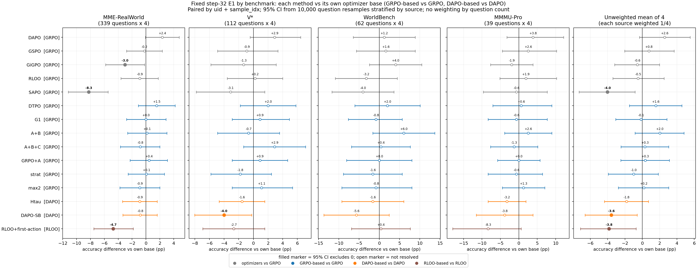
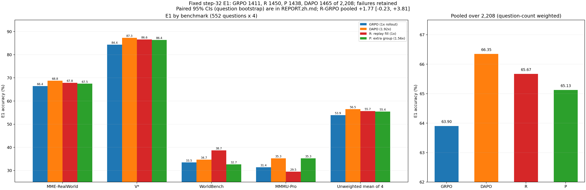

# VLM 多轮裁图 RL：学习信号设计

Qwen3-VL-4B 在 caption v5.1 协议下多轮裁图后回答选择题。本仓库记录 RL 阶段的全部实验：同一 SFT 起点（A-SFT）、同一题池（rl4k）、同一评测（E1），比较不同的优化器、奖励、advantage 与信用分配。每个实验按“设定 / 定性 + 定量 / 训练 Log”三部分报告。

- **结果总表与图**：本页 §2；逐个结果目录：[results/RESULTS.md](results/RESULTS.md)
- **完整阶段报告**（各方法公式、分源与配对表、案例、训练曲线、审计）：[docs/README_stage_20261106.md](docs/README_stage_20261106.md)
- **代码**：[code/README.md](code/README.md)　**协议**：[protocol/CAPTION_V51.md](protocol/CAPTION_V51.md)　**实验流程**：[protocol/EXPERIMENT_LIFECYCLE.zh.md](protocol/EXPERIMENT_LIFECYCLE.zh.md)

## 1. 当前状态（2026-11-06）

- **新底座 GRPO + R（回放补满）**：只改“哪些组进入更新”——本步全对 / 全错组换成上一步的混合组，每次更新的混合组 72 → 126；rollout 与 GRPO 相同（时长 1.02×）。E1 1450/2208（GRPO 1411、DAPO 1465）。多采 56% 新轨迹的 P（1438）未高于 R。[报告](results/entry_ab_20261106/REPORT.zh.md)
- **GRPO 底座上点估计高于 GRPO 的方法**：A+B（奖励 + advantage 按任务尺度归一）、DTPO（中间 / 最终回合 token 权重）、R、P；95% 区间均含 0。
- **进行中**：坐标刻度检验——A-SFT 数据与协议改为 Qwen3-VL 原生 [0,1000] 整数坐标后重训 SFT，与现 A-SFT（[0,1]）在 E1 上比较。
- **下一步候选（未开训）**：在 R 上按首轮观察决策做条件基线分解，只用 L1 证据框判断首裁是否覆盖目标。

## 2. 结果总表（E1，step 32）

| 方法 | 底座 / 改动层 | rollout | MME-RW | V\* | WorldBench | MMMU-Pro | **4 bench 不加权** | 相对底座（不加权）[95% 区间] | 合并 /2,208 | 裁图 / 条 | 生成 token / 条 | 处理 token / 条 |
|---|---|---:|---:|---:|---:|---:|---:|---|---:|---:|---:|---:|
| A-SFT 起点（无 RL） | —（SFT） | — | 57.1 | 81.2 | 27.8 | 28.8 | 48.75 | — | 1252 | 0.994 | — | 5,015 |
| GRPO | 优化器（对照） | 1× | 66.4 | 84.4 | 33.5 | 31.4 | 53.92 | — | 1411 | 1.905 | 261 | 8,125 |
| **R：回放补满** | GRPO 底座 · 进入更新 | 1× | 67.8 | 86.6 | 38.7 | 29.5 | 55.66 | +1.74 [-0.97, +4.36] | 1450 | 2.161 | 264 | 9,100 |
| P：混合题追加一组 | GRPO 底座 · 进入更新 | 1.56× | 67.5 | 86.4 | 32.7 | **35.3** | 55.44 | +1.52 [-1.51, +4.48] | 1438 | 1.927 | 248 | 8,136 |
| DTPO | GRPO 底座 · 信用分配 | 1× | 68.0 | 86.4 | 35.5 | 32.1 | 55.48 | +1.55 [-1.48, +4.57] | 1447 | 3.357 | 395 | 15,579 |
| A+B | GRPO 底座 · 奖励 + advantage 归一 | 1× | 66.6 | 83.7 | **39.5** | 34.0 | 55.95 | +2.02 [-0.84, +4.81] | 1429 | 2.404 | 342 | 10,047 |
| A+B+C | GRPO 底座 · A+B + 续答行 | 1× | 65.6 | **87.3** | 33.9 | 30.1 | 54.23 | +0.30 [-2.46, +3.04] | 1412 | 2.337 | 326 | 10,181 |
| GRPO+A | GRPO 底座 · 奖励 | 1× | 66.9 | 85.3 | 33.5 | 31.4 | 54.26 | +0.33 [-2.49, +3.14] | 1421 | 4.020 | 440 | 18,034 |
| G1（读值一致性） | GRPO 底座 · 奖励 | 1× | 66.4 | 85.3 | 32.7 | 30.8 | 53.79 | -0.14 [-3.06, +2.84] | 1412 | 2.308 | 374 | 10,063 |
| strat | GRPO 底座 · advantage | 1× | 66.5 | 82.6 | 31.9 | 30.8 | 52.93 | -0.99 [-3.93, +1.85] | 1399 | 2.473 | 321 | 10,793 |
| max2 | GRPO 底座 · 奖励（psi v2） | 1× | 65.6 | 85.5 | 32.7 | 32.7 | 54.10 | +0.18 [-2.76, +3.04] | 1404 | 3.540 | 431 | 14,727 |
| DAPO | 优化器（动态采样） | 1.92× | **68.8** | **87.3** | 34.7 | **35.3** | **56.50** | +2.58 [-0.33, +5.52] | **1465** | 2.092 | 287 | 8,930 |
| Hτ（bbox 覆盖奖励） | DAPO 底座 · 奖励 | DAPO 式补采 | 67.9 | 85.7 | 33.1 | 32.1 | 54.69 | -1.82 [-4.37, +0.70] | 1437 | 2.546 | 305 | 10,872 |
| DAPO-SB | DAPO 底座 · advantage | 1.95× | 68.0 | 83.3 | 29.0 | 31.4 | 52.92 | -3.58 [-6.60, -0.58]\* | 1416 | 1.631 | 222 | 7,055 |
| GSPO | 优化器 | 1× | 66.2 | 83.5 | 35.1 | 34.0 | 54.69 | +0.77 [-2.04, +3.68] | 1412 | 2.263 | 278 | 9,756 |
| GiGPO | 优化器 | 1× | 63.4 | 83.0 | 37.5 | 29.5 | 53.36 | -0.56 [-3.20, +2.00] | 1371 | 1.998 | 275 | 8,506 |
| RLOO | 优化器 | 1× | 65.6 | 84.6 | 30.2 | 33.3 | 53.43 | -0.49 [-3.39, +2.51] | 1395 | 1.992 | 278 | 8,535 |
| RLOO + 首动作分叉 | RLOO 底座 · 辅助损失 | 约 2× | 60.8 | 81.9 | 30.6 | 25.0 | 49.60 | -3.83 [-7.13, -0.71]\* | 1307 | 1.372 | 203 | 6,266 |
| SAPO（单 rollout） | 优化器 | n=1 | 58.2 | 81.2 | 29.4 | 30.8 | 49.91 | -4.01 [-7.29, -0.84]\* | 1274 | 1.063 | 171 | 5,292 |

- 每个方法只与自己的优化器底座比较（GRPO 底座 vs GRPO，DAPO 底座 vs DAPO，RLOO 底座 vs RLOO）。区间：同一 (uid, sample_idx) 配对，来源内按题重采样 10,000 次（seed 20261105）；`*` = 区间不含 0。
- 粗体 = 该准确率列最高（不含 A-SFT）。“4 bench 不加权”= 四个来源准确率的平均；“合并”按题数加权（MME-RealWorld 占 61%），仅作旧口径参考。行按底座分组，不按分数排序。
- 表由 [make_main_table.py](results/main_table/make_main_table.py) 从 [e1_by_bench_RP.json](results/entry_ab_20261106/e1_by_bench_RP.json) 与 [costs.csv](results/main_table/costs.csv) 生成。

## 3. 设定与评测口径

| 项 | 值 |
|---|---|
| 起点 | A-SFT：Qwen3-VL-4B-Instruct，LoRA SFT（6,953 条逐轮样本 / 3,983 题，2 epoch），E1 .5670 |
| 协议 | caption v5.1：每轮 `<think>`（首行 `Step N \| WORD`）+ 一个动作（`<grounding>` 裁图，坐标为所选视图上的 [0,1] 相对值；或 `<answer>`）；最多 8 次裁图 |
| 奖励 | V·Y：合法终答且答对为 1，其余为 0（另加过程项的方法见各自报告） |
| RL | rl4k 4,096 题单遍；n=8；32 步 × 128 题；actor mini-batch 32 题；lr 1e-6；max_grad_norm 1.0；clip .2/.3；无 KL；seed 42 |
| E1 | 552 题 × 4 次采样 = 2,208 条：MME-RealWorld 339、V\* 112、WorldBench 62、MMMU-Pro 39 题；T=0.7、top_p 1；max_pixels 589,824；失败留分母；统一评分器 |

评测口径的已知差异：E1 的分辨率上限（约 576 个视觉 token / 图）远低于 Qwen3-VL-4B processor 默认上限（约 16,384），且为 4 次采样平均而非 greedy。基座直接作答 V\* 67.4，其他论文报告 Qwen3-VL-4B 无工具 V\* 78.5–80.1（[来源汇总](literature/QWEN3VL_EVAL_PRACTICE.md)）。所有方法在同一 E1 口径下比较；与其他论文报告值不可直接比较。

## 4. 方法（公式见 [阶段报告 §1.4](docs/README_stage_20261106.md)）

| 层 | 方法 |
|---|---|
| 优化器 | GRPO、DAPO（动态采样 + clip-high）、GSPO、GiGPO、RLOO、SAPO（单 rollout） |
| 进入更新 | R 回放补满、P 混合题追加一组 |
| 奖励 | G1 读值一致性、GRPO+A（尺度门控证据分 S）、max2（psi v2）、Hτ（bbox 覆盖） |
| advantage | A+B（任务尺度归一）、strat（同结果层中心化）、DAPO-SB（停止相对） |
| 信用分配 | DTPO（中间 / 最终回合权重） |
| 辅助损失 | RLOO + 首动作分叉 |

## 5. 目录

| 路径 | 内容 |
|---|---|
| [results/](results/RESULTS.md) | 每个实验一个目录：报告、图、长表、匿名配对数据、复算脚本 |
| [code/](code/README.md) | 各方法实际运行代码快照与 MANIFEST（sha256） |
| [protocol/](protocol/) | caption v5.1 协议全文、外部模型协议、实验 14 阶段流程 |
| [design/](design/) | 方法设计稿与冻结记录（含未实施的草案） |
| [docs/](docs/) | 阶段报告全文快照（[11-06](docs/README_stage_20261106.md)、[11-04](docs/README_stage_20261104.md)、[更早](docs/README_before_stage_20261104.md)） |
| context/、observations/、literature/、prompts/、cards/ | 导师要求整理、现象记录、文献摘记、给外部模型的提示词、方法卡片 |
| data/、figures/、scripts/、provenance/ | 早期汇总数据与图、绘图脚本、来源指纹 |

公开内容不含原始图像、题面与机器路径；原始轨迹与权重不在本仓库。复算说明见 [REPRODUCIBILITY.md](REPRODUCIBILITY.md)。
