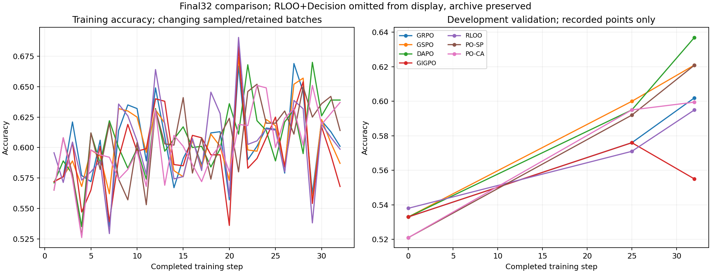

# 给导师的阶段汇报：从DAPO到局部信用的尝试

2026-10-31更新。待发送草稿。记录我们的研究思路、已做方法和实验结果。

老师，我们这次是试着沿着“观察算法差异—提出问题—构造方法—跑实验”的顺序自己推导。我们选择DAPO作为工作基线，尝试进一步细化中间信用，但目前两种方法都没有超过DAPO，也还没有定位到真正的瓶颈。想结合这轮结果，请您看看我们的切入点和构造思路。

## 1. 为什么从DAPO出发

我们先比较了GRPO、GSPO和DAPO。三者都使用组相对结果信号；我们当时重点关注的区别是：GSPO改变已有reward和advantage如何更新policy，DAPO的动态采样改变哪些group进入更新，保留有reward差异的组并继续补采。

已有结果中，GSPO相对GRPO的最终增益很小，DAPO的增益更明显。开发验证的两个后期观测点如下：

| 方法 | step25开发验证 | step32开发验证 | 最终32步E1 |
|---|---:|---:|---:|
| GRPO | 57.6% | 60.2% | 63.90% |
| GSPO | 60.0% | 62.1% | 63.95% |
| DAPO | 59.5% | 63.7% | 66.35% |

25步时GSPO稍高，32步时DAPO反超，末步结果与GRPO、GSPO拉开了距离。这里说的是32个更新步的后段；DAPO会过滤和补采，不等于每个RL样本恰好训练一遍。

**我们当时的猜测是：group advantage本身可能不是当前最核心的瓶颈，哪些轨迹能够提供有效的reward差异、这些差异如何用于训练，可能更值得关注。** 所以我们没有继续找一个更先进的优化器，而是基于DAPO尝试细化中间credit assignment。DAPO还有其他组件差异，这一轮并没有把动态采样的贡献单独拆出来。

## 2. 我们希望解决什么

我们之前在[信用分配推导](../design/CREDIT_ASSIGNMENT_FOCUS.md)中，将可能交织的问题分成三类：

| 问题 | 我们关心的情况 | 原本的推进设想 |
|---|---|---|
| **信用分配** | 关键crop与多余crop共享终答奖励；失败轨迹中也可能有有用的中间观察 | 我们先建模中间选择的贡献，给出更细的学习信号 |
| **能力／状态表示** | 已裁到目标仍认错颜色、数字或对象，跨轮记忆和后续推理出错 | 希望模型通过RL、利用更好的学习信号，逐步学出这部分能力 |
| **奖励目标不完整** | 答对但编造论据、引用不对应、调用工具不必要 | 后续再用reward shaping补充这些行为目标 |

因此，我们当时的路线是：**先建模信用分配，让RL学习更好的视觉探索和解题能力，再补充独立的奖励目标。** 这是我们的设计设想，目前还没有达到超过基线的结果。

具体想学到的行为是：在当前观察和历史下，选择更有助于最终解题的描述与动作；即使一条主轨迹最后答错，也希望其中有用的中间选择能获得学习信号。

## 3. 两种方法如何构造

这轮做的是两个独立实验：**SP（整轮局部比较）**和**CA（caption/action分段信用）**，都加在原DAPO主目标上，没有修改终答奖励。

共同记号：$s$是生成当前轮之前的状态，包含题目、已见图像、历史文本和剩余预算；$u=(c,a)$是新生成的一整轮，$c$是动作前的描述／思考文本，$a$是裁图或作答动作。$R\in\{0,1\}$仍由原协议和终答评分给出。后续完整续写只用于估值，不直接训练这些续写token。

### 方法一：SP——比较同一状态下不同整轮选择

**设计想法：** 从同一个状态出发，生成不同的“描述＋动作”，比较沿各条路线继续解题的平均结果，把信用给更好的整轮选择。

同一$s$自然采样$M=2$个候选$u_j$。执行候选后，各做$K=4$次完整续写：

$$
\widehat Q_j=\frac{1}{K}\sum_{k=1}^{K}R_{j,k},\qquad
A_j^{\mathrm{SP}}=\widehat Q_j-\frac{1}{M-1}\sum_{\ell\ne j}\widehat Q_\ell.
$$

候选已经终止时，直接用其终答回报，不再续写。$M=2$时，两条候选的优势就是互为相反数的收益差；不再除以标准差。

$A_j^{\mathrm{SP}}$赋给候选整轮的所有生成token，训练的是这次“描述＋动作”整体。我们希望由此区分同一状态下更有用和更无用的选择。

### 方法二：CA——把描述与动作的信用分开

**设计想法：** 一轮里的描述可能有问题，但动作仍可能带来有用观察；反过来也可能。因此，我们尝试分别评价描述和动作对后续解题结果的贡献。

在$s$新采样一轮$u=(c,a)$，定义两个中间状态：

- $h=(s,c)$：固定已经生成的描述，还没有固定后面的动作。
- $s'$：执行该轮动作之后的状态，若为裁图则包含真实裁图回执。

从$s$、$h$、非终止的$s'$分别做$K=4$次完整续写，估计后续终答回报的均值：

$$
\widehat V(x)=\frac{1}{K}\sum_{k=1}^{K}R(\tau_k\mid x).
$$

将两段信用定义为：

$$
A^{\mathrm{caption}}=\widehat V(h)-\widehat V(s),
$$

$$
A^{\mathrm{action}}=r+\widehat V(s')-\widehat V(h).
$$

非终止裁图的$r=0$；本轮终止时$r$取实际终答回报，且$\widehat V(s')=0$。两段之和为：

$$
A^{\mathrm{caption}}+A^{\mathrm{action}}
=r+\widehat V(s')-\widehat V(s).
$$

描述token使用第一项，动作token使用第二项。这里的$V$是续写均值，没有另外训练value model。无法在实际生成token上可靠切分两段时，整轮回退到$r+\widehat V(s')-\widehat V(s)$。

### 共同训练方式

两种方法都保留DAPO主损失，分别计算局部clipped policy loss后相加：

$$
\mathcal L_{\mathrm{SP}}=\mathcal L_{\mathrm{DAPO}}+\beta\mathcal L_{\mathrm{local,SP}},\qquad
\mathcal L_{\mathrm{CA}}=\mathcal L_{\mathrm{DAPO}}+\beta\mathcal L_{\mathrm{local,CA}}.
$$

正式实验共同使用$\beta=0.125$、每步$H=8$个局部状态、$K=4$次续写；SP每状态$M=2$个候选，CA每状态1个候选。两组从相同A-SFT出发，各32步，主批次128题×8条，沿用DAPO过滤、学习率和裁剪设置。

**实际局部状态从DAPO过滤后保留的组中选取。** 所以虽然设计动机包含“最终未答对的探索也能学习”，本轮并没有另外把被过滤掉的全错主组送回更新。

完整token损失、mask、终止处理、参数和实现核对见[SP／CA公式说明](../design/PO_METHODS.md)。

## 4. 结果：尚未超过直接基线DAPO

同一E1题池552题×4条，使用同一终答评分器：

| 方法 | 模型规模 | E1正确率 | 裁图/条 | 处理token/条 |
|---|---|---:|---:|---:|
| DAPO | 4B | **66.35%** | 2.092 | 8929.8 |
| CA | 4B | 65.44% | 2.007 | 8584.8 |
| SP | 4B | 63.86% | 2.276 | 9854.1 |
| GSPO | 4B | 63.95% | 2.263 | 9756.2 |
| GRPO | 4B | 63.90% | 1.905 | 8125.4 |
| GiGPO | 4B | 62.09% | 1.998 | 8506.3 |
| RLOO control | 4B | 63.18% | 1.992 | 8535.4 |
| Mini-o3 | 7B | 63.95% | 2.703 | 17279.8 |
| DeepEyes | 7B | 55.89% | 0.852 | 13799.6 |

相对DAPO，CA新增答对223条、失去243条，净少20条；SP新增214条、失去269条，净少55条。CA总体裁图和token略少，SP则更多。[分数据集结果与曲线](../results/po_final32_20261031/REPORT.md)。

我们现在有两个层面的“baseline”：**Mini-o3和DeepEyes是外部模型对照，原4B＋DAPO是新方法要超过的直接基线。** 在目前这套E1运行结果里，4B＋DAPO分数高于两个7B模型；但这不等于我们的局部信用改进已经超过基线。外部模型采用原生工具接口＋E1采样／预算适配，尚不是完整官方评测复现，具体差异见[协议记录](../protocol/EXTERNAL_PROTOCOLS.md)。

这些是单训练seed的现有结果，各算法样本供给和计算量不完全相同；E1不是独立盲测。

## 5. 轨迹里还没有解决的情况

本轮又对照了18条轨迹，其中12条新增、6条复核，涉及GRPO、GSPO、DAPO、SP、CA。记录到的实例包括：

- **已看到目标，后面仍没有正确使用。** 梯子题CA第一张crop已同时包含梯子和马车，下一轮却说马车在视图外，最终8裁答错；DAPO对应轨迹3裁答对。
- **少裁且答对，仍认错对象。** 推车题CA两次crop答对，却把银色汽车称为婴儿车。
- **读图、计算和答案分别出现问题。** 电路题CA读对电容，后面单位和计算出错；另几组答对的轨迹仍有参数读取或推导错误。
- **局部回报差不直接给出论据是否正确。** CA第9步一例$\widehat V(s)=1,\widehat V(h)=0,\widehat V(s')=1$，得到caption信用−1、action信用+1；动作后的续写答对，但仍出现把前方车辆当自车、用车灯判断速度的论据。

详细原句、题号和计数见[本轮轨迹记录](../results/po_diagnostic_20261031/RESULTS.md)。这是选取实例的记录。

## 6. 我们现在想请教的问题

这次是我们学着研究的思路做的一次尝试：从DAPO更好的结果出发，假设更细的中间credit assignment还能继续提升，构造了两个版本并跑完。但结果没有超过DAPO，我们还不知道是不是没有抓住当前的重点。

我们仍有两个猜测想继续核对：CA减少的crop是在省掉无效观察，还是在部分题型放弃了必要观察；局部信用主要覆盖混合组，少量续写估计和“答对但论据错误”的情况，是否让它没有稳定奖励我们希望的视觉进展。

想请老师看看：**如果我们仍按“信用分配由我们建模、能力通过RL学习、奖励目标后续补充”这条路线推进，当前应该如何构造，才能真正超过DAPO？还是应先调整对瓶颈的理解？** 另外，现有4B＋DAPO高于两个7B外部模型的结果，在论文中应该如何定位这组baseline对照？
