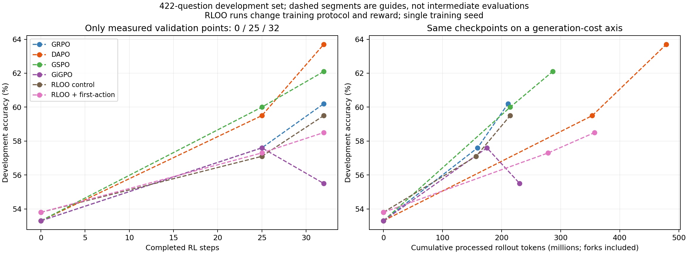
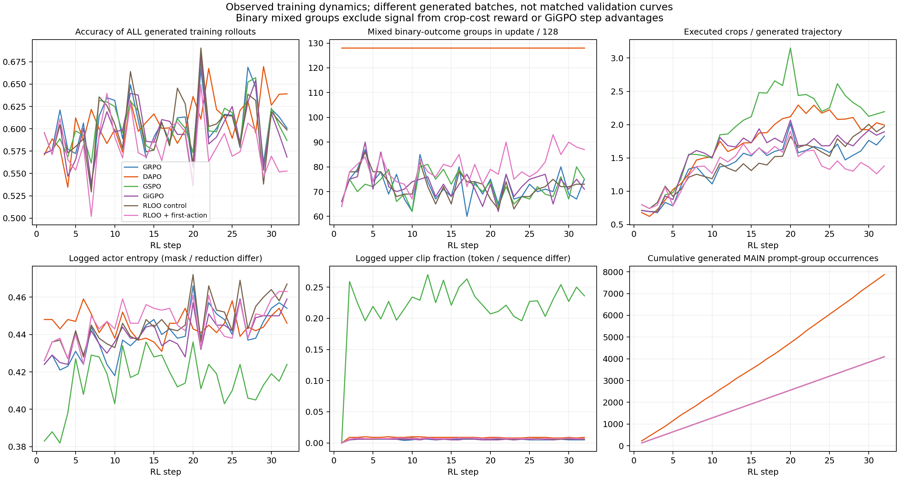

# 六算法：训练阶段、实际配置与预算

2026-10-30更新。当前任务是整理既有证据，供后续Pro建模；没有新增训练、评测或参数选择。读图时区分训练批次准确率、开发验证准确率和E1。

## 阶段与已观测结果

| 阶段 | 实际观测 | 可以说什么 | 不能据此说什么 |
|---|---|---|---|
| 初始化step0 | 前四组开发验证.533；v53两组.538 | 协议/奖励设置不同，初始读数也不同 | RLOO初始模型能力已经更高 |
| step1–24 | 有逐步训练信号、裁图、熵等；没有对应的中间开发验证点 | 描述训练动态及样本组成 | GSPO整个早期持续更好，或某步开始反超 |
| step25 | GSPO .600 > DAPO .595 > GRPO/GiGPO .576；RLOO .571，decision .573 | 这一验证点GSPO读数最高 | 0.5pp已证明算法优势或原因 |
| step32 | DAPO .637 > GSPO .621 > GRPO .602；RLOO .595，decision .585，GiGPO .555 | DAPO在这次末步开发验证最高；与GSPO排名相对step25反转 | 交叉具体时刻、稳定性或归因 |
| 固定末步E1 | DAPO .6635、GSPO .6395、GRPO .6390；其余见结果表 | 已观察到固定checkpoint之间的结果差异 | 将E1接到开发曲线上，或当独立盲测 |

开发验证422题，数值来自舍入日志；只记录0/25/32三个点，图中虚线仅连接观测点。单训练seed；现有数据不能重建中间验证。32步之后的历史续训是另一预算，不接入本图。

## 实际运行组件，而非论文标签

| 本次实验 | advantage | actor loss归约 | clip低/高 | KL | 动态过滤 |
|---|---|---|---|---|---|
| GRPO | 组内标准化 | token | .2/.3 | 关闭 | 无 |
| DAPO | 组内标准化 | token | .2/.28 | 关闭 | .01/.99，保留混合组 |
| GSPO | 组内标准化；序列importance ratio | seq | .0003/.0004 | 关闭 | 无 |
| RLOO control | leave-one-out | token；仍为clipped actor目标 | .2/.3 | 关闭 | 无 |

来源为正式日志配置打印、启动脚本和归约补丁的只读复核。GSPO日志不同配置块同时包含seq/token；actor的seq覆盖不能与其他模块混淆。GiGPO在episode优势之外有step优势，详见[训练信号](TRAINING_SIGNALS.md)。

因此本次GRPO也使用token平均、非对称clip、无KL。RLOO control并非原论文整个REINFORCE训练器的复现；它与GRPO还改变了训练协议（v5.1→v5.2i）及奖励（0/1→Y(1−.01N)）。日志actor/ppo_kl不是对冻结reference施加KL reward的证据。

[DAPO原文](https://arxiv.org/html/2503.14476v1)§2.3、3.1–3.3讨论去KL、clip-higher和token归约；[RLOO原文](https://arxiv.org/html/2402.14740v2)§2的RLHF目标包含KL shaped reward。论文组件不等于本次各组的实跑差异。

## 同32步不等于同投入

| 方法 | 生成主题组次 | 更新Y混合组次 | 更新唯一题 | 生成阶段处理token |
|---|---:|---:|---:|---:|
| GRPO | 4096 | 2309 | 4096 | 210875246 |
| DAPO | 7872 | 4096 | 2648 | 478822888 |
| GSPO | 4096 | 2308 | 4096 | 286498622 |
| GiGPO | 4096 | 2333 | 4096 | 230552365 |
| RLOO control | 4096 | 2308 | 4096 | 214449299 |
| RLOO首动作监督 | 4096 | 2544 | 4096 | 357279357（含额外fork） |

每组更新题组总数均4096。混合按二元结果Y定义，不覆盖GiGPO过程信号或RLOO成本奖励产生的额外差异。DAPO主生成题组次为GRPO约1.92倍，处理token约2.27倍。token统计含生成时反复处理的上下文；不含actor反向等完整训练FLOPs，也不等于实际GPU核时。横轴重画没有制造新的同预算checkpoint，不能靠虚线插值宣称同成本胜出。

DAPO筛前7872组中全对2573、混合4350、全错949；进入更新的混合组为4096。全错949中102组含非answer终态，剩余组仍不能仅凭answer终态认定协议全部合法。GRPO全错489/4096=11.94%，全对1298/4096=31.69%。**不能把所有零结果优势组都称为全错组。**

## 固定E1的差异

DAPO相对GRPO净多54/2208条正确，+2.45pp；按552题各4次答对数计，128题增加、92题减少、332题不变。既有按题bootstrap区间[+0.45,+4.35]pp仅条件于当前checkpoint和采样，不包含训练seed不确定性。GSPO净多1条；RLOO control净少16条。详见[同题统计](PAIRED_RESULTS.md)。

## 逐步训练诊断

训练准确率为各自全部生成轨迹（DAPO包含筛前数据），不是同题验证；混合组为最终更新批次。GSPO clip统计基于序列比率，其他组基于token比率，数值不能当作相同事件率比较。熵的mask/归约也有差异，不能仅凭较低熵认定探索坍缩。

可下载[验证图PDF](../figures/validation_curves.pdf)、[诊断图PDF](../figures/training_diagnostics.pdf)。聚合数据：[192行逐步CSV](../data/algorithm_curves/curves.csv)、[验证与成本](../data/algorithm_curves/summary.json)、[生成组构成](../data/algorithm_curves/generated_group_composition.json)。原始私有输入身份见[来源hash](../provenance/CURVE_AUDIT.json)；从公开聚合重画见[脚本](../scripts/plot_algorithm_curves.py)。
