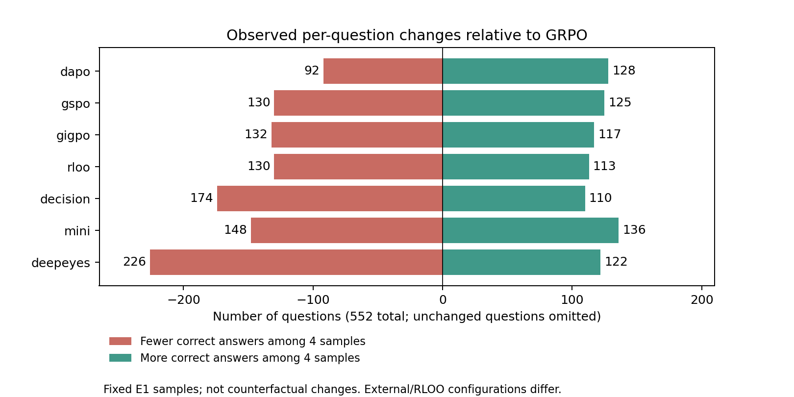

# 固定E1同题得失复算

本次仅CPU重聚合已发布轨迹，未新增模型评测、训练、逐图审查或修改评分。输入SHA见paired/results.json，便携复算脚本见../scripts/recompute_pairs.py。原96条逐图记录仍为独立的定向样本。

以552题各4次采样答对数比较；增加/减少是观测样本计数变化，不是已证明的能力获得/遗忘。同sample_idx仅对齐记录，不保证模型间相同随机过程。

| 对照→方法 | 题目答对次数增加 | 减少 | 不变 | 对齐条目错→对 / 对→错 | 净准确率差(pp) |
|---|---:|---:|---:|---:|---:|
| sft→grpo | 189 | 96 | 267 | 369 / 210 | +7.20 |
| sft→dapo | 210 | 81 | 261 | 412 / 199 | +9.65 |
| sft→gspo | 190 | 102 | 260 | 394 / 234 | +7.25 |
| sft→gigpo | 181 | 117 | 254 | 362 / 243 | +5.39 |
| sft→rloo | 185 | 107 | 260 | 369 / 226 | +6.48 |
| sft→decision | 161 | 137 | 254 | 329 / 274 | +2.49 |
| grpo→dapo | 128 | 92 | 332 | 267 / 213 | +2.45 |
| grpo→gspo | 125 | 130 | 297 | 253 / 252 | +0.05 |
| grpo→gigpo | 117 | 132 | 303 | 260 / 300 | -1.81 |
| grpo→rloo | 113 | 130 | 309 | 244 / 260 | -0.72 |
| grpo→decision | 110 | 174 | 268 | 234 / 338 | -4.71 |
| grpo→mini | 136 | 148 | 268 | 307 / 306 | +0.05 |
| grpo→deepeyes | 122 | 226 | 204 | 266 / 443 | -8.02 |
| rloo→decision | 112 | 168 | 272 | 233 / 321 | -3.99 |
| dapo→mini | 120 | 148 | 284 | 259 / 312 | -2.40 |
| base_cot→sft | 180 | 155 | 217 | 425 / 325 | +4.53 |
| base_zoom→sft | 150 | 165 | 237 | 308 / 356 | -2.17 |

逐题列表：paired/question_deltas.csv；分源正确数和分母：paired/source_deltas.csv。paired/results.json另含固定checkpoint下按题bootstrap区间（5000次；探索性、未多重校正、不覆盖训练seed波动）。

| 方法 | 正确条数/2208 | 4次全错题/552 | 4次全对题/552 |
|---|---:|---:|---:|
| base_cot | 1152 | 181 | 220 |
| base_zoom | 1300 | 128 | 228 |
| sft | 1252 | 97 | 176 |
| grpo | 1411 | 84 | 235 |
| dapo | 1465 | 86 | 256 |
| gspo | 1412 | 87 | 233 |
| gigpo | 1371 | 79 | 214 |
| rloo | 1395 | 89 | 225 |
| decision | 1307 | 94 | 191 |
| mini | 1412 | 125 | 277 |
| deepeyes | 1234 | 137 | 163 |

八方法（不含SFT/Base）共同4次全错共16题，题号见paired/results.json。4次采样不是能力上限或真实pass概率。

## 已审查样本的对应事实

- mme_1231/sample2：GRPO/DAPO/GiGPO/RLOO/decision选不存在，与GT一致；GSPO、Mini-o3、DeepEyes均给停车状态且错。小远车颜色仍未穷尽验证；不存在选项是本题有效答案，不是拒答。
- test_Manage_234/sample1：RLOO终答E正确但引用crop与阈值量不对应；DAPO截断，GSPO UNCLEAR，其他本地组错。Mini-o3截断，DeepEyes错。不能把正确选项当过程正确。
- test_Music_299/sample3：八模型终答均错，已有图像记录包含符号误读/裁切不全/文字与选项不一致；音乐理论未独立专家验证。
- 这些来自上游BATCH04/BATCH07及external/CASES（已整合到本库observations/cases），与全量得失统计分开；本次没有新增视觉审查或外推失败频率。

## 训练记录

paired/training_signals.json复算各32步更新ledger；RLOO从completion_counts.json的32步记录汇总。binary_groups基于Y，不等于成本奖励R的方差。GRPO/DAPO等的adv_nonzero_token_share按step取平均，不是总token加权。

## 可比性与缺测

- SFT→本地RL为同E1 caption接口；RLOO与GRPO训练奖励/协议不同，不能单归因advantage归一化。
- 原模型CoT/原生zoom→SFT caption同时改变接口，不能当纯SFT效果。
- Mini-o3/DeepEyes为各自原生工具接口加E1预算适配；不是完整官方协议复现，也不是同底座/视觉预算。
- 没有全库错误类型参考标签、独立必要观察标签或区域标签，不能发布各失败类型precision/recall或声称某算法普遍消除某类错误。
- E1非盲测；训练advantage与评测轨迹不一一对应，不从评测错答推断梯度。

