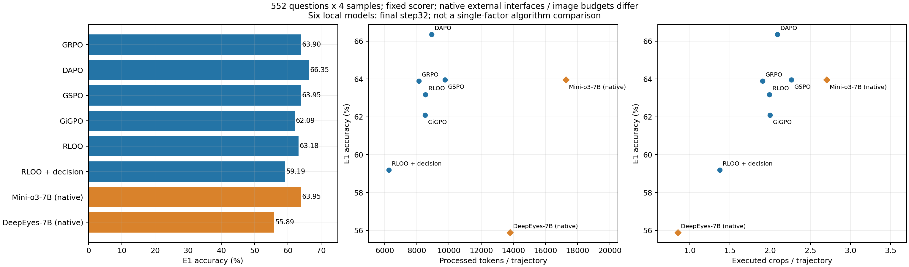
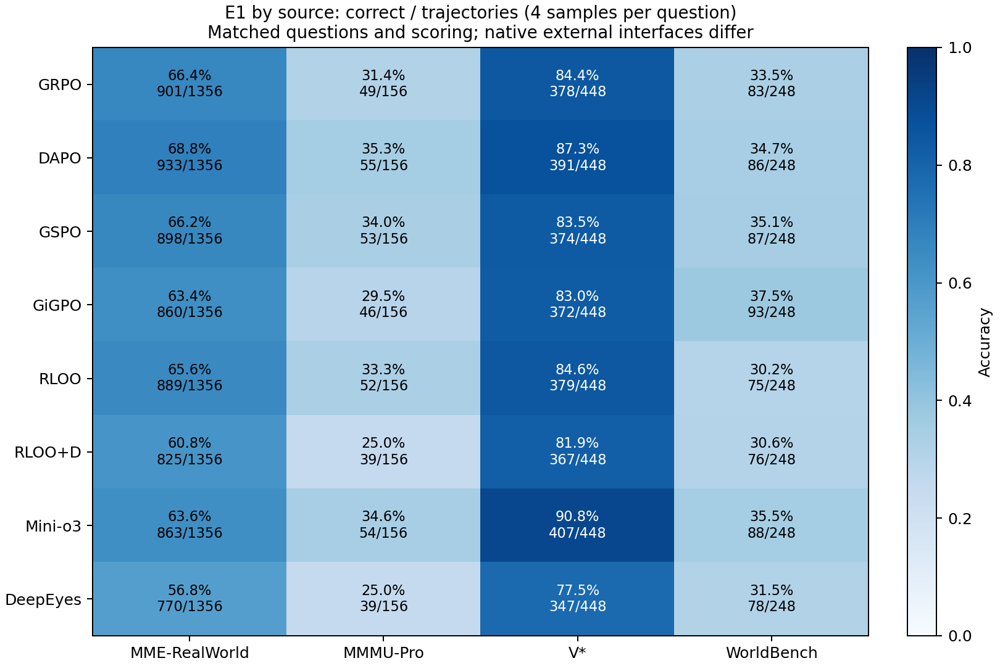
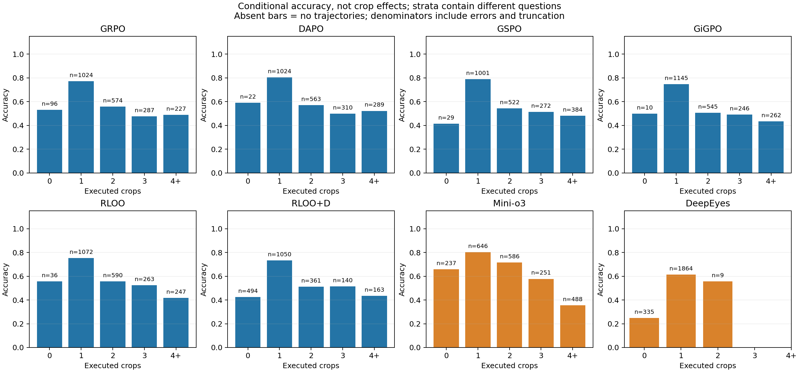
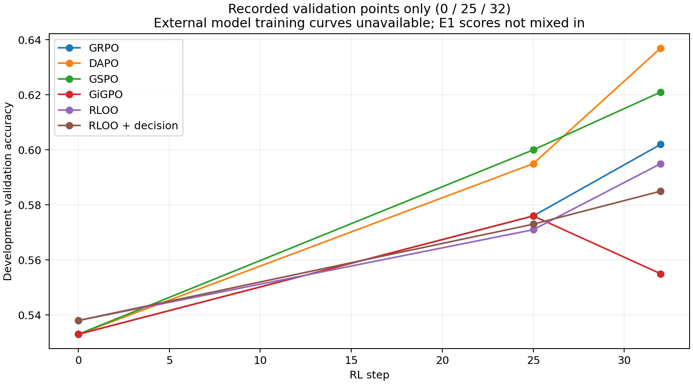

# 当前结果

**主实验 [G1 (R-read)](g1_rread_20261103/RESULTS.zh.md)（2026-11-03）**：E1 .6395 vs G0 .6390 持平；训练池同题读取一致性 .5518→.6911（配对 +0.139，750↑/140↓）但未转化到端到端——落在冻结协议「读取改善未转化」行；去选项内容变化测试未跑。主图 `g1_main.png`，全家福曲线（vs DAPO/DTPO/GSPO/GIGPO/GRPO）`family_curves.png`。附属：因果 SFT+GRPO 对照 .6033（起点 .4543，SFT 差距 11.3pp 被 RL 收窄至 3.6pp，该线已停，见 [bsftc_grpo_20261103](bsftc_grpo_20261103/RESULTS.zh.md)）。

前置准入 [R-read 离线准入（2026-11-03）](rread_admission_20261103/RESULTS.zh.md)——评分器 16/16 反例通过、2,048 条真实轨迹双路径零偏差、有效读取差异率 0.509 ≫ 10% 准入线。

其余新增入口：[三类基础baseline：Base / A-SFT / outcome-only GRPO](baseline_classes_20261031/REPORT.md)。原先的八方法表保留为历史算法对照；不再代替第一、二类展示。

事实快照；本次没有新增GPU评测。每方法2208条，失败保留分母。上游已发布25条件均快照到data/rollouts；完整目录见 [catalog](CONDITIONS.md)。

| 方法 | E1 | 裁图/条 | 总处理token/条 | 生成token/条 |
|---|---:|---:|---:|---:|
| grpo | 0.6390 | 1.905 | 8125.4 | 261.2 |
| dapo | 0.6635 | 2.092 | 8929.8 | 287.0 |
| gspo | 0.6395 | 2.263 | 9756.2 | 277.8 |
| gigpo | 0.6209 | 1.998 | 8506.3 | 275.3 |
| rloo | 0.6318 | 1.992 | 8535.4 | 278.0 |
| rloo_decision | 0.5919 | 1.372 | 6266.1 | 203.3 |
| minio3 | 0.6395 | 2.703 | 17279.8 | 679.7 |
| deepeyes | 0.5589 | 0.852 | 13799.6 | 3291.5 |

相同总分可能来自不同题目，见 [同题得失](PAIRED_RESULTS.md)。条件裁图数下的题目组成不同，不能把层间准确率解释成多裁一次的因果收益。没有参考状态/区域标签，暂不报告“必要观察”或“有效裁图”的precision/recall；pass@4也不是区域召回率。

## 图表与数据

每张图有同名PDF。数据在data/summary_eight.json、data/strata.csv、data/validation_points.json和data/training_summary.json。GSPO step25 .600>DAPO .595；step32 .621<.637；这里只能记录已观测点的交叉，不能定位具体反超时刻或原因。

## v53结果与预算

control墙钟9h42m09，decision11h32m34；主rollout各32768条。decision额外分叉32744条，成本单列。开发验证末步 .595/.585是422题开发结果，不能与E1 .6318/.5919混用。

E1 decision少裁图、少token同时掉分；协议标记390/2208，其中160条仍按E1答对。标记不是评分器自动判错，不能将分差直接归给协议。外部模型caption标记必须N/A，不能填0。
