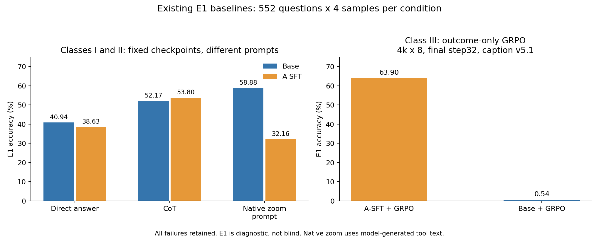

# 三类基础 baseline：已有结果重新展示

> 2026-11-01新增对照：SFT Native Zoom坐标归一化后44.88%，进一步取消8192累计生成上限仍44.88%。[新结果与轨迹](../native_zoom_normalized_20261031/REPORT.md)。下表32.16%继续保留为原协议历史结果。

更新：2026-10-31，America/New_York。本页复用已经完成的评测，没有新跑模型。每个条件 **552题 × 4次采样 = 2,208条**，同题键、GT和来源已重新核对；失败和截断保留在分母。E1是开发诊断集，不是独立盲测。

## 第一类：原始 Base model

Base为Qwen3-VL-4B-Instruct。直接作答、CoT和原生工具提示分别列出，不再只展示RL方法。

| 推理方式 | 条件ID | 正确 / 全部 | E1准确率 |
|---|---|---:|---:|
| Direct answer | B0-ans | 904 / 2208 | **40.94%** |
| CoT，无工具 | B0 | 1152 / 2208 | **52.17%** |
| 模型原生zoom工具提示 | B1 | 1300 / 2208 | **58.88%** |

## 第二类：Base model + SFT，重复上述三种提示

这里的SFT是同一个A-SFT模型：caption轨迹SFT，3,983题、6,953监督轮、2 epoch。不是重新训练三个SFT模型，也不是答案式SFT（H1）。

| 推理方式 | 条件ID | 正确 / 全部 | E1准确率 |
|---|---|---:|---:|
| Direct answer | B3-ans | 853 / 2208 | **38.63%** |
| CoT，无工具 | B3-cot | 1188 / 2208 | **53.80%** |
| 模型原生zoom工具提示 | B3-zoom | 710 / 2208 | **32.16%** |

补充保留SFT原训练接口：A-SFT + caption提示（B3）为1252/2208，**56.70%**；原模型直接套caption提示（B2）为15/2208，**0.68%**。这两行与原生zoom提示是不同接口，不能混为一行。

## 第三类：标准GRPO，outcome-only reward

奖励为答对1、答错0；没有crop成本项、局部信用辅助损失或新增Reward Shaping。主展示选现有4k×8、最终32步的两组，评测均为caption v5.1。

| 初始化与训练 | 条件ID | 预算 / 评测接口 | 正确 / 全部 | E1准确率 |
|---|---|---|---:|---:|
| Base + A-SFT + 标准GRPO | K-GRPO | 4k×8，step32 / caption | 1411 / 2208 | **63.90%** |
| Base + 标准GRPO | K-base | 4k×8，step32 / caption | 12 / 2208 | **0.54%** |

已有其他预算/接口的结果也保留，不能用它们替换上面同预算的行：

| 历史条件 | 条件ID | 预算 / 评测接口 | 正确 / 全部 | E1准确率 |
|---|---|---|---:|---:|
| Base + A-SFT + 标准GRPO | B4 | 6k×16，step47 / caption | 1458 / 2208 | 66.03% |
| Base + 标准GRPO | B5 | 6k×16，step47 / caption | 17 / 2208 | 0.77% |
| Base + 标准GRPO，无工具 | B6 | 6k×16，step47 / 无工具 | 1316 / 2208 | 59.60% |

**Base + GRPO不能只写一个无接口说明的分数。** 0.54%对应caption接口，59.60%对应历史无工具条件，两者预算与接口不同。这里只记录结果，不补写掉分原因。

## 原生工具提示到底如何执行

历史runner的`answer`模式只要求直接给出选项；名为`direct`的旧模式实际带“Think step by step”提示，因此本页明确称CoT，避免被文件名误导。

原生工具行使用Qwen的`image_zoom_in_tool`：工具schema经过模型自己的chat template序列化，模型生成`<tool_call>`文本，本地runner解析文本、执行crop、返回图像，再让模型继续生成。**没有通过API的function-calling接口发起调用**。模板里的schema仍采用`type: function`表示；因此不能把这份历史配置描述为“完全不含工具schema的普通文本提示”。本次没有改工具协议，也没有重跑。

第一、二类共享同题、采样设置和各自对应提示。工具和无工具的输入历史与实际成本不同。三类baseline的计分使用既有统一评分规则，缺失答案/失败/截断均保留；分数不是只在格式成功子集计算。

## 可直接复查的数据

- [汇总与token/裁图/截断成本](summary.csv)
- [四数据集分数及精确分母](by_source.csv)：MME-RealWorld、MMMU-Pro、V*、WorldBench
- [输入SHA与核验范围](PROVENANCE.json)
- [全部历史条件及公开模型轨迹](../CONDITIONS.md)
- [CPU汇总与作图脚本](../../scripts/build_baseline_classes.py)；重新运行不会推理或训练模型。
- [历史runner与提示](https://github.com/CrepuscularIRIS/vlm-caption-trajectories/blob/ad152debe1d954a3d58cbd19496c018fa62f4e32/pipeline/eval/baselines/eval_base.py)
- [标准GRPO原配置及完整历史表](https://github.com/CrepuscularIRIS/vlm-caption-trajectories/blob/ad152debe1d954a3d58cbd19496c018fa62f4e32/docs/01_overview.md)

## 当前研究安排

用户已取消DAPO-LOO两组继续训练：L0完整24步、L01完整28步时停止，已保存checkpoint分别为step20/25；这不是最终32步完成结果，没有启动这两组E1。监控已暂停，原始日志和保存文件保留。

下一阶段转向Reward部分。研究者预期Reward设计可能带来较大提升；这是下一阶段的预期，本页尚无新Reward实验结果，也没有自动派发新的训练。
