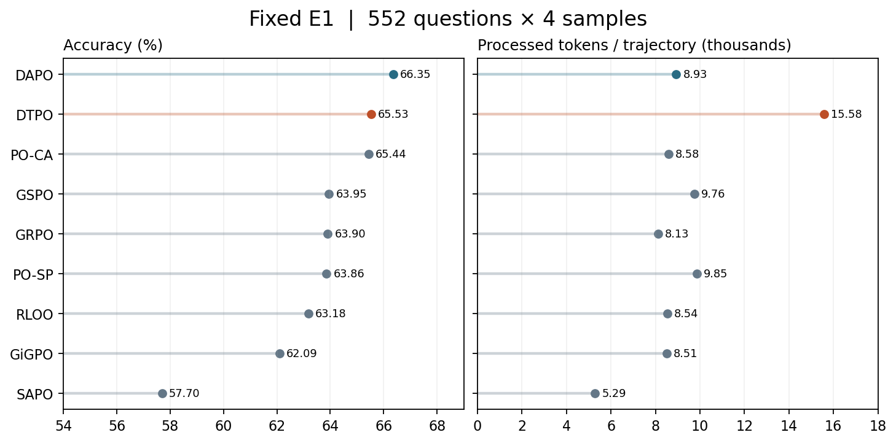
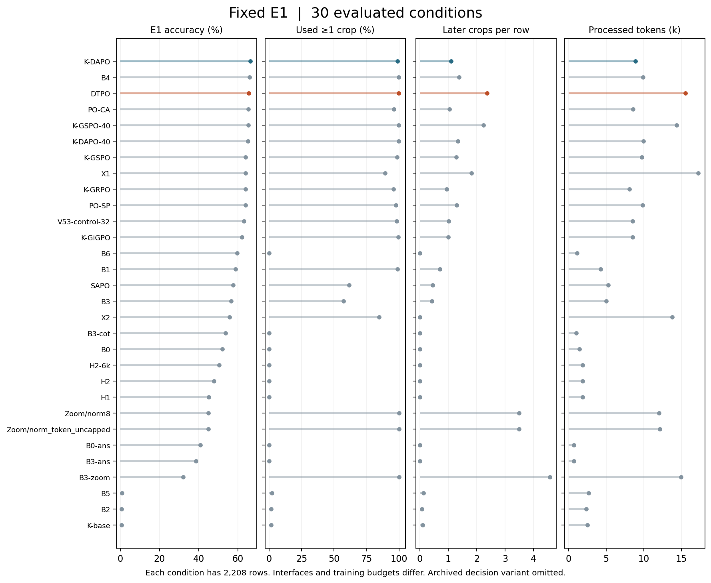
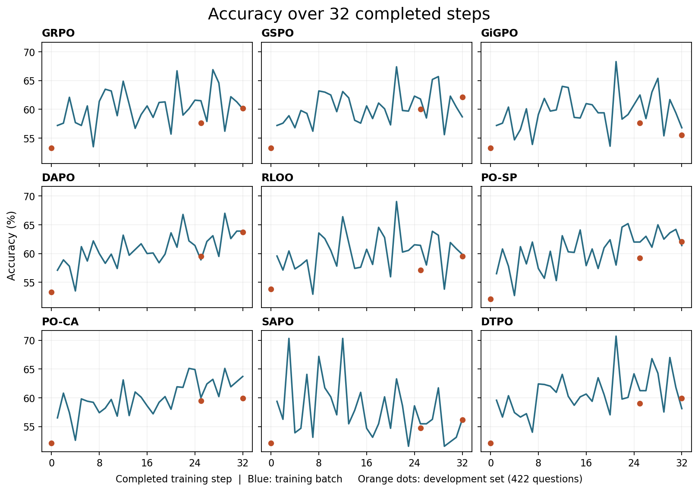
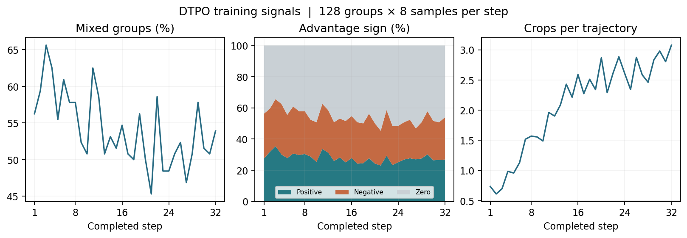
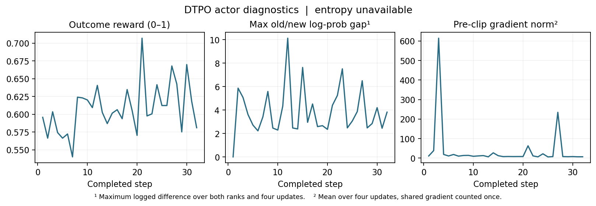

# DTPO 最终 32 步 · E1 与训练记录

## 1．本轮设置

从 Qwen3-VL-4B 的 A-SFT 权重开始，沿用 Caption v5.1、4,096 道训练题、终答 0/1 奖励与最多 8 次裁图。每步 128 题 × 8 条轨迹，每 32 个题组更新一次 actor。DTPO 将非最终助手回合合为中间段、最后助手回合作为最终段，两段各按有效 token 数归一化，损失为 0.5 × 中间段 + 最终段。clip 0.2/0.24，无动态过滤或裁图 judge。这是现有协议下的分段损失实验。正式训练 exit 0，step 32 的两 rank 各有 128 个有限更新事件，tracker 和七个恢复文件齐备。

## 2．定量结果与两道同题案例

**DTPO 1,447/2,208（65.53%），DAPO 1,465/2,208（66.35%）。** 同键比较，两者都答对 1,222 条；仅 DTPO 对 225 条，仅 DAPO 对 243 条，都答错 518 条。DTPO 每条平均执行 3.36 次裁图、处理 15,579 个 token；DAPO 为 2.09 次、8,930 个 token。池、协议、评测脚本哈希与采样设置匹配，错误与截断均保留分母。E1 与开发集有重叠，等步数下各方法的实际计算量不同。[配对原表](paired.csv) · [固定条件成本表](fixed_e1.csv)

| 来源 | DTPO | DAPO | 净增正确条数 |
|---|---:|---:|---:|
| MME-RealWorld | 922/1,356 | 933/1,356 | −11 |
| MMMU-Pro | 50/156 | 55/156 | −5 |
| V* | 387/448 | 391/448 | −4 |
| WorldBench | 88/248 | 86/248 | +2 |

此前记录称 DTPO 的 V* 得分最高。逐条复算结果为 DTPO 86.38%、DAPO 87.28%，此处已更正。总分和原始评分结果未变。

在 V* 的新增／失去两层中，各选按题键与采样序号排序的第一条。已读原图、逐轮原文、四条轨迹的所有裁图，关键细节回到实际呈现大小核对。两例用于描述分歧，不估计出现频率。

- **相对位置，DTPO 得一条。** DTPO 的首裁同时包含长椅边的参照人物和右方推车。第二裁转到树丛，模型指出目标缺失，第三裁回到两者并答对。DAPO 一次紧裁留下桥上的另一人和推车，把桥上人当作参照后答错。
- **颜色辨认，DTPO 失一条。** DTPO 七号视图中岸上的环可见红白两色，第八裁转到水面，最终输出 UNCLEAR，按原规则计错。DAPO 一次裁到水中的橙色浮标，原文先说看不到白色标记，随后选择红白，选项计对；它引用的这张图不足以支持两个颜色。

总览含基础模型、A-SFT、原生工具、RL、外部及历史预算条件，旧 decision 条件仍留在档案。首裁为每条至少有一次裁图的比例，后续为每条超出首次的裁图数；重复历史和图像输入计入处理 token。缩写与接口见[条件目录](../CONDITIONS.md)，[总图数据](all_conditions.csv)。

## 3．训练 log 与曲线

DTPO 开发验证只在 0、25、32 步观测，约为 52.1%、59.0%、59.95%。图中蓝线是各步实际训练批的终答准确率，橙点是 422 题开发验证。各方法样本供给和奖励定义不同；DTPO 的原始终答奖励与 Y 数值相同。试验未记录策略分布熵，entropy 留作缺测。下图的 diff 明确定义为本步各 rank、各 mini-update 已记的 old/new log-prob 最大绝对差，不能代替策略熵或 KL。

重画：在本目录用 Python 与 matplotlib 执行 `python plot.py`。脚本从公开表读取；[训练／验证点](training_points.csv)、[逐步信号](dtpo_signals.csv)、[reward 与更新诊断](diagnostics.csv)、[评分摘要](summary_dtpo32.json)、[脱敏 header](header_dtpo32.json)、[输入指纹](AGGREGATE_SOURCES.json)。[训练图 PDF](training_curves.pdf) · [全条件图 PDF](all_conditions.pdf)。原始 DTPO 轨迹整文件 SHA 与云端对齐。此实例的逐图结论限于上述两题。
