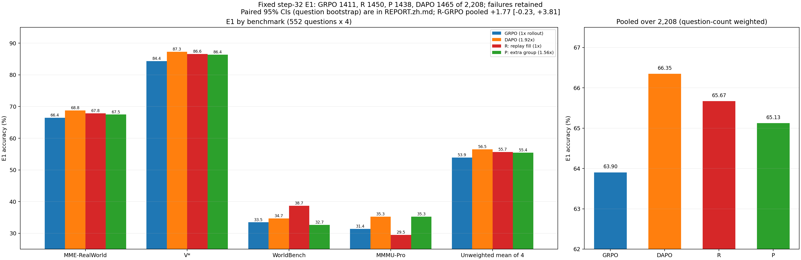
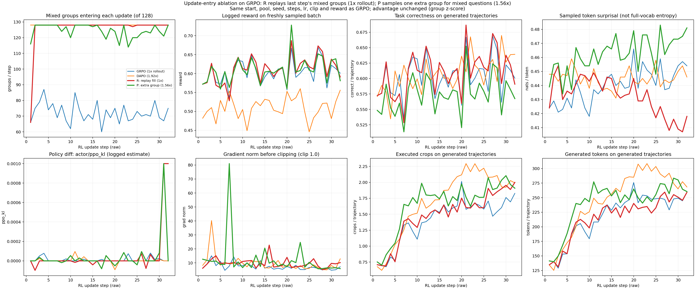

# 进入更新拆解：R（回放补满）与 P（混合题追加一组），32 步报告

## 1. 设定

无 SFT 改动。起点 A-SFT Qwen3-VL-4B；rl4k 4,096 题单遍，n=8，32 步，每步 128 题、actor mini-batch 32 组（每步 4 次更新），lr 1e-6，max_grad_norm 1.0，clip .2/.3，无 KL，seed 42，奖励 V·Y，advantage = 组内 z-score（样本 std）。与 k8 GRPO 同一启动器（grpo_v52m_c，code_sha 510a0110e43a8a0e），只多一个文件 `entry_patches.py`（替换 `_make_batch_data`），运行 code_sha ab0c68cdadbb03a0。

| 组 | 唯一变量（只改“哪些组进入更新”） |
|---|---|
| R：回放补满 | 每步把本步全对/全错组替换为上一步的混合组（年龄 1、每组最多回放一次）；回放组随本步重算 old log prob，奖励与 advantage 按原组重算。每步仍 128 组 |
| P：混合题追加一组 | 第一轮 128 题 × 8 条后，对第一轮混合的题再独立采 8 条（新 uid、各自 z-score）；第一轮混合组 + 第二轮混合组截到 128，不足用零优势组补齐 |

设计与预登记判读见 [DESIGN.zh.md](DESIGN.zh.md)。冒烟：R 2 步 exit 0；P 首次冒烟因追加题数（73）不能被 2 卡整除失败，加 pad/unpad 后 exit 0。正式训练前两步 R 的 128 组 rollout（是否答对、裁图数、生成 token）与 k8 GRPO 逐组相同。

| | GRPO | R | P | DAPO |
|---|---:|---:|---:|---:|
| 每步进入更新的混合组（32 步均值） | 72.2 | 126.0 | 124.4 | 128 |
| 生成轨迹 | 32,768 | 32,768 | 51,176（1.56×） | 62,976（1.92×） |
| 32 步 step 计时合计 | 24,411 s | 24,861 s（1.02×） | 31,584 s（1.29×） | 40,364 s（1.65×） |

R、P 同机并行（GPU 0,1 / 2,3）；k8 GRPO 与 DAPO 当时也同机并行。训练退出码 0、32 次更新、step32 七个恢复文件；合并 exit 0；E1 exit 0，2,208 唯一键、552 题各 4、与 GRPO 同键同 GT/source、error 0。

## 2. 定性 + 定量

E1：step 32，552 题 × 4，temperature .7，统一评分器，失败留分母。两种口径：按题数合并（MME-RealWorld 占 61%），四个 benchmark 不加权平均（导师 11-05）。

| 方法 | rollout | 合并（/2,208） | 不加权平均 | MME-RW | V\* | WorldBench | MMMU-Pro | 首裁 | 后续裁图 | 处理 token / 条 |
|---|---:|---:|---:|---:|---:|---:|---:|---:|---:|---:|
| GRPO | 1× | 63.90（1411） | 53.92 | 66.4 | 84.4 | 33.5 | 31.4 | .9565 | .9488 | 8,125 |
| **R** | **1×** | **65.67（1450）** | **55.66** | 67.8 | 86.6 | **38.7** | 29.5 | .9891 | 1.1716 | 9,100 |
| P | 1.56× | 65.13（1438） | 55.44 | 67.5 | 86.4 | 32.7 | **35.3** | .9851 | .9416 | 8,136 |
| DAPO | 1.92× | **66.35（1465）** | **56.50** | **68.8** | **87.3** | 34.7 | **35.3** | .9900 | 1.1024 | 8,930 |

粗体 = 该列四个条件中最高（准确率列）。配对差（百分点，按题 bootstrap 10,000 次，seed 20261105；不加权口径在来源内分层重采样）：

| | 合并 | 不加权 |
|---|---|---|
| R − GRPO | +1.77 [−0.23, +3.81] | +1.74 [−0.97, +4.36] |
| P − GRPO | +1.22 [−0.77, +3.31] | +1.52 [−1.51, +4.48] |
| P − R | −0.54 [−2.45, +1.40] | −0.22 [−3.16, +2.85] |
| R − DAPO | −0.68 [−2.72, +1.27] | −0.84 [−3.79, +2.06] |
| P − DAPO | −1.22 [−3.22, +0.77] | −1.06 [−3.89, +1.80] |

R 合并配对四格（对 GRPO）：共同对 1172、仅 R 对 278、仅 GRPO 对 239、共同错 519。

按预登记判读表：R 与 P 都高于 GRPO 且与 DAPO 未分辨；R（1×）不低于 P（1.56×），P − R 区间含 0。本轮未做案例逐图审查（R/P 与 GRPO 相同协议与奖励，改动不涉及单条轨迹的内容）。

dev（训练验证集 val_nosft，不是 E1）：R .569（25）/ .583（32）；P .595 / .590；GRPO .576 / .602；DAPO .595 / .637。R 的 dev 低于 GRPO 而 E1 高于 GRPO。

## 3. 训练 Log

第 25–32 步均值：

| | 进入更新的混合组 | reward | 训练正确率 | 采样 surprisal | 裁剪前 grad norm | 裁图 / 条 | 生成 token / 条 |
|---|---:|---:|---:|---:|---:|---:|---:|
| GRPO | 71.9 | .613 | .613 | .448 | 5.99 | 1.65 | 247 |
| R | 128.0 | .626 | .626 | .415 | 8.84 | 1.86 | 250 |
| P | 123.9 | .618 | .584 | .471 | 6.91 | 1.96 | 268 |
| DAPO | 128 | .504 | .626 | .447 | 7.34 | 2.04 | 282 |

- reward 取日志 `reward/overall`（本步新采样）；P 的训练正确率、裁图、生成 token 含追加组（追加组只来自已混合的题）。DAPO reward 只含保留组。
- R、P 训练账本的 `step` 字段是奖励调用序号：R 每步 1 次，P 每步 2 次（第一轮、追加组），长表已映射回训练步。
- 采样 surprisal 是 T=.7 下采样 token 的值，不是全词表熵。R 第 25–32 步低于 GRPO（.415 vs .448），P 高于 GRPO（.471）。
- ppo_kl：R、P 第 31–32 步日志打印为 0.001（打印精度 3 位）；其余步在 ±1e-4。P 第 7 步裁剪前 grad norm 81。
- 训练生成 token：R 7,092,555、P 12,288,335；处理 token：R 214,906,839、P 373,294,234。

数据：`family_long.csv`（含 R、P 各 323 行）；`e1_by_bench_RP.json`（聚合）；复画 `build_publication.py`；进入规则 `entry_patches.py`。
