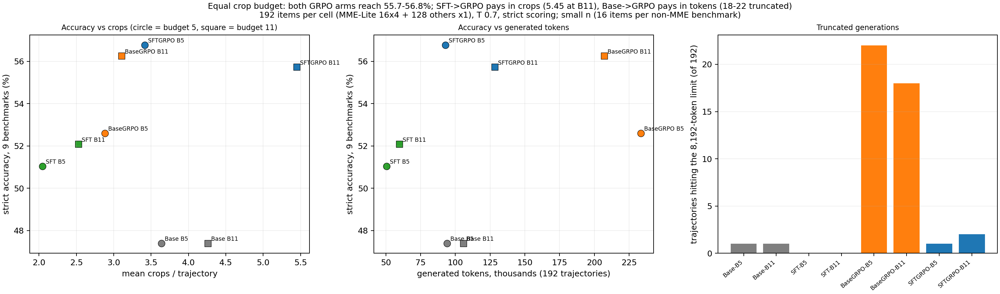
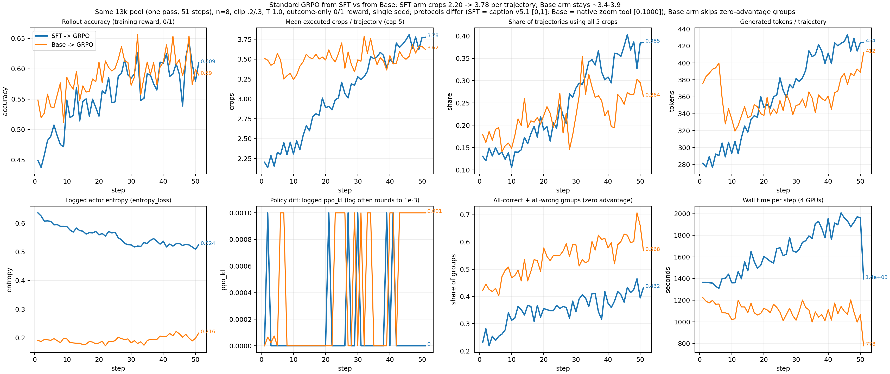

# formal_v1 标准 GRPO 两臂（SFT 起点 / Base 起点）与问题诊断（2026-11-14）

学生模型 Qwen3-VL-4B-Instruct。本页记录：数据与 SFT、两臂标准 GRPO 的设定与结果、等裁图预算评测、轨迹拆解，以及工具定位诊断。只写事实与没弄清的问题；单 seed，评测题少（非 MME 的每个 benchmark 16 题，一题 = 6.25 pp），按题区间都附上。题面、原图与机器路径不在本仓库。

## 0. 一页摘要

| 项 | 内容 |
|---|---|
| 结果 | 等预算（≤11 次裁图）9 项合计：Base 47.40%、SFT 52.08%、Base→GRPO **56.25%**、SFT→GRPO 55.73%；Base→GRPO 相对 Base +8.85 pp [+2.49, +15.85]，SFT→GRPO 相对 SFT +3.65 pp [−3.96, +11.67] |
| 代价 | SFT→GRPO 多裁图（平均 2.53 → 5.45）；Base→GRPO 多 token（18–22 / 192 条文字循环写到 8,192 上限，全部答错） |
| GRPO 后的主要错误 | 冗余裁图 > 裁偏 ≈ 取证后读错 / 绑错 > 恢复失败 > 整图未探索 |
| 冗余的一个来源 | SFT 系在**放大图里已经看到目标后，回原图定位**时命中率掉一半（SFT 83.7% → 39.9%，SFT→GRPO 90.3% → 66.3%）；Base 系不掉（93–94%） |
| 与 SFT 的关系 | 被测 SFT 语料（fv2prim）4,105 条轨迹中 1,774 条有第 2 张裁图；第 2 张以后在原图给框的 3,631 次中，668 次（18.4%）完全落在上一张范围内；[0,1] 坐标格式另解释约 8–11 pp（2026-11-16 更正，见文末） |

## 1. 数据与 SFT

**SFT 语料**：fv2prim，4,105 条轨迹 / 11,132 个监督轮次，全部来自 MME-RealWorld（去评测图，按图与 RL 池划分），DeepSeek 教师 + 结构化 hint 生成；formal_v1 呈现（原图与裁图都从原图切，面积 [65,536, 2M]，32 对齐），协议 caption v5.1：每轮 `<think>Step N | WORD …</think>` 后接 `<grounding>{"bbox_2d":[x1,y1,x2,y2],"source":VIEW}</grounding>`（[0,1] 坐标，相对所选视图）或 `<answer>`。全量微调语言模型，冻结视觉塔，2 轮。本页无 SFT 改动。

SFT 语料第 2 张及以后的裁图（按语料 MANIFEST 中的像素框统计，共 7,027 次裁图）：

| | 数量 |
|---|---|
| 有第 2 张裁图的轨迹 | 1,774 / 4,105（43%） |
| 第 2 张以后的裁图 | 4,402：原图 3,631（82.5%）、某张裁图内 771（17.5%） |
| 原图上给框时相对上一张：在上一张范围内 / 部分相交 / 不相交 | 668（18.4%）/ 1,554（42.8%）/ 1,409（38.8%）；面积比中位数 0.69 |

**RL 数据池 v2**：13,000 题，ZwZ2 9,100（带彩框的多区域证据题，可从图上恢复彩框坐标，7,663 题可用）、MME-RealWorld 2,000、VisualProbe 1,900（后两者无区域框）。

## 2. 两臂标准 GRPO 的设定

| 项 | SFT → GRPO | Base → GRPO |
|---|---|---|
| 起点 | 上述 SFT | Qwen3-VL-4B-Instruct |
| 工具协议 | caption v5.1，[0,1] 坐标 | Qwen 原生 `image_zoom_in_tool`，[0,1000] 整数 |
| 算法 | 标准 GRPO：结果奖励 0/1（规则判分），无动态采样，clip .2 / .3，seq loss，无 KL、无 entropy | 同左 |
| 规模 | n = 8，256 组 / step，actor mini-batch 32 组，T 1.0，lr 1e-6，13k 过一遍 = 51 步，单 seed | 同左（同一批题） |
| 轮次 | 训练 ≤5 次裁图 + 作答，单轮 ≤640 token；超轮、截断、无答案的轨迹不进更新 | 同左 |
| 零优势组 | 不跳算 | 跳算（数学等价；单 mini-batch 参数差 2.03e-6） |
| 耗时（4 × RTX PRO 6000） | 23 h 22 m | 15 h 32 m |

两臂之间不是单变量对照：起点、协议、零优势跳算同时不同。

## 3. 结果

### 3.1 等裁图预算评测

144 题（9 个 benchmark × 16 题），MME-Lite 每题 4 次、其他每题 1 次，每格 192 条，T 0.7，strict 判分；B5 = ≤5 次裁图，B11 = ≤11 次；评测单轮上限 8,192 token。7 项 = 去掉 MMMU-Pro 与 WorldBench（这两个 benchmark 审查中有 gold 存疑的题，待重评）。

| 模型 | 9 项 B5 | 9 项 B11 | 7 项 B5 | 7 项 B11 |
|---|---:|---:|---:|---:|
| Base | 47.40 | 47.40 | 50.62 | 49.38 |
| SFT | 51.04 | 52.08 | 57.50 | 57.50 |
| Base → GRPO | 52.60 | **56.25** | 58.13 | 60.00 |
| SFT → GRPO | **56.77** | 55.73 | **63.12** | 61.88 |

配对（同题同采样，按题 bootstrap 95% 区间，9 项）：

| 对比 | B5 | B11 |
|---|---|---|
| Base → GRPO 相对 Base | +5.21 [−2.65, +13.44] | +8.85 [+2.49, +15.85] |
| SFT → GRPO 相对 SFT | +5.73 [−0.51, +12.17] | +3.65 [−3.96, +11.67] |
| Base → GRPO 相对 SFT → GRPO | −4.17 [−12.37, +3.70] | +0.52 [−8.21, +9.04] |

| 格 | 平均裁图 | 用满预算 | 生成 token（192 条） | 截断（8,192） |
|---|---:|---:|---:|---:|
| Base B11 | 4.26 | 13 | 105,656 | 1 |
| SFT B11 | 2.53 | 3 | 59,585 | 0 |
| Base → GRPO B5 / B11 | 2.88 / 3.10 | 25 / 3 | 233,463 / 207,249 | 22 / 18 |
| SFT → GRPO B5 / B11 | 3.42 / 5.45 | 65 / 31 | 92,878 / 128,430 | 1 / 2 |

- Base → GRPO 每条生成 token 的中位数 286（SFT → GRPO 474）；多出的 token 集中在截断轨迹：末轮反复“Wait, let me re-examine…”，最后 400 词不重复比例 .17–.21，不再调用裁图。
- 训练中同类轨迹按长度屏蔽、不进更新：Base 臂第 1–10 步 293 条 → 第 41–50 步 1,461 条（20,480 条中 1.4% → 7.1%）；SFT 臂 6 → 73 条。

### 3.2 训练曲线

| 指标 | SFT → GRPO（第 1 → 51 步） | Base → GRPO |
|---|---|---|
| rollout 准确率 | .449 → .609 | .548 → .590 |
| 平均裁图 / 用满 5 次 | 2.20 → 3.78 / 13.0% → 38.5% | 3.51 → 3.62 / 17.9% → 26.4% |
| 生成 token / 条 | 282 → 424 | 376 → 412 |
| entropy（日志 entropy_loss） | .636 → .524 | .191 → .216 |
| 零优势组（全对 + 全错） | 23% → 43% | 42% → 57% |
| policy diff（ppo_kl） | 日志多数步四舍五入到 1e-3，记为精度缺测 | 同左 |

## 4. 轨迹拆解

### 4.1 GRPO 后的错误类型（SFT → GRPO，人工审查 30 条 + 程序统计）

| 现象 | 频率 |
|---|---|
| 冗余裁图 | 23 / 30；第 2 张起与之前某张 IoU ≥ .5 的比例 35%（SFT 14%），第 8 张起 53% |
| 裁偏 | 17 / 30；逐张审查 95 张中偏离 51 张：文字说要看的位置 ≠ 实际框 17、认错对象约 17、上一张截断后追错 7 |
| 取证后读错 / 绑错 | 17 / 30 |
| 恢复失败 | 尝试 15 次，成功 3 |
| 整图未探索 | 5 / 14 |

证据已足够后的 36 张裁图，模型自述理由：上一张没裁到 10、放大看细节 8、确认已看到的内容 12、换对象 4、其他 2。

### 4.2 冗余不是“答对的轨迹裁得多”

SFT → GRPO 训练中，混合组（组内有对有错）答对 / 答错轨迹的平均裁图：第 1–10 步 2.45 / 2.40，第 21–30 步 3.34 / 3.35，第 41–50 步 3.99 / 4.03；全对组 1.48 → 2.90。结果奖励在组内对裁图数几乎没有一阶偏好，但整体裁图上升。**上升来源没弄清。**

### 4.3 两臂裁图行为（B11，去 MMMU-Pro / WorldBench 的 160 条）

| | Base | SFT | Base → GRPO | SFT → GRPO |
|---|---:|---:|---:|---:|
| 第 2 张起与之前某张重叠 | 61% | 14% | 38% | 35% |
| V\* / TreeBench 首次覆盖全部 GT 后再裁 | 2.13 | 1.21 | 0.50 | 2.86 |
| 后续裁图下一轮自述“没裁到” | 2% | 16% | 3% | 16% |

## 5. 工具定位诊断（只推理，不训练）

ZwZ2 训练池 175 题（题面只点名一种颜色的彩框，按目标面积 4 档），每题 4 次，只评第一张实际执行的裁图；命中 = 覆盖目标 ≥ 90%。四模型各用自己的协议。表为有效首裁内的命中率，`localization_summary.csv` 为汇总。

| 模型 | T1a 单图 | T2b 先注入含目标的放大图，再要求原图裁 | T2c 注入的放大图不含目标 | T2d 同 T2b + 回执写明放大图在原图上的范围 |
|---|---:|---:|---:|---:|
| Base | 94.1 | 93.2 | 56.4 | 58.0 |
| Base → GRPO | 94.6 | 94.4 | 91.6 | 92.4 |
| SFT | 83.7 | **39.9** | 64.5 | 43.9 |
| SFT → GRPO | 90.3 | **66.3** | 79.4 | 63.7 |

- 同题配对：T2c − T2b，SFT +21.4 pp [12.5, 30.4]，SFT → GRPO +12.2 pp [6.4, 17.9]；T2d − T2b 区间跨 0。SFT 系的 T2b 掉点四个面积档都在（−26 到 −53 pp）。
- 失败形式：原图上未命中的框按放大图坐标重新解释后仍不命中（0–2%）；T2b 未命中框约 60% 落在放大图对应范围内、平均只盖住目标 27–34%，约一半盖到相邻的另一个彩框。人工审查 18 条：切到目标一部分 11、落到相邻彩框 5。
- T2b 的框落在注入放大图对应范围内：Base 93.0%、Base → GRPO 95.6%、SFT 60.5%、SFT → GRPO 63.3%。Base 自己的问题方向相反：放大图不含目标时（T2c）命中 54–56%，Base → GRPO 恢复到 90%。
- 措辞对照：Base T2c 改用与 T2b 相同的指令措辞，−2.0 pp。
- 坐标格式互换：Base 保持原生协议、只把坐标改为 [0,1] 小数：单图时 606–627 / 700 条输出越界（仍写 0–1000 量级）；T2b 有效命中 93.2 → 81.5（配对 −11.4 [−15.4, −7.6]），Base → GRPO 94.4 → 85.7（−8.3）；两位与三位小数示例之间无差（+1.3，跨 0）。SFT 系两位 / 三位小数输出的命中率 58.5% / 52.0%。
- V\*（单目标 137 题，只作诊断）：命中 Base 69.5、Base → GRPO 75.2、SFT 84.7、SFT → GRPO 88.9；平均 IoU .446 / .407 / .079 / .091（SFT 系裁图面积约为 Base 系的 10 倍）。
- 自然题面下（T1b），在声明了颜色的轨迹里，首裁盖住所声明颜色的比例：Base 74.8%、SFT 60.2%、Base → GRPO 76.3%、SFT → GRPO 72.9%。

## 6. 目前发现的问题

| # | 问题 | 来源 | 证据 |
|---|---|---|---|
| 1 | 放大图里已看到目标后，回原图定位失准：框只切到目标一部分或落到相邻对象 → 自述没裁到 → 重裁 → 最终仍引用之前看清的那张 | SFT 系（GRPO 修回一部分） | §5 T2b；§4.1；§4.3 自述 16% |
| 2 | SFT 语料中“目标已在上一张里，就在那块范围内重新框住”的示范占少数 | SFT 语料 | §1：668 / 3,631（18.4%） |
| 3 | [0,1] 坐标格式比 [0,1000] 整数低约 8–11 pp（跨视图定位） | 协议 | §5 坐标互换 |
| 4 | SFT 系框偏松 | SFT | §5 V\* IoU .08–.09 |
| 5 | SFT → GRPO 裁图持续增加，组内结果奖励解释不了 | GRPO | §4.2 |
| 6 | Base → GRPO 文字循环复查至截断；训练中按长度屏蔽、不受惩罚 | GRPO + 屏蔽规则 | §3.1 |
| 7 | 证据已够后仍反复确认（约 1 / 3 的冗余） | — | §4.1 |

## 7. 没弄清的问题

1. SFT → GRPO 的裁图为什么持续上升（混合组内答对 / 答错裁图数相同，全对组也在涨）？
2. 超长 / 截断轨迹应该屏蔽，还是记 0 分进更新？
3. 问题 1 的修复应放在 SFT 语料（补跨视图重定位示范，可用 ZwZ2 彩框自动构造正确框）、RL 工具奖励（ZwZ2 上每张裁图是否盖住自己声明的彩框，加目标占比约束），还是坐标格式？
4. B11 下 Base → GRPO 与 SFT → GRPO 持平，SFT 的贡献怎么表述？

## 8. 文件与重画

| 文件 | 内容 |
|---|---|
| `fig_training.png/.pdf`、`fig_tradeoff.png/.pdf` | 主图（图内英文） |
| `training_long.csv`、`tradeoff.csv`、`localization_summary.csv` | 图与表的长表 |
| `data/*.training_metrics.csv`、`data/*.kl_raw.txt` | 两臂逐步训练指标（来自训练日志） |
| `data/all8/` | 等预算八格的分 benchmark 分数、配对与成本 |
| `plot_report.py` | 重画：在本目录运行 `python plot_report.py` |

## 更正记录

- 2026-11-16：§0 与 §1 的 SFT 语料统计原为旧语料（4,034 条，多来源）的数字：762 条有第 2 张裁图、811 次原图框中 42 次（5.2%）在上一张内、面积比中位数 0.96。本页被测 SFT 模型使用的是 fv2prim 语料，已按 fv2prim 重算替换。其余各节的模型评测数字不受影响。
