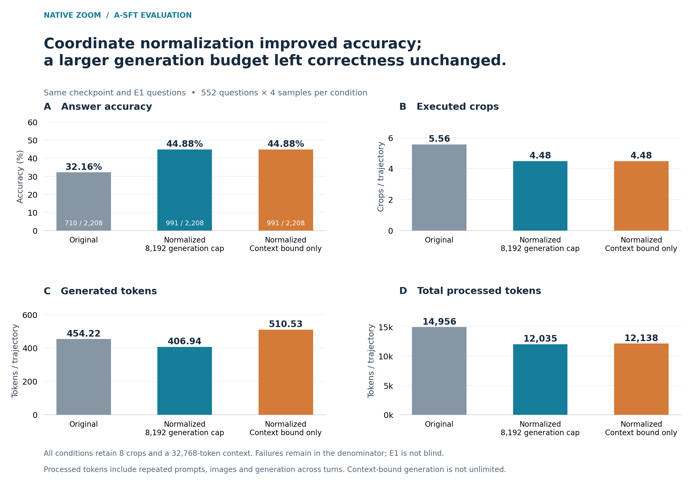
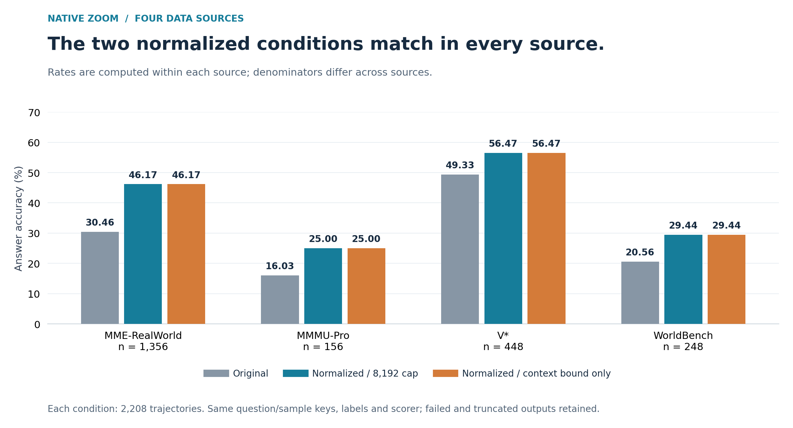

# Native Zoom：坐标归一化与生成 token 上限对照

2026-11-01（America/New_York）。按用户要求完成两组推理评测，无新增训练。各552题×4=2208条，全部exit0；同题键、GT、来源、模型/池/header/源码与输出SHA验收通过，原评分器统一复算，失败保留分母。

## 结果

| 条件 | 正确/2208 | 准确率 | crop/条 | 生成token/条 | 总处理token/条 | 裁图预算耗尽 | 截断 |
|---|---:|---:|---:|---:|---:|---:|---:|
| 原SFT Native Zoom | 710 | 32.16% | 5.56 | 454.22 | 14955.83 | 1173 | 5 |
| 坐标归一化，8192累计生成 | 991 | **44.88%** | 4.48 | 406.94 | 12034.60 | 676 | 10 |
| 坐标归一化，取消累计生成上限 | 991 | **44.88%** | 4.48 | 510.53 | 12138.20 | 676 | 10 |

- 归一化相对原结果：新增答对326条、失去45条，净增281条，**+12.73个百分点**。
- 取消8192累计生成上限相对归一化组：**逐条正确性完全相同，新增0、失去0**。
- 两组实测单卡评测墙钟（含模型初始化/退出检查）约32.78分钟、63.31分钟；runner生成循环1908秒、3748秒。两种计时嵌套，不能相加，且不是多次测量均值。

## 四个数据来源

| 来源 | 每组分母 | 原结果 | 归一化 | 归一化+取消生成上限 |
|---|---:|---:|---:|---:|
| MME-RealWorld | 1356 | 30.46% | 46.17% | 46.17% |
| MMMU-Pro | 156 | 16.03% | 25.00% | 25.00% |
| V* | 448 | 49.33% | 56.47% | 56.47% |
| WorldBench | 248 | 20.56% | 29.44% | 29.44% |

## 实际改了什么

固定原A-SFT、E1、temperature=.7、top_p=1、seed_base=20261017、提示和工具schema、图像处理、评分。两组都保留**8次裁图、32768上下文**。

坐标适配器：四个值都在[0,1]时乘1000，否则按原native 0–1000执行；每次记录raw、canonical 0–1、native 0–1000与推定尺度。它是范围启发式，存在极小native框的歧义，不声称直接识别模型意图。没有更改提示来要求新的坐标格式。

第二组只取消8192累计生成限制，单轮可生成到剩余上下文耗尽；**不是无限上下文，也没有取消裁图次数限制**。这一组是额外预算对照，不与8192组称等计算。

## 多出来的token去了哪里

全量逐轮字段比对：**2198条轨迹的turn记录完全一致**。改变的10条均为原8192处截断的轨迹：此前工具轮完全一致，延长的末轮均保留原文本为前缀，没有增加工具调用；总生成长度变为30258–31536，仍以length截断。

这10条合计多生成228741 token。所有分源准确率、逐条正确性、裁图数与终止类别都没有改变。本次记录为“放宽累计生成上限未带来新增答对”，不扩展为所有模型或所有预算下都无用。

## 实际轨迹核对

定向查看2题4条：原图、全部执行crop的PIL重建、对应文本；不公开题面或图像，不把定向抽样当总体错误率。重建不是历史processor张量回放。

1. **时间轴例（test_History_239/sample0，旧→归一化）**：首轮两个工具请求文本完全相同。旧执行器把0–1坐标当0–1000，亚像素框重建为黑图；8次裁图后耗尽预算。归一化后能读到两事件日期，第三张crop补全右侧事件，计算差值并输出J正确，3次裁图结束。
2. **几何例（test_Math_492/sample2，归一化→取消生成上限）**：两组3张crop像素和工具轮一致，原图/裁图中可见交点E和圆心O。末轮把DE长度用作三角形AEB的斜边，随后代数移项错误并循环同段推导。“This is still outside the options, so let's try the other way:”从78次增加到315次。8192→31188生成token，仍未完成有效终答，两组计0。长输出人工查看前段/末段，完整文本做前缀与重复短语程序核对，不声称逐字人工阅读3万token。

## 资料与停止点

[汇总CSV](summary.csv) · [分源精确计数](by_source.csv) · [配对得失/评分](RESULTS.json) · [10条延长记录核对](token_delta_checks.json) · [视觉审查记录](audit_findings.jsonl) · [验收与SHA](PROVENANCE.json) · [复现图表](plot.py)

公开原始模型输出：[归一化组](norm8.jsonl.gz) · [取消累计生成上限组](norm_token_uncapped.jsonl.gz)。旧输出保留在[原B3-zoom](../../data/rollouts/B3-zoom.jsonl.gz)。不包含输入题面、原图或机器路径。

原三类baseline表的32.16%保留为历史原生接口结果；本次44.88%是带坐标适配器的新条件，不能静默替换为“原生协议复现”。E1并非独立盲测。

两组已完成，后续研究方向交回用户决定；不自动启动Reward训练、追加预算或恢复已取消的L0/L01。
