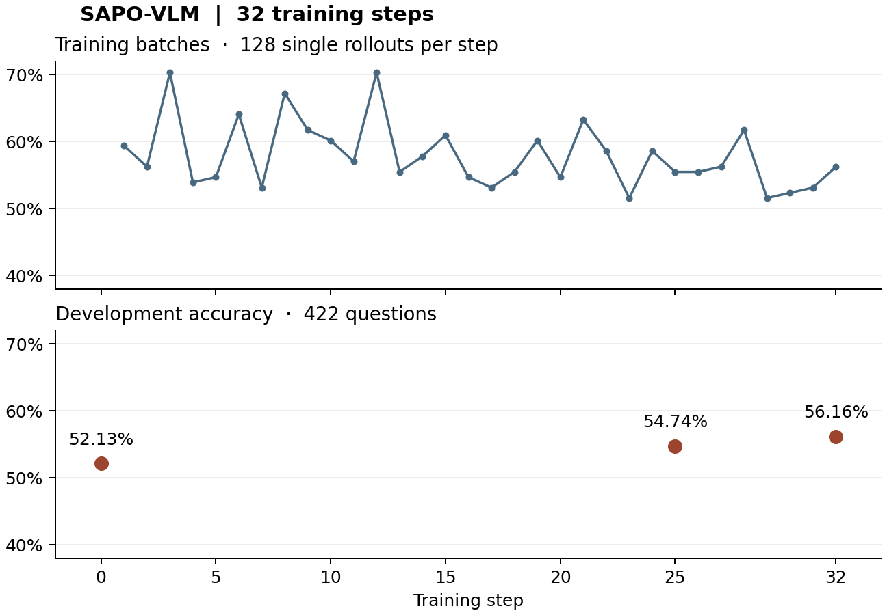

# SAPO-VLM 固定第 32 步 E1 结果

SAPO 答对 **1,274/2,208（57.70%）**。历史 DAPO 答对 **1,465/2,208（66.35%）**。逐个匹配同一道题、同一采样编号，SAPO 独对 192 条，DAPO 独对 383 条，两组同对 1,082 条，同错 551 条。

| 数据来源 | 轨迹数 | SAPO | DAPO | SAPO 净得失 |
|---|---:|---:|---:|---:|
| MME-RealWorld | 1356 | 789（58.19%） | 933（68.81%） | -144 |
| MMMU-Pro | 156 | 48（30.77%） | 55（35.26%） | -7 |
| V* | 448 | 364（81.25%） | 391（87.28%） | -27 |
| WorldBench | 248 | 73（29.44%） | 86（34.68%） | -13 |

SAPO 每条评测轨迹平均执行 1.06 次裁图，DAPO 为 2.09 次。至少使用一次裁图的轨迹分别占 61.59% 和 99.00%。每条平均生成 171 和 287 个 token，计入每轮完整输入后，平均处理 5,292 和 8,930 个 token。分源和裁数分层的分子、分母及成本在 [数据表](e1_results.json)。裁数相同的层在两组中可包含不同题目。

**训练与开发验证。** SAPO 从 A-SFT 起训，每题单轨迹，128 题一批，共 32 步。V/Q 共享策略模型，用终答二元奖励训练。正式双卡运行墙钟约 86 分钟，含验证和保存。422 题开发集在第 0、25、32 步分别为 52.13%、54.74%、56.16%。DAPO 每题生成 8 条轨迹并筛选混合组，32 步的训练计算预算不同。

**同题观察。** 复用先前 PO 审查中每个数据源已选定的一道 SP/CA 分歧题，使用相同采样编号查看 SAPO 与 DAPO。已核对四道完整题面、原图、8 条完整输出和全部 41 次实际裁图的重建视图。

- 表格。两组都选了相邻职位的数据。SAPO 在两次裁图后把目标称为第二行。DAPO 的第二张裁图已同时显示相邻两行及不同数值，八裁后的最终引用却指向另一个表块。
- 电路。SAPO 直接作答并选中标准选项，但其串联描述与原图的并联支路冲突。DAPO 把首次裁图中露出的分子称为源幅值，四裁后选错。
- 手表。SAPO 的最后两张局部图可见手指和戒指，无法从中核实它断言的黑色表面和表带。DAPO 表示未找到目标，随后列举不同颜色的表并选银色。两组均答错，小目标身份保留不确定。
- 店铺标识。SAPO 声称从最后一次裁图读出了完整电话，图中可见地铁站柱和入口，无法核实该数字串。DAPO 最后报告看不清并输出 UNCLEAR。统一评分下两条均记错。

**验收口径。** 两组各 552 题 × 4，键、来源和标准答案逐条对齐。SAPO 输出 SHA 与远端完成记录一致。原评分器保留全部 2,208 条作为分母，SAPO 的 2 条截断和 DAPO 的 5 条截断均计错。两组协议检查标记分别覆盖 16 条和 14 条。SAPO 推理用 −100 logit bias 抑制两个保留的价值读出 token，题池、裁图预算和其余采样参数按原 E1 执行。运行日志有 tokenizer 正则警告，其影响尚未测量。E1 是已有开发评测池，本次预先固定最终权重。上述四题为定向观察。
