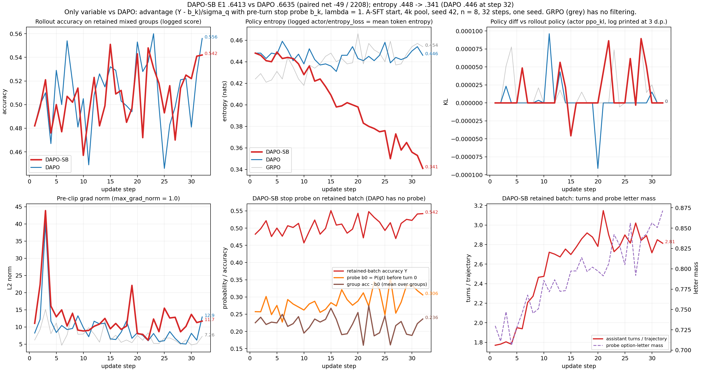

# DAPO vs DAPO-SB（Advantage.md 的停止相对 advantage）：三部分报告（2026-11-05）

## 一、设定

| 项 | DAPO（对照，k8） | **DAPO-SB** |
|---|---|---|
| SFT | A-SFT（`sft_v22_turnwise_merged`，E1 .5670），**本轮无 SFT 改动** | 同左 |
| 奖励 | R = V·Y | 同左 |
| advantage | DAPO：(Y − Ȳ_q)/(σ_q+ε)，同一值铺到整条轨迹 | $A_{i,t}=(Y_i-b_{i,k(t)})/(\sigma_q+\epsilon)$，λ=1：第 k 个 assistant 回合的 token 用该回合之前的停止探针 $b_{i,k}$ 作基线；回执、图像 token 为 0；σ_q 仍为组内 Y 的样本标准差 |
| 探针 $b_{i,k}$ | 无 | rollout 引擎当前权重（θ_old）一次前向、不采样：caption v5.1 SYSTEM + 题面与选项 + 该回合前实际呈现过的图像（原图 + 前 k 张裁图），不含模型自己的文本；以 `<answer` 结尾读 `>A`…`>J` 与单独的 `>`，以 `<answer>` 结尾读 `A`…`J`，合并为 P(gt 字母) |
| 公共 | A-SFT 起点、4k 池、seed 42、n=8、128 题/步 × 32 步、mini 32、lr 1e-6、无 KL；online_filtering（filter_key=overall，0.01/0.99，max_try 100）；clip .2/.28；token 平均；caption v5.1 协议（最多 8 次裁图） | |

- **唯一变量**：advantage 的基线（组均值 Ȳ_q → 每回合的探针 $b_{i,k}$）。advantage 核心直接使用 Pro 的参考实现 `stop_relative_advantage.py`（sha16 a4f3374f）。
- **未做的准入**：Advantage.md 第七节的三层离线验收没有做，包括探针扰动与真实停止对照、同状态分叉的四种信用方向、固定根状态基线的同批梯度对照。本轮按用户指示直接训练。探针只做过冒烟：A-SFT 在 40 道训练题的原图上，P(gt) 均值 .371，取最大概率选项的正确率 .525，字母质量均值 .778。
- **运行**：GPU 2,3；与 sg_a（GPU 0,1）并行；32/32 步，0 Traceback；step32 双 rank 文件非空；守护记录的 cgroup 内存最高 347G（两训练合计）。mm cache 设置与 k8 DAPO 不同，只影响速度和内存（见 FREEZE）。
- 冻结记录与 hash：`FREEZE.zh.md`。

## 二、定性 + 定量

### 定量（E1 = 552 题 × 4 次采样 = 2,208，统一评分器 summarize.py；表由 `data/e1_compare_sb.py` 从轨迹重算）

| | **DAPO-SB** | DAPO | GRPO | GRPO+A（S 奖励） | GRPO+A+B |
|---|---:|---:|---:|---:|---:|
| **E1** | **.6413** | .6635 | .6390 | .6436 | .6472 |
| mme_realworld（1,356） | .6799（922） | .6881（933） | .6645（901） | .6689（907） | .6659（903） |
| vstar（448） | .8326（373） | .8728（391） | .8438（378） | .8527（382） | .8371（375） |
| worldbench（248） | .2903（72） | .3468（86） | .3347（83） | .3347（83） | .3952（98） |
| mmmu_pro（156） | .3141（49） | .3526（55） | .3141（49） | .3141（49） | .3397（53） |
| 裁图 / 条 | 1.631 | 2.092 | 1.905 | 4.020 | 2.404 |
| 零裁图直答 | 4.80%（106） | 1.00%（22） | 4.35% | 0.18% | 0.32% |
| 生成 token / 条 | 222 | 287 | 261 | 440 | 342 |
| 总处理 token / 条（summarize） | 7,055 | 8,930 | 8,125 | 18,034 | 10,047 |
| 无有效答案 | 0.72% | 0.95% | 0.86% | 0.95% | 1.04% |
| 截断（summarize） | 0.09% | 0.23% | 0.09% | 0.09% | 0.27% |
| 重复裁图框的轨迹 | 0.36% | 0.41% | — | — | — |

- mmmu_pro 有三臂都是 49/156。逐键核对确认是不同轨迹：DAPO-SB 与 GRPO 同 pred 64/156，GRPO+A 与 GRPO 同 pred 67/156。
- 零裁图的正确率：DAPO-SB .500（106 条），DAPO .591（22 条）；有裁图的正确率：DAPO-SB .648，DAPO .664。

配对四格（按 uid+sample_idx，2,208 对）：

| 对比 | 两者都对 | 仅 DAPO-SB 对 | 仅后者对 | 都错 | 后者净增 | 仅 DAPO-SB 对 / 仅后者对，分源 |
|---|---:|---:|---:|---:|---:|---|
| DAPO-SB vs DAPO | 1187 | 229 | 278 | 514 | +49 | mme 146/157、vstar 33/51、wb 35/49、mmmu 15/21 |
| DAPO-SB vs GRPO | 1161 | 255 | 250 | 542 | −5 | mme 161/140、vstar 42/47、wb 32/43、mmmu 20/20 |
| DAPO-SB vs GRPO+A | 1162 | 254 | 259 | 533 | +5 | mme 165/150、vstar 37/46、wb 37/48、mmmu 15/15 |
| DAPO-SB vs GRPO+A+B | 1155 | 261 | 274 | 518 | +13 | mme 171/152、vstar 32/34、wb 38/64、mmmu 20/24 |

按题计（每题 4 次采样，DAPO-SB 答对数 − DAPO 答对数）的分布：−3：8 题，−2：34，−1：95，0：314，+1：69，+2：27，+3：5。

成本（Advantage.md 要求记录的训练额外前向）：
- 训练日志中的探针请求合计 ≥182,334 次，每个不同状态 2 次请求。Ray 日志会合并重复行，所以这是下限。
- 32 步 timing_s/step 合计：DAPO-SB 13.25 h，k8 DAPO 11.21 h。其中 gen（含探针）8.01 h vs 5.60 h，update_actor 3.66 h vs 4.13 h。两次运行的并行负载不同，DAPO-SB 与 sg_a 同机并行。

判读：本轮没有预登记数值判据。Advantage.md 给的第一对实验是"纯 DAPO 对比 DAPO-SB"，只要求记录准确率、推理成本、训练额外前向、重复裁图和截断，上表已列出。未做的判别实验：固定根状态基线消融、λ=0/0.5、同状态分叉的信用方向检查（Advantage.md §七）。只跑了一个 seed。

### 定性（同题四次采样；答案与依据分开记）

**案例 1：vstar_148"铲子在房子的哪一侧"（GT B=右侧；GT 框 [1487,939,1612,1210]，图 2250×1500）。** DAPO 4/4，DAPO-SB 1/4。
- DAPO-SB s1、s2、s3 各 1 张裁图，覆盖 GT 框的比例都是 0.0，裁图位于图像左下部（如 [0,900,1012,1500]）。答 "the shovel is on the left side of the house [observation_1]" → A，错。
- DAPO-SB s0 的第 1 张裁图 [1350,750,2250,1500] 完整覆盖 GT（1.0），答 B，对。
- DAPO s1、s2、s3 都有完整覆盖 GT 的裁图（1.0），如 s2 的 [1440,840,1642,1260]，答 "leaning against the wall at the right side of the house" → B，对。DAPO s0 的裁图覆盖 GT 最多 .31，也答 B，对。

**案例 2：validation_Music_5（mmmu_pro，判断"该音符是 G♭ 大调的上主音"，GT B=错误）。** DAPO 3/4，DAPO-SB 0/4。
- DAPO-SB 4/4 都没有裁图，都答 A。s0 写 "a note on the third line (A above middle C) … the second note of G♭ major is A♭"，随后 CALC 写 "A♭ = A4" → A。
- DAPO s0 同样没有裁图，前半句相同（"A above middle C … the second note of G♭ major is A♭"），结尾为 "The note shown is A, not A♭, so the claim is false" → B，对。DAPO s1、s3 有裁图，答 B，对；s2 没有裁图，答 A，错。

**反向案例：mme_7685"2020 年 Qtr2 的 Rent Trend 数值"（GT A=2.1）。** DAPO-SB 4/4，DAPO 1/4。
- DAPO-SB 4/4 各 1 张横条裁图，读数 "the Qtr2 bar labeled 2.1" → A。
- DAPO s1、s2、s3 读数 "the 2020 Qtr2 bar is labeled 2.2" → B，错。其中 s1 的裁图 [21,195,999,374] 与 DAPO-SB s3 的 [0,229,1030,348] 位置相近。

## 三、训练 Log

`data/sb_curves.png`（pdf 同名）的六个面板：保留组上的 rollout 正确率、entropy、policy diff（ppo_kl）、裁剪前 grad norm、停止探针（b0、组正确率减 b0）、每条轨迹的回合数与探针字母质量。长表 `data/sb_curves_long.csv`，重画脚本 `data/plot_sb_curves.py`，曲线由 `obs/src/train_curves.py` 的 parse_log 从日志解析。

| | 第 1 步 | 第 32 步 |
|---|---|---|
| 保留组正确率（score） | .482 / DAPO .482 | .542 / DAPO .556 |
| entropy | .448 / DAPO .448 | **.341** / DAPO .446 |
| ppo_kl | 0 / 0 | 两臂全程 \|kl\| <1e-4（日志按 3 位小数打印） |
| 裁剪前 grad norm | 11.06 / DAPO 8.23 | 11.71 / DAPO 12.91（全程都 >1，每步都被裁剪） |
| advantages 均值（critic/advantages/mean） | +.113 / DAPO −.007 | — |
| 探针 b0 均值 | .257 | .306 |
| 组正确率 − b0（组均值） | +.225 | +.236（32 步均值 +.220） |
| 原始 advantage >0 的回合占比 | .462 | .529 |
| 每条轨迹的 assistant 回合数（保留组） | 1.77 | 2.81 |
| 探针字母质量 | .730 | .872 |
| \|A\| 均值（DAPO-SB / 同批 DAPO 公式） | 1.003 / .809 | .961 / .794 |

- dev val（4k val_nosft）：训练前 .533 → 第 25 步 .590 → 第 32 步 .6066。
- 未弄清的问题：训练中保留组每条轨迹的回合数从 1.77 升到 2.81，E1 上的裁图数却是 1.63（DAPO 2.09），零裁图率 4.8%（DAPO 1.0%）。两者的题池和过滤不同，没有做同口径对照；k8 DAPO 训练时的回合数没有按这个口径记录。
