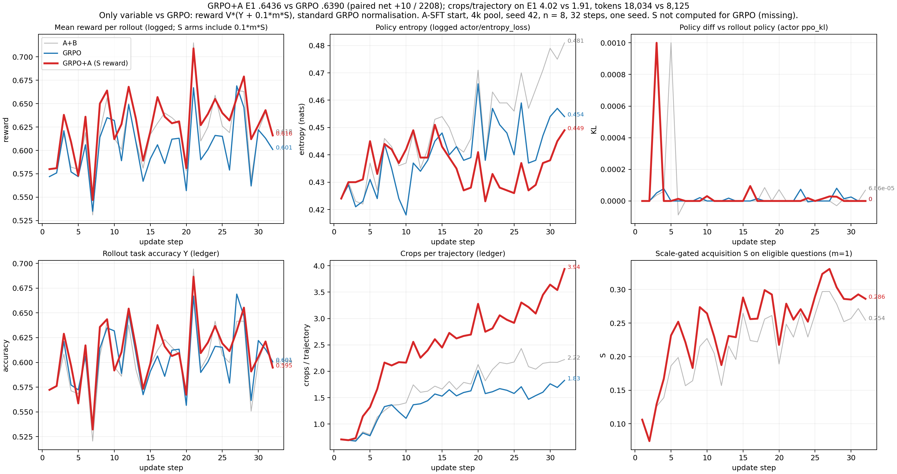

# GRPO vs GRPO+A（单 A：只加 S 奖励）：三部分报告（2026-11-05）

## 一、设定

| 项 | GRPO（对照，k8） | **GRPO+A（sg_a）** | 参考：A+B（sg_ab） |
|---|---|---|---|
| SFT | A-SFT，**本轮无 SFT 改动** | 同左 | 同左 |
| 奖励 | R = V·Y | R = V·(Y + 0.1·m·S) | 同 GRPO+A |
| advantage | 标准 GRPO：(R−mean)/(std+ε) | **同 GRPO**（CAPTION_ADV_TS=0） | task-scaled（B） |
| 公共 | A-SFT 起点、4k 池、seed 42、n=8、128 题/步 × 32 步、mini 32、lr 1e-6 const、无 KL、clip .2/.3、无过滤 | | |

- **唯一变量**：对 GRPO 是奖励中的 S 项（定义与 A+B 相同，见 `REPORT.zh.md`）；对 A+B 是 advantage 归一方式。
- **运行**：GPU 0,1；与 DAPO-SB 并行；32/32 步，0 Traceback；tracker 32；step32 双 rank 文件非空；updates.jsonl 32 行；32 步 timing_s/step 合计 11.98 h。第 1 步的 1,024 行 rollout 与 sg_ab 一致。
- 冻结记录：`FREEZE.zh.md` 的 sg_a 节。

## 二、定性 + 定量

### 定量（E1 = 2,208，summarize.py；`../sb_20261104/data/e1_compare_sb.py` 重算）

| | GRPO | **GRPO+A** | A+B | 参考：DAPO |
|---|---:|---:|---:|---:|
| **E1** | .6390 | **.6436** | .6472 | .6635 |
| mme_realworld（1,356） | .6645 | .6689 | .6659 | .6881 |
| vstar（448） | .8438 | .8527 | .8371 | .8728 |
| worldbench（248） | .3347（83） | .3347（83） | .3952 | .3468 |
| mmmu_pro（156） | .3141（49） | .3141（49） | .3397 | .3526 |
| 裁图 / 条 | 1.905 | **4.020** | 2.404 | 2.092 |
| 零裁图直答 | 4.35% | 0.18% | 0.32% | 1.00% |
| 生成 token / 条 | 261 | 440 | 342 | 287 |
| 总处理 token / 条（summarize） | 8,125 | **18,034** | 10,047 | 8,930 |
| 无有效答案 | 0.86% | 0.95% | 1.04% | 0.95% |
| 截断 | 0.09% | 0.09% | 0.27% | 0.23% |

- worldbench 和 mmmu_pro 的答对数与 GRPO 相同。逐键核对确认是不同轨迹：同 pred 分别为 88/248、67/156，同裁图数分别为 29/248、17/156。

配对四格（2,208 对）：

| 对比 | 两者都对 | 仅 GRPO+A 对 | 仅后者对 | 都错 |
|---|---:|---:|---:|---:|
| GRPO+A vs GRPO | 1143 | 278 | 268 | 519 |
| GRPO+A vs A+B | 1159 | 262 | 270 | 517 |
| GRPO+A vs DAPO | 1193 | 228 | 272 | 515 |

判读：沿用 A+B 的预登记门槛"总体 ≥+1pp"。GRPO+A 对 GRPO 为 +0.46pp（配对净增 10/2208）；每条轨迹的总处理 token 是 GRPO 的 2.22 倍。没有做显著性检验，只跑了一个 seed。

### 定性

本轮没有单独做同题案例审查（待补）。

## 三、训练 Log

`data/sg_a_curves.png`（pdf 同名）的六个面板：reward、entropy、ppo_kl、rollout 正确率、裁图数、S。GRPO+A 高亮，GRPO 为直接对照，A+B 为灰色参考；GRPO 没有计算 S，该面板缺测。长表 `data/sg_a_curves_long.csv`，重画脚本 `data/plot_sg_a_curves.py`。日志曲线由 `obs/src/train_curves.py` 从服务器日志解析为 `data/curves_sg_a.json`；账本 `data/sg_a_ledger_steps.json` 按奖励调用统计（GRPO 不补采，调用次数 = 更新步）。数值如下（前四行为 GRPO+A / A+B，后三行只列 GRPO+A）：

| | 第 1 步 | 第 8 步 | 第 16 步 | 第 24 步 | 第 32 步 |
|---|---|---|---|---|---|
| reward（logged score） | .580 / .580 | .650 / .620 | .657 / .629 | .655 / .659 | .616 / .618 |
| entropy | .424 / .424 | .442 / .443 | .439 / .450 | .427 / .459 | .449 / .481 |
| ppo_kl | 第 3 步 1.0e-3 单点，其余 <1e-4（A+B 在第 5 步有 1.0e-3 单点） | | | | |
| 裁剪前 grad norm | 9.05 / 6.36 | 6.43 / 11.31 | 4.96 / 6.56 | 7.07 / 5.04 | 4.32 / 6.66 |
| rollout 正确率（账本） | .572 | .636 | .638 | .637 | .595 |
| 裁图 / 条（账本） | 0.71 | 2.11 | 2.73 | 2.98 | 3.94 |
| S（m=1） | .106 | .183 | .256 | .252 | .286 |

- 第 25–32 步均值：裁图 3.39 / 条，S（m=1）.299。
- dev val：.533 → 第 25 步 .583 → 第 32 步 .6066。
