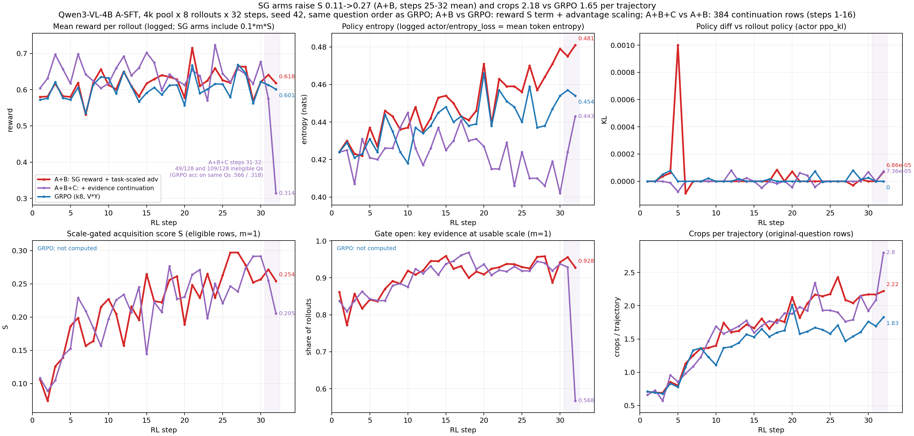

# GRPO vs A+B vs A+B+C（Design_New 两种改动）：三部分报告（2026-11-04）

## 一、设定

| 项 | GRPO（对照，k8） | A+B | A+B+C |
|---|---|---|---|
| SFT | A-SFT（`sft_v22_turnwise_merged`，E1 .5670），**本轮无 SFT 改动** | 同左 | 同左 |
| 奖励 | R = V·Y | R = V·(Y + 0.1·m·S) | 同 A+B；续答行 R = V·Y |
| advantage | 标准 GRPO：(R−mean)/(std+ε) | task-scaled：((y−ȳ)+(s'−s̄'))/max(std(y), 1/√G) | 同 A+B |
| 数据 | 4k 池，seed 42 RandomSampler | 同左（第 1 步与 GRPO 逐项相同：acc .572、裁图 0.71、生成 135 token） | 同一题序预排，384 行替换为证据续答行（第 1–8 步每步 32 行、第 9–16 步每步 16 行），shuffle=false |
| 公共 | n=8，128 题/步 × 32 步，mini 32，lr 1e-6 const，无 KL，clip .2/.3，无过滤，caption v5.1 协议（最多 8 次裁图） | | |

- **S（尺度门控获取分）**：L1 证据框在某个视图中覆盖 ≥0.9，且在最终模型输入中的尺度达到代理阈值（文字行高 6→14 px，物体短边 16→48 px，**未校准**）。取 L2 evidence_set 的均值，再取最大的那组。关键框达到可用尺度之前只记探索分（上限 α=0.25），之后记 α+(1−α)Φ。原图视图计入。资格 m=1 的题 3,014/4,096。
- **唯一变量**：A+B 对 GRPO 是奖励中的 S 项加 advantage 归一方式；A+B+C 对 A+B 是续答行。
- **离线准入**（A-SFT 真实轨迹 256 题 × 8）：无任务信号组中 S 有组内差异的占 40.4%（准入线 10%）；追加整图裁剪 ΔS=0；8 格平铺 ΔS +0.164（预登记的监控项：裁图数）。
- **事故**：① A+B+C 第 31–32 步的原题集合与另外两臂不同。续答题从题序尾部选，被跳过的不合格题挤进了这两步，m=0 题分别占 49/128 和 109/128；GRPO 在同一批题上的正确率是 .566 / .318，A+B+C 是 .560 / .311。② 守卫把正常退出误报为 DEAD。两臂都完成了 32/32 步，无 Traceback。
- 冻结记录与版本 hash：`FREEZE.zh.md`（本目录）。

## 二、定性 + 定量

### 定量（E1 = 552 题 × 4 次采样 = 2,208，统一评分器 summarize.py；对照分数复算一致）

| | GRPO | **A+B** | A+B+C | 参考：G1（R-read） | 参考：DAPO |
|---|---:|---:|---:|---:|---:|
| **E1** | .6390 | **.6472** | .6395 | .6395 | .6635 |
| mme_realworld（1,356） | .6645 | .6659 | .6563 | .6645 | .6881 |
| vstar（448） | .8438 | .8371 | **.8728** | .8527 | .8728 |
| worldbench（248） | .3347 | **.3952** | .3387 | .3266 | .3468 |
| mmmu_pro（156） | .3141 | .3397 | .3013 | .3077 | .3526 |
| 裁图 / 条 | 1.905 | 2.404 | 2.337 | 2.308 | 2.092 |
| 零裁图直答 | 4.35% | 0.32% | 1.95% | — | — |
| 生成 token / 条 | 261 | 342 | 326 | 374 | 287 |
| 总处理 token / 条 | 8,125 | 10,047 | 10,181 | 10,063 | 8,930 |
| 无有效答案 | 0.86% | 1.04% | 1.45% | — | — |

配对四格（按 uid+sample_idx，2,208 对）：

| 对比 | 两者都对 | 仅前者对 | 仅后者对 | 都错 | 后者净增 | 仅前者对 / 仅后者对，分源 |
|---|---:|---:|---:|---:|---:|---|
| GRPO vs A+B | 1157 | 254 | 272 | 525 | **+18** | mme 157/159、vstar 43/40、wb 39/54、mmmu 15/19 |
| GRPO vs A+B+C | 1152 | 259 | 260 | 537 | +1 | mme 171/160、vstar 33/46、wb 38/39、mmmu 17/15 |
| A+B vs A+B+C | 1146 | 283 | 266 | 513 | −17 | mme 169/156、vstar 30/46、wb 59/45、mmmu 25/19 |

V* 错答的尺度复算（与 `rereview_20261104` 同一口径：GT 长边 / 覆盖它的最小裁图长边）：

| | 错答数 | 错答中单裁覆盖 GT | 其中尺度中位数 | 其中 <5% | 答对且覆盖的尺度中位数 |
|---|---:|---:|---:|---:|---:|
| GRPO | 70 | 38 | 0.066 | 14 | 0.193 |
| A+B | 73 | 29 | 0.087 | 7 | 0.218 |
| A+B+C | 57 | 30 | 0.053 | 15 | 0.153 |

预登记门槛：R-bind 草案沿用的“总体 ≥+1pp”。A+B 对 GRPO 为 +0.82pp（净增 18/2208），A+B+C 为 +0.05pp。本轮没有做显著性检验，也没有跑分层探针。

### 定性（同题四次采样；案例图含原图裁片，不公开）

**案例 1：vstar_82“汽水罐是什么颜色”（GT 绿色，目标框 8×12 px）。** GRPO 1/4，A+B 4/4，A+B+C 3/4。
- GRPO s2：7 张裁图，覆盖目标的裁图尺度都在 0.012–0.019。最后一张裁图宽 1011 px，答 “The soda can has a reddish tint” → B，错。
- A+B s0：第 2 张裁图是 56×56 px，覆盖尺度 0.214，答 “The enlarged view of the soda can shows it is a distinct green” → D，对。
- A+B 有 2/4 的采样带尺度 0.21 的裁图；另外 2/4 的覆盖尺度在 0.012–0.038 之间，也答对了。

**案例 2：vstar_15“行李箱是什么颜色”（GT 棕色，被栏杆部分遮挡，由一名穿黑裤的人拖着）。** GRPO 3/4，A+B 0/4，A+B+C 1/4。
- A+B s1、s2：没有任何裁图覆盖 GT 行李箱，答 “clearly black in [observation_2]”。这两张裁图位于图像左中部，不是 GT 位置。
- A+B s0：第 4 张裁图 56×56 px 紧框覆盖 GT（尺度 0.73），答 “clearly dark, consistent with black … The person's clothing in [observation_2] is black, so it is not the suitcase” → C，错。
- GRPO s0：68×56 px 裁图覆盖 GT，答 “brown suitcase carried by the person” → D，对。

## 三、训练 Log

`sg_curves.png`（pdf 同名）的六个面板：reward、entropy、policy diff（ppo_kl）、S、门控开启率、裁图数。长表 `sg_curves_long.csv`，重画脚本 `scripts/plot_sg_curves.py`。日志 reward 与账本重算 reward 逐步核对，32/32 步 × 2 臂差值 ≤0.01。

| | 第 1 步 | 第 25–32 步均值 / 终点 |
|---|---|---|
| reward | A+B .580 / A+B+C .604（含续答行）/ GRPO .572 | 终点 .618 / .314（第 32 步构成偏差）/ .601 |
| entropy | .424（三臂相同） | 终点 .481 / .443 / .454 |
| ppo_kl | 0 | 三臂均 <1e-4；A+B 在第 5 步有 1.0e-3 的单点 |
| S（m=1） | .106 / .109 | 25–32 步均值 A+B .27 |
| 门控开启 | .86 / .84 | .93 / 第 32 步 .57（构成偏差） |
| 裁图 / 条（原题行） | 0.71 / 0.66 / 0.71 | 25–32 步均值 A+B 2.18、GRPO 1.65 |

续答行（A+B+C 第 1–16 步）的正确率在 .617–.844 之间，同步原题行在 .547–.674 之间。

## 未跑 / 未决

- Design_New §3 的分层探针（H/L/B/O/O-scale），以及尺度函数 h 的校准，都没有跑。
- A+B 多出约 0.5 张裁图/条、多出约 80 个生成 token/条，没有拆分到具体题型。
- A+B+C 的 V* +2.9pp 与 worldbench −5.7pp（相对 A+B）各自对应哪些题，没有逐图审查。
