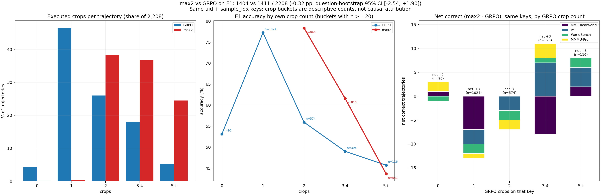
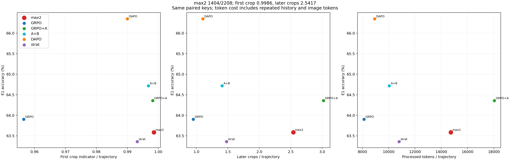
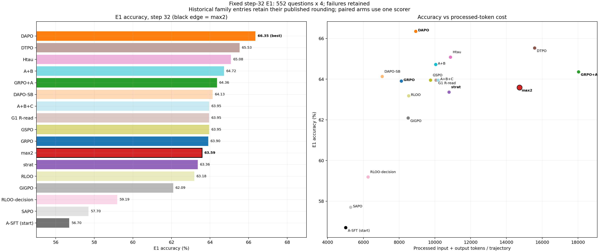
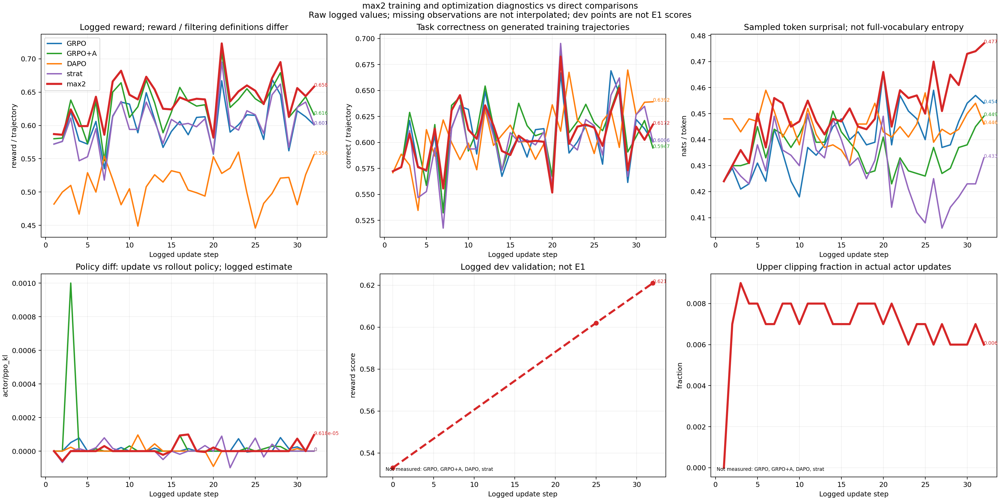

# max2：GRPO + 终点式 S v2，32 步报告

## 1. 设定

无 SFT 改动。起点为 A-SFT Qwen3-VL-4B，现有 4,040 条 SFT；RL 题池 4,096 题各采样 8 条，32 步、seed=42、lr=1e-6、max_grad_norm=1.0、无 KL 奖励，clip=0.2/0.3，caption v5.1。

本次运行是完整的 `sgv2_grpo_max2`，不是早停旧运行 `sgv2_grpo_max`。奖励为 `R=V·(Y+0.1·m·S)`，之后做标准整组 GRPO 归一。`S=clip(psi_T−psi_0,0,1)`；逼近分为每目标 `0.5×(maxIoU+目标被历史 crop 并集覆盖比例)` 后聚合，探索分为全部历史 crop 并集面积/原图面积，`psi=max(逼近分,0.25×探索分)`；原图不计作 crop。

psi 的参考实现见 [`psi_v2.py`](psi_v2.py)（只含 max 模式用到的部分，约 60 行）；`python psi_v2.py` 在 2,000 个随机样例上与训练实际调用的 [`code/methods/sg/v2/reward_sg.py`](../../code/methods/sg/v2/reward_sg.py)（`CAPTION_SG_PSI=max`）逐数值对照，输出 `2000/2000 match`。训练代码 sha256 拼接值前 16 位 `43b1ec2c5fd92b20` 与远端启动日志相同。

相对 GRPO+A，psi 公式及证据索引口径均有变化：max2 用 L1 全部框集合，可判题 3,077；GRPO+A 用 L2 evidence_sets，可判题 3,014。不能将此对照写成只有 psi 公式一个变量。相对 strat，S 进入复合奖励后整组归一，而不是在同结果层内中心化。

训练账本 32,768 条、4,096 道题，每题 8 条，显式 step1–32 各 1,024 条；重复 `(step,i)` 为 0。终止类型 answer=32,404、invalid=254、length=110。Step32、tracker=32 与七个非空恢复文件已记录；独立训练退出码及逐 rank optimizer 更新事件缺失。CPU 合并独立退出码为 0，两个合并分片 SHA256 留在私有运行回执。

固定 E1 使用最终 step32、新 tag `sgv2_max2_s32`，552 题×4，temperature=0.7、top_p=1、seed_base=20261017；失败留分母，不用于训练。评测独立退出码为 0。六条件各 2,208 唯一键、552 题、每题 sample0–3，GT/source 配对相同；比较器核对的 header 设置及四项数据/代码 hash 差异均为空。统一评分器及输入 SHA 见 `comparison.json`。

## 2. 定性 + 定量

| 条件 | 正确/2208 | 准确率 | 首裁/轨迹 | 后续裁图/轨迹 | 全部裁图/轨迹 | 处理 token/轨迹 |
|---|---:|---:|---:|---:|---:|---:|
| max2（新） | 1404 | 63.59% | 0.9986 | 2.5417 | 3.5403 | 14726.9891 |
| GRPO | 1411 | 63.90% | 0.9565 | 0.9488 | 1.9053 | 8125.3800 |
| GRPO+A | 1421 | 64.36% | 0.9982 | 3.0217 | 4.0199 | 18033.9316 |
| A+B | 1429 | 64.72% | 0.9968 | 1.4072 | 2.4040 | 10047.4081 |
| DAPO | **1465** | **66.35%** | 0.9900 | 1.1024 | 2.0924 | 8929.8478 |
| strat | 1399 | 63.36% | 0.9932 | 1.4796 | 2.4728 | 10792.7595 |

粗体为准确率列的最优值；成本列不标最优。首裁为是否执行至少一次裁图的指示量，后续为 `max(n_crops−1,0)`；处理 token 含重复历史与图像 token，不是生成 token。四位小数为既有评分器输出；配对差使用整数正确数计算。

| 分源 | max2 | GRPO | GRPO+A | A+B | DAPO | strat |
|---|---:|---:|---:|---:|---:|---:|
| MME-RealWorld /1356 | 889 | 901 | 907 | 903 | **933** | 902 |
| MMMU-Pro /156 | 51 | 49 | 49 | 53 | **55** | 48 |
| V* /448 | 383 | 378 | 382 | 375 | **391** | 370 |
| WorldBench /248 | 81 | 83 | 83 | **98** | 86 | 79 |

配对四格以 max2 为新条件；区间按 552 道题重采样 10,000 次，不是新增训练 seed。粗体为区间不含 0 的行。

| 对照 | 共同对 | 仅 max2 对 | 仅对照对 | 共同错 | max2−对照（百分点） | 按题95%区间 |
|---|---:|---:|---:|---:|---:|---|
| GRPO | 1125 | 279 | 286 | 518 | −0.3170 | [−2.5362, 1.9022] |
| GRPO+A | 1139 | 265 | 282 | 522 | −0.7699 | [−2.8986, 1.4493] |
| A+B | 1148 | 256 | 281 | 523 | −1.1322 | [−3.2609, 1.0870] |
| DAPO | 1172 | 232 | 293 | 511 | **−2.7627** | **[−4.9819, −0.5435]** |
| strat | 1129 | 275 | 270 | 534 | +0.2264 | [−1.9022, 2.4004] |

按既定区间判读，max2 与 GRPO、GRPO+A、A+B、strat 的差异未分辨；与 DAPO 的差值区间为负。此处不作原因解释。E1 max2：error=0、截断=3、零裁图=3、缺答案=28，各项可能重叠，不能相加作互斥失败数。

### 与 GRPO 的差距拆分

数据：[`grpo_gap.json`](grpo_gap.json)，由 [`grpo_gap.py`](grpo_gap.py) 从两份私有轨迹按 `uid+sample_idx` 对齐后只输出聚合数；两边正确数与统一评分器一致（脚本内断言）。分档为描述性计数，裁图数与题目难度相关，不作因果归因。

| 每条裁图数 | 0 | 1 | 2 | 3–4 | 5+ |
|---|---:|---:|---:|---:|---:|
| GRPO 条数 | 96 | 1024 | 574 | 398 | 116 |
| max2 条数 | 3 | 8 | 846 | 810 | 541 |
| GRPO 按自身裁图数的正确率 | .531 | .772 | .559 | .490 | .457 |
| max2 按自身裁图数的正确率 | — | — | .784 | .616 | .436 |

max2 在 0、1 档的条数不足 20，不报正确率。

| 按 GRPO 在同键上的裁图数 | 条数 | GRPO 对 | max2 对 | 净差 | MME | V* | WorldBench | MMMU-Pro |
|---|---:|---:|---:|---:|---:|---:|---:|---:|
| 0 | 96 | 51 | 53 | +2 | +1 | 0 | −1 | +2 |
| 1 | 1024 | 791 | 778 | −13 | −7 | −3 | −2 | −1 |
| 2 | 574 | 321 | 314 | −7 | 0 | −3 | −2 | −2 |
| 3–4 | 398 | 195 | 198 | +3 | −8 | +7 | +1 | +3 |
| 5+ | 116 | 53 | 61 | +8 | +2 | +4 | +2 | 0 |
| 合计 | 2208 | 1411 | 1404 | −7 | −12 | +5 | −2 | +2 |

按题（4 次采样平均）max2 比 GRPO 多裁的图数：≤0 的 19 题净差 +13；(0,1] 的 163 题 −1；(1,3] 的 321 题 −16；>3 的 49 题 −3。max2 缺答案 28 条、GRPO 19 条；max2 缺答案的 28 条中，GRPO 在同键上答对 11 条。

成本：训练生成 token=11,126,332，账本处理 token=371,949,079。32 个 `timing_s/step` 合计 43,355.981 秒，双卡×该时长=24.0866561111 GPU·小时；包含 step 计时范围内验证与保存，不等于完整 run 墙钟或账单，不含合并及 E1。E1 生成 token=951,092，处理 token=32,517,192；E1 GPU·小时未单独计量。

案例在 E1 完成前冻结为：V* 中按 `(uid,sample_idx)` 字典序，各取首个“max2 对/GRPO 错”和“max2 错/GRPO 对”。实际两例来自同一道题的不同采样，不是两个独立题目。所有回合、原图和实际 crop 已离线重放；共18个方法视图（含各自原图）已打开拼图检查，其中3个关键视图另以原显示尺寸打开。原图、题面、原 uid 和完整轨迹不公开。本地重放 caption_env SHA 为 `d827642f2b06de654afa08ec3680350d0da007e1be0426a568ab8933056ebd31`，远端 header 为 `4f5865dbde0cf457ceafc7e6cfb8a917b67143d885cffc937cfbd55f98e31d35`，不同；重放逐步核对了 box_abs、image_wh、boxes_abs 与 n_crops，但不声称远端逐像素一致。私有重放复用旧脚本，文件名前缀 `strat` 在本次清单中仅为 max2 的技术别名，不是 strat 条件。

- **case1，max2 对、GRPO 错**：max2 裁7次后输出 B，GRPO 裁1次后输出 C。max2 引用 observation_4/7 的短语为“a red top section and a white lower section”；这两张视图显示水面橙红球体与岸边，未包含官方目标框。答案与 GT 相同，但所引视图不支持其对目标外观的陈述。GRPO 裁图同样未包含官方目标框。首个可核验的选区偏差均在首次 crop；不能将此例记为 max2 有效找到目标。
- **case2，max2 错、GRPO 对**：max2 裁4次后输出 D；GRPO 裁2次后输出 B。max2 四张 crop 均未包含官方目标框；其终答前称“orange/red and shows no white band”，随后输出的 D 与该描述不相同。GRPO 第二张 crop 包含官方目标框，视图可见岸边红白环状物；其短语“small ring-shaped object”与该视图相符。max2 首次 crop 已落在另一水面对象，GRPO 首裁也未包含官方目标，第二裁包含目标。以上仅记录这两条配对轨迹，不作总体机制外推。

历史 family 图保留旧条目的已发布舍入精度；本表六条件均由同一评分器重新计算。没有新增 oracle、消融或多 seed 实验。

## 3. 训练 Log

主图包含 reward、任务正确率、采样 token surprisal、policy diff（actor/ppo_kl）、dev、上侧 clipping fraction。日志的 entropy 是 T=0.7 下采样 token surprisal，不是全词表策略熵；不同条件的 reward 与组过滤口径保留差异。dev 仅有 Step0=0.533、Step25=0.602、Step32=0.621 三个实测点，以点加虚线绘出，连线不代表新增观测，不是 E1。诊断图对照条件为 GRPO、GRPO+A、DAPO、strat。

Step32 日志：reward/overall=0.658、reward/accuracy=0.617、actor/entropy_loss=0.477、actor/ppo_kl=0.00009618136888947243、裁剪前 grad_norm=7.171、lr=1e-6、上侧 clipping fraction=0.006、下侧=0.000016637633368135334。日志值有打印舍入；任务正确率长表另用原始账本逐条求均值。

逐项 family 图为 `family_01_reward` 至 `family_08_adv_nz`（PNG/PDF），均由 `family_long.csv` 重画，不平滑、不补零。update 原始 all_correct/all_wrong/mixed 字段按复合 reward>0 分类，不是任务 Y 的全对/全错；本报告未把该分类用于任务对错统计。

分析初版遗漏 Step0 dev，并误把计时范围写成不含验证/保存；两处已修，总秒数不变。回归检查输出 `1 passed in 2.93s`。训练逐 rank 更新事件及原训练退出码仍缺失；CPU 测试、合并 exit0 与 E1 exit0 不替代这些缺项。
