# strat：同结果层中心化的过程 advantage（2026-11-05）

## 一、设定

无 SFT 改动。起点 A-SFT（Qwen3-VL-4B，4,040 条），rl4k 4,096 题；每题 n=8、32 步、每步 128 题；seed=42、lr=1e-6、max_grad_norm=1.0、clip low/high=.2/.3，无 KL 项，caption v5.1。单个训练 seed。

相对 outcome-only GRPO，改动位置是 **advantage**：保留 stock GRPO 的第一项，额外加入同题、同结果、可评分轨迹中的中心化 S。训练奖励保持 r=V·Y，不加入 S：

$$
A_i=\frac{r_i-\bar r_g}{\operatorname{std}_{sample,g}(r)+10^{-6}}
+0.1\left(S_i-\operatorname{mean}_{j\in H_i}S_j\right),\qquad
H_i=\{j:uid_j=uid_i,\ r_j=r_i,\ j\text{ 可评分}\}.
$$

不可评分或层内不足两条时，第二项为 0；该项只中心化、不再除标准差，广播至该轨迹全部有效 response token。源码的分层标签 `y` 实际由 `sum(token_level_rewards)>=1−1e−6` 得到，即 r=V·Y 的二值结果，不把非法轨迹误记为普通正确答案。

S 使用导师 psi v2 的 L1 几何评分：prox 为最大 IoU 与并集覆盖均值（多目标平均、证据集取最大），explore 为历史裁图并集面积/原图面积，psi=max(prox,.25·explore)，S=clip(psi_T−psi_0,0,1)。原图不算 crop，起始裁图集为空。GT/L1 只在训练评分侧使用，不作为普通 E1 模型输入。

直接对照是 GRPO。GRPO+A 是此前的 psi v1 奖励加分条件；其 S 定义和信号位置均与 strat 不同，不用二者差值单独归因某一个改动。DAPO 有过滤/补采且 clip high=.28，属于已完成算法对照，不是只差过程项的单变量消融。

固定 E1：552 题×4=2,208；seed_base=20261017、temperature=.7、top_p=1、累计生成上限8192、上下文32768、max_pixels589824、最多8裁图。统一评分器读取最后 answer，沿用既有 fallback；error、截断、无答案保留分母。四条件均为552题各sample0–3、2,208唯一键；同键 GT/source 一致；header 的评测设置、val/vstar_holdout/caption_env/script SHA256 无差异。精确指纹见 [comparison.json](comparison.json)。

运行与恢复记录：
- Runner 完整步32，tracker last_global_step32，终点两rank model/optim/extra_state及dataloader共7个恢复文件非空；原训练独立退出码和每rank128次有限 optimizer 事件**未取得**，不标全项验收完成。
- 合并退出码0。首次编排在合并后计算hash时遇旧Python不支持 `hashlib.file_digest`，改用流式SHA256；未重复合并。
- E1 退出码0，UTC 16:40:33–17:06:16，约25分43秒。日志有tokenizer regex警告，未修改冻结设置或重评。
- 另一组 max2 尚未纳入本报告；本报告不包含其结果。

## 二、定性 + 定量

### 同题案例

按固定规则取 V* 中字典序第一条 strat对/GRPO错，以及第一条相反方向；规则在打开案例前冻结。原图、题面、实际裁图和完整turn留在私有run目录；公开记录见 [CASE_REVIEW.zh.md](CASE_REVIEW.zh.md)。答案与依据分列，案例不用于估计现象频率或解释总体分差。

### 总分与分源

| 条件 | 总体 /2208 | MME /1356 | V* /448 | WorldBench /248 | MMMU-Pro /156 |
|---|---:|---:|---:|---:|---:|
| **strat** | **1399，63.36%** | 902，66.52% | 370，82.59% | 79，31.85% | 48，30.77% |
| GRPO | 1411，63.90% | 901，66.45% | 378，84.38% | 83，33.47% | 49，31.41% |
| GRPO+A | 1421，64.36% | 907，66.89% | 382，85.27% | 83，33.47% | 49，31.41% |
| DAPO | 1465，66.35% | 933，68.81% | 391，87.28% | 86，34.68% | 55，35.26% |

| strat vs 对照 | 都对 | 仅strat对 | 仅对照对 | 都错 | 净差 | 差值pp，按题bootstrap95%区间 |
|---|---:|---:|---:|---:|---:|---|
| GRPO | 1147 | 252 | 264 | 545 | −12 | −0.54 [−2.63,+1.49] |
| GRPO+A | 1147 | 252 | 274 | 535 | −22 | −1.00 [−3.04,+1.09] |
| DAPO | 1188 | 211 | 277 | 532 | −66 | −2.99 [−5.03,−1.04] |

按题bootstrap 10,000次，随机数种子20261105；每题四次采样整体重采样，不是多训练seed，区间不含训练seed不确定性，未作多重比较校正。匿名逐题结果见 [paired_questions.json](paired_questions.json)；分源四格见comparison.json。此处只报告固定终点数值，不新增事后通过门槛。

### 成本与失败计数

| 条件 | 首裁指示均值 | 后续裁图/条 | 总裁图/条 | 总处理token/条 | 生成token/条 | 零裁 | 截断 | error | 无答案 |
|---|---:|---:|---:|---:|---:|---:|---:|---:|---:|
| strat | .9932 | 1.4796 | 2.4728 | 10792.76 | 320.58 | 15 | 3 | 0 | 32 |
| GRPO | .9565 | .9488 | 1.9053 | 8125.38 | 261.16 | 96 | 2 | 0 | 19 |
| GRPO+A | .9982 | 3.0217 | 4.0199 | 18033.93 | 439.86 | 4 | 2 | 0 | 21 |
| DAPO | .9900 | 1.1024 | 2.0924 | 8929.85 | 286.97 | 22 | 5 | 0 | 21 |

首裁=1[执行裁图数>0]；后续=max(N−1,0)。处理token累加每轮完整输入+输出，含重复历史和图像token；不等于唯一文本量。无答案和截断计数可以重叠；无答案不等同所有协议违规，未单列统计全部违规类型。

strat训练生成32,768条、4,096个不同uid、累计处理232,486,038 token、生成7,503,204 token。32个日志 `perf/time_per_step` 合计33,562.447秒=9.3229小时；双卡×该合计=18.6458 GPU·小时，**只按记录步时计，不含初始化/合并/评测，不是独立GPU利用率测量**。DAPO过滤补采的历史生成量62,976条，与strat生成量不等。

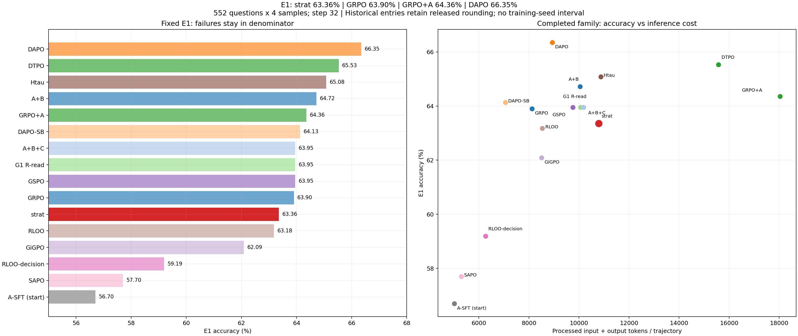

图中其他历史条件沿用已发布表的四位分数与成本精度；本轮strat及三个直接对照用原始逐条重评分覆盖。不是重新评测全部条件。

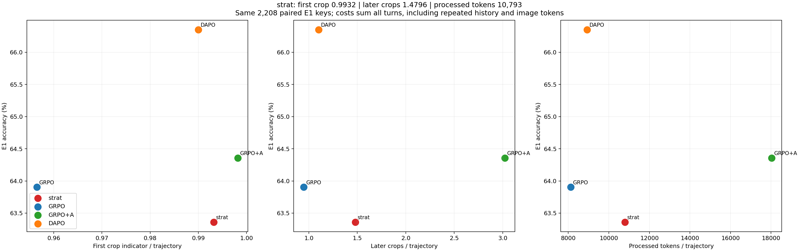

## 三、训练 Log

长表 [family_long.csv](family_long.csv) 合并已有全family聚合与strat逐步结果；[strat_curves_long.csv](strat_curves_long.csv) 保留strat原始字段。32个strat call通过qid集合、轨迹数、组数及组结果计数，与rollout step唯一双射连接，不凭行序。

strat第1→32步：日志reward .572→.601；采样surprisal .424→.433；第32步ppo_kl日志0.0（记录精度，不宣称精确KL为零）；裁剪前grad_norm7.121；第二项平均绝对值.008563→.004761，非零轨迹占比.561523→.736328，同结果齐一组的token加权绝对advantage质量占比.010896→.003310。

这里 `actor/entropy_loss` 是temperature=.7下采样token surprisal，不是全词表熵。policy diff沿用日志估计，允许负值。新family图使用逐步原值，不平滑、不插值；旧条件的日志/过滤/归约差异保留，缺测不画。

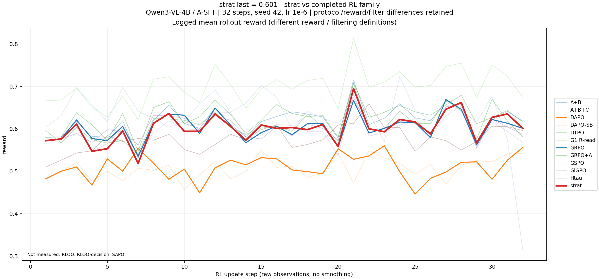
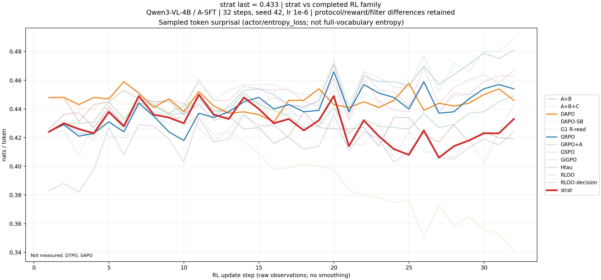
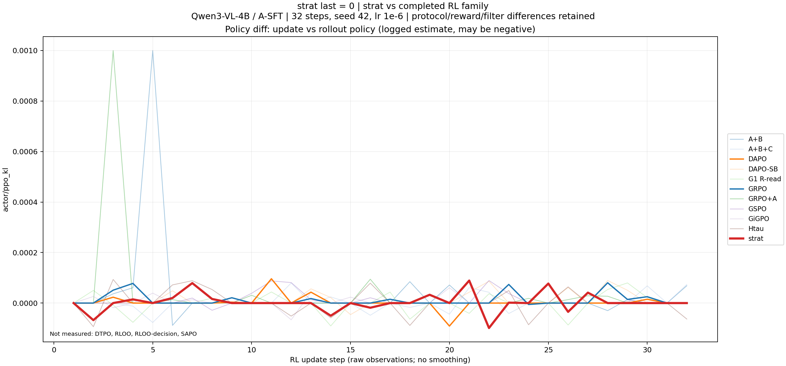
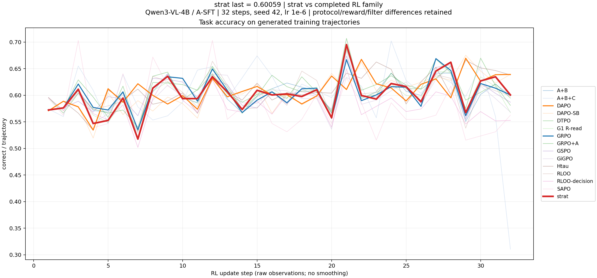
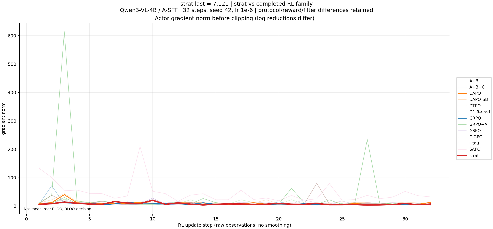
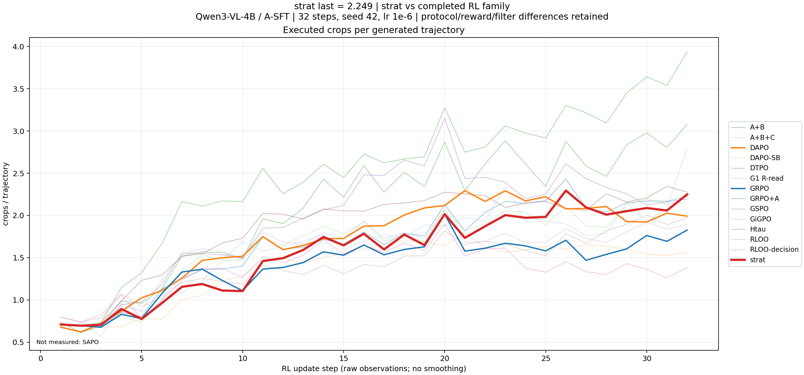
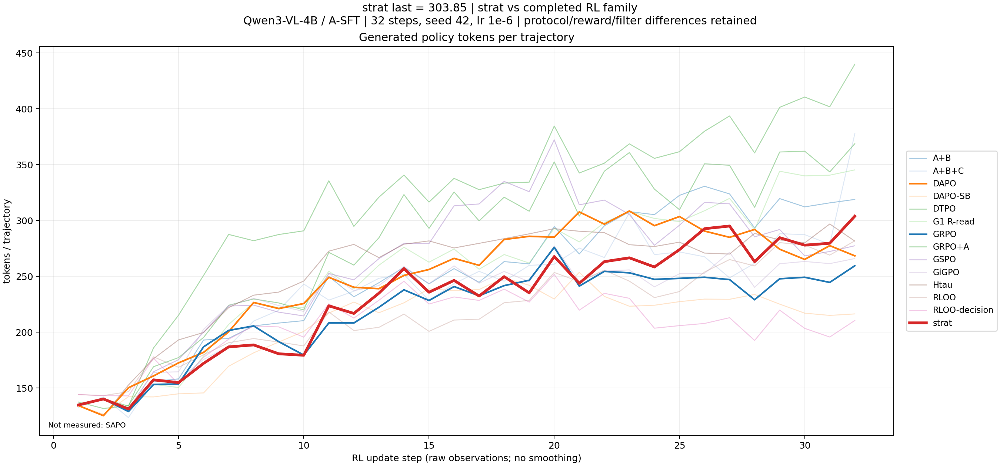
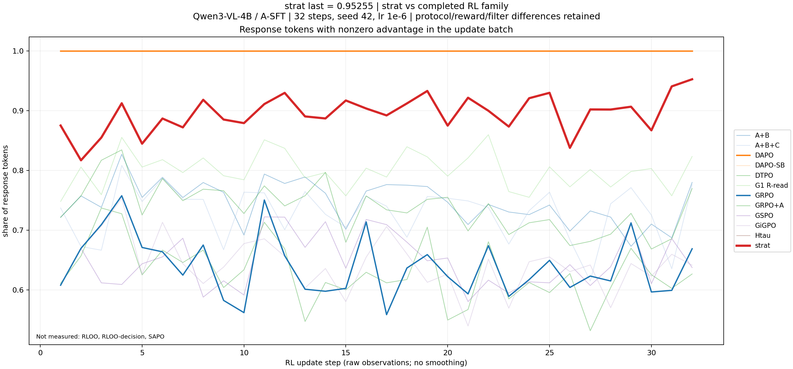

strat专有统计及直接GRPO对照：

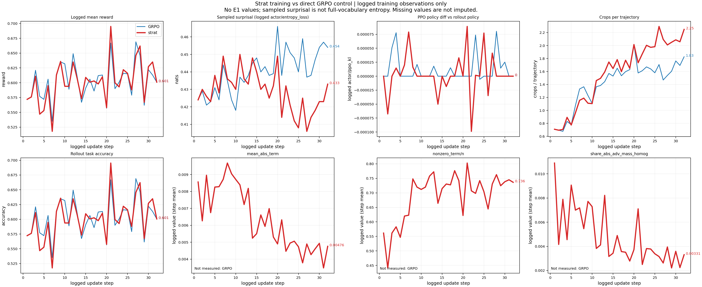

复画：`python plot_delivery.py --data .`。固定评分复算：`python compare.py --scorer scorer_reference.py --out OUTPUT --arm strat STRAT_JSONL STRAT_HEADER --arm GRPO GRPO_JSONL GRPO_HEADER --arm GRPO+A SGA_JSONL SGA_HEADER --arm DAPO DAPO_JSONL DAPO_HEADER`。原始输入仅在私有证据目录；公开聚合可用 `python verify_delivery.py` 核对，不将其等同原始模型响应重评分或逐图复核。
